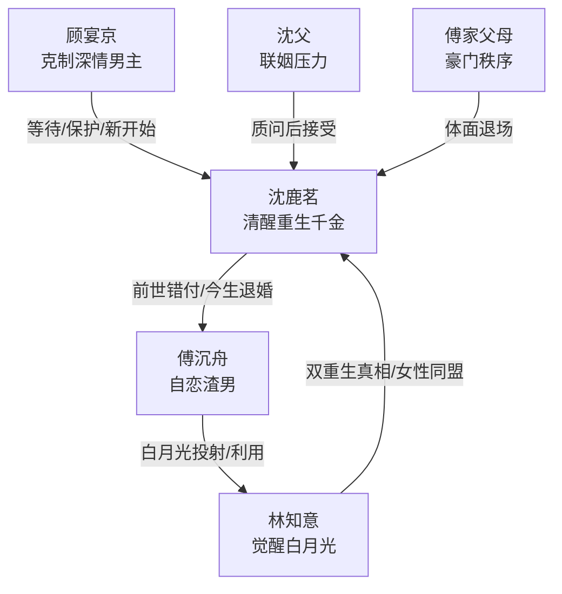

# 角色标签图谱

## 角色清单

### 沈鹿茗 — 清醒重生千金 / 资本反杀型大女主
- 叙事功能: 第一人称主角，承担复仇、清醒、女性互救和新生主线。
- 核心标签: 重生、清醒、能忍能打
- 弧光: 前世隐忍错付 → 今生当众退婚 → 与情敌结盟 → 走向新生活
- 台词风格: 平静短句，反问有力，善用事实压制。
- 关键行为: 五年收购傅氏股份；婚礼退婚；拒绝傅沉舟；接纳林知意；选择顾宴京。
- 读者情绪关系: 前期心疼，中后期爽，结尾获得补偿感。

### 傅沉舟 — 自恋傲慢渣男 / 失控型前任
- 叙事功能: 核心反派与情绪债制造者。
- 核心标签: 自恋、傲慢、摇摆
- 弧光: 婚礼羞辱女主 → 误判欲擒故纵 → 同时挽回两女 → 染病隔离
- 台词风格: 质问式、命令式、自我中心。
- 关键行为: 送棺材；拖延婚礼；用林知意刺激女主；拿星星罐挽回。
- 读者情绪关系: 恨、厌烦、期待他被打脸。

### 林知意 — 觉醒白月光 / 前情敌转同盟
- 叙事功能: 打破雌竞结构，提供双时间线真相。
- 核心标签: 重生、醒悟、坦白
- 弧光: 白月光符号 → 另一个受害者 → 女主盟友 → 事业新生
- 台词风格: 前期柔弱，中段冷静，后期爽朗。
- 关键行为: 点破自己也重生；揭示另一条时间线；拉黑傅沉舟；入职大厂。
- 读者情绪关系: 从怀疑到释然，再到欣赏。

### 顾宴京 — 克制深情商界新贵 / 补偿型男主
- 叙事功能: 给女主提供“非旧爱”的新可能和情感补偿。
- 核心标签: 深情、克制、可靠
- 弧光: 前世错过 → 今生及时出现 → 等待女主 → 共同出国
- 台词风格: 简短、尊重、克制。
- 关键行为: 酒吧出面护女主；表示愿意等待；与女主正式交往。
- 读者情绪关系: 安心、心动、补偿。

### 江瑶 — 闺蜜 / 现实提醒者
- 叙事功能: 提供女主内心转折的问答入口。
- 核心标签: 担忧、亲近、见证
- 弧光: 担心退婚后果 → 接受女主选择
- 台词风格: 关心式追问。
- 关键行为: 婚后换装时提醒女主；酒吧陪伴。
- 读者情绪关系: 轻微安心。

### 沈父 / 傅家父母 — 家族联姻秩序代表
- 叙事功能: 提供豪门婚姻压力与社会秩序背景。
- 核心标签: 体面、生意、利益
- 弧光: 维持联姻 → 被女主实力说服
- 台词风格: 父权质问 / 体面遗憾。
- 关键行为: 沈父质问退婚；傅家父母接受联姻破裂。
- 读者情绪关系: 低强度压力源。

## 关系网络

## 角色功能对照表（供改编参考）

| 原角色 | 极致标签 | 叙事功能 | 读者情绪功能 | 改编时必须保留的 |
|--------|---------|---------|-------------|---------------|
| 沈鹿茗 | 清醒重生千金 | 主角、反杀者 | 心疼转爽 | 五年布局、当众退婚、绝不回头 |
| 傅沉舟 | 自恋失控渣男 | 反派、债务源 | 恨与厌 | 傲慢误判、欲擒故纵执念、失控降格 |
| 林知意 | 觉醒白月光 | 真相提供者、同盟 | 释然、惊喜 | 不能恶毒到底，必须共同识破渣男 |
| 顾宴京 | 克制深情新贵 | 情感补偿 | 安心、甜 | 尊重女主节奏，不强行拯救 |
| 江瑶 | 闺蜜见证者 | 解释入口 | 亲近 | 引出女主前世/退婚动机 |
