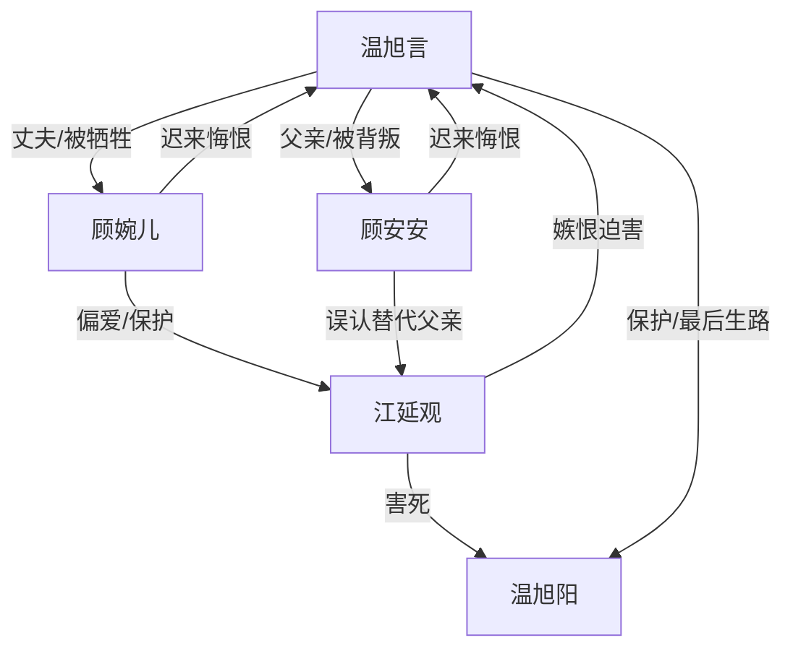

# 角色标签图谱

## 角色清单

### 温旭言 — 被榨干的清醒死遁者
- 叙事功能: 第一人称受害者、情绪债承载者、最终拒绝原谅的裁判。
- 核心标签: 熊猫血、系统宿主、被牺牲的丈夫/父亲。
- 弧光: 眷恋妻儿 → 彻底死心 → 死亡脱离 → 拒绝道歉。
- 台词风格: 短、冷、少解释。
- 关键行为: 撕绷带、丢旧物、护弟弟、签字关闭维持、结尾拒见。
- 读者情绪关系: 心疼、替他憋屈，结尾因他的拒绝获得痛快。

### 顾婉儿 — 迟来的悔恨型偏心妻子
- 叙事功能: 最大亲密施害者，制造婚姻背叛和迟来悔恨。
- 核心标签: 顾总、偏心白月光、傲慢施害者。
- 弧光: 认为丈夫命硬 → 多次牺牲丈夫 → 丈夫死后崩溃 → 终生赎罪。
- 台词风格: 命令式、压迫式、后段破碎忏悔。
- 关键行为: 下令抽血、阻止求死、抽温旭阳血、撕授权书、调监控、成立基金。
- 读者情绪关系: 前期恨，后期看她悔恨但不希望她被原谅。

### 顾安安 — 白眼狼儿子/被教坏的因果回旋点
- 叙事功能: 亲子伦理刀，证明伤害来自最亲的人。
- 核心标签: 七岁儿子、亲子舞、递笔者。
- 弧光: 依赖父亲 → 站队江延观 → 递授权书逼死父亲 → 被抛弃后悔。
- 台词风格: 天真残忍，重复成人话术。
- 关键行为: 求父亲救江叔叔、让江延观签爸爸栏、递授权书、回家看见父亲遗物。
- 读者情绪关系: 恨与复杂心疼并存，但不允许轻易洗白。

### 江延观 — 恶毒白月光/寄生型反派
- 叙事功能: 外部恶源，推动抽血、夺位、害弟弟和真相清算。
- 核心标签: 白月光、装病、挑拨者。
- 弧光: 被偏爱保护 → 持续索取 → 真相曝光 → 伏法毁容。
- 台词风格: 茶言茶语，私下恶毒直白。
- 关键行为: 假车祸、偷权限卡、诱抽血、挑拨安安、逼死温旭阳。
- 读者情绪关系: 纯恨点，承担法律清算爽点。

### 温旭阳 — 最后一条生路/无辜牺牲者
- 叙事功能: 把压迫从婚姻扩展到血亲，制造不可逆极痛。
- 核心标签: 病弱弟弟、机票、生路。
- 弧光: 带哥哥离开 → 被盯上血源 → 被抽死 → 新世界补偿。
- 台词风格: 乖、弱、保护哥哥。
- 关键行为: 买机票、递出生路、被抽血仍安慰哥哥。
- 读者情绪关系: 极致心疼，推动读者要求更重报应。

## 关系网络

## 角色功能对照表（供改编参考）

| 原角色 | 极致标签 | 叙事功能 | 读者情绪功能 | 改编时必须保留的 |
|--------|---------|---------|-------------|---------------|
| 温旭言 | 被榨干的清醒死遁者 | 受害者与终局裁判 | 心疼、爽 | 他必须主动拒绝原谅 |
| 顾婉儿 | 偏心妻子 | 最大亲密施害者 | 恨、看悔恨 | “命硬/不会死”压迫话术 |
| 顾安安 | 白眼狼儿子 | 亲子刀 | 心寒、复杂 | 递出关键文件/工具 |
| 江延观 | 恶毒白月光 | 外部恶源 | 纯恨 | 装病夺资源、私下承认恶意 |
| 温旭阳 | 无辜牺牲者 | 加重不可逆损失 | 极致心疼 | 最后一条生路被毁 |
