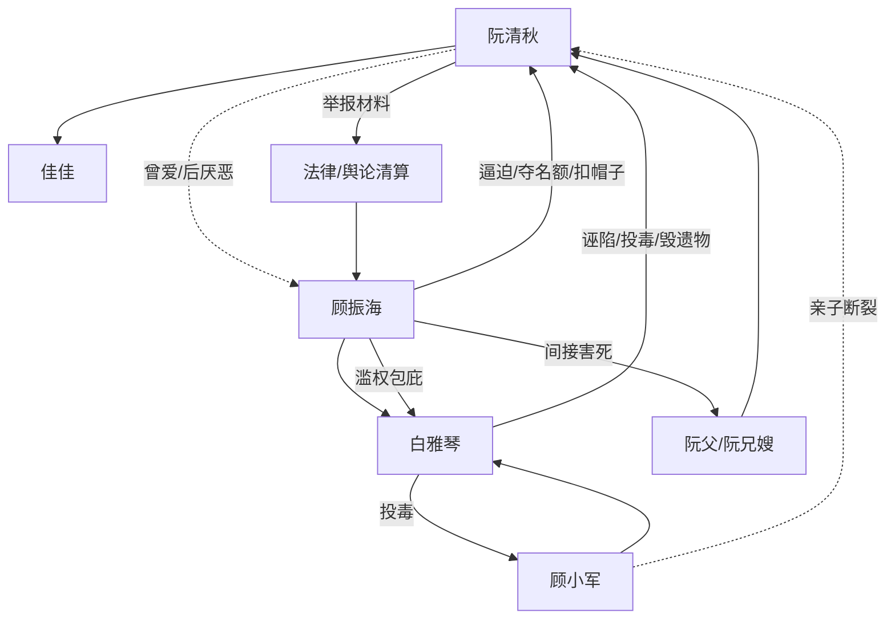

# 角色标签图谱

## 角色清单

### 阮清秋 — 清醒断情复仇母亲

- 叙事功能: 受害者、复仇执行者、情绪债债权人、现代线胜利者。
- 核心标签: 冷静、母性底线、不可原谅。
- 弧光: 为爱牺牲的妻子 → 被彻底逼死的母亲 → 持证清算的复仇者 → 现代世界掌权者。
- 台词风格: 短、冷、直接切断关系。
- 关键行为: 跳河脱离；忍满一年；收集罪证；割喉完成任务；现代拒绝父子。
- 读者情绪关系: 心疼、敬佩、爽。

### 顾振海 — 伪深情权力型丈夫

- 叙事功能: 最大施害者、火葬场主体、迟到悔悟载体。
- 核心标签: 自负、双标、滥权。
- 弧光: 自认掌控家庭的厂长 → 逼死妻子亲族 → 悔疯守尸 → 犯罪入狱 → 求原谅失败。
- 台词风格: 命令式、道德绑架式，悔悟后转为哀求。
- 关键行为: 给阮清秋扣帽子；夺治疗名额；包庇白雅琴；逼死阮清秋；杀白雅琴；现代线强闯。
- 读者情绪关系: 恨、恶心、后期看其崩溃获得爽感。

### 顾小军 — 白眼狼儿子/迟到悔悟孩子

- 叙事功能: 亲子伦理痛点，因果回旋对象。
- 核心标签: 恶毒、被纵坏、迟懂死亡。
- 弧光: 盼母亲去死 → 认白雅琴做妈 → 亲眼见母死 → 病危悔悟 → 现代求母失败 → 消散。
- 台词风格: 幼稚但残忍，后期哭求。
- 关键行为: 河边劝母死；摔骨灰；踢母亲；让母亲再去死；现代试图抢佳佳。
- 读者情绪关系: 前期恨，后期有限怜悯但不可洗白。

### 白雅琴 — 伪善毒白月光

- 叙事功能: 表层反派、挑拨者、罪证集中点。
- 核心标签: 装弱、歹毒、冒名。
- 弧光: 救命恩人假面 → 厂长偏爱的白月光 → 投毒诬陷真相曝光 → 被顾振海虐杀。
- 台词风格: 茶言茶语，常以“为你们好”包装伤害。
- 关键行为: 毁佳佳遗物；夺名额；害死阮父；诬陷阮兄；给小军下毒；冒充救命恩人。
- 读者情绪关系: 强恨点，清算时提供直接爽感。

### 佳佳 — 被夺走又复活的女儿

- 叙事功能: 女主唯一不可替代的情感锚点，任务动机。
- 核心标签: 无辜、母亲底线、补偿。
- 弧光: 死于父亲冷漠 → 骨灰遗照被羞辱 → 现代复活 → 与母亲获得安宁。
- 台词风格: 现代线童真直接。
- 关键行为: 作为记忆和遗物牵动所有冲突；现代识别父子为“讨厌的人”。
- 读者情绪关系: 心疼、希望她被补偿。

### 阮清秋哥哥/嫂子/父亲 — 被连坐的原生亲情

- 叙事功能: 证明阮清秋在旧世界并非孤立无援，也证明顾振海毁掉的不只是婚姻。
- 核心标签: 家、清白、牺牲。
- 弧光: 温暖亲人 → 被诬陷毁灭 → 形成最终死亡触发。
- 台词风格: 哥哥关切，嫂子无直接台词但以一尸两命制造重锤。
- 关键行为: 父亲被背锅打死；哥哥嫂子最后相见；兄嫂被诬陷逼死。
- 读者情绪关系: 心疼、愤怒升级。

## 关系网络

## 角色功能对照表（供改编参考）

| 原角色 | 极致标签 | 叙事功能 | 读者情绪功能 | 改编时必须保留的 |
|--------|---------|---------|-------------|---------------|
| 阮清秋 | 清醒断情母亲 | 债权人/复仇者 | 心疼与爽 | 不复合、不心软、最终拥有新生活 |
| 顾振海 | 伪深情滥权丈夫 | 最大债务人 | 恨与看火葬场 | 迟到悔悟无效，必须亲手种因 |
| 顾小军 | 白眼狼儿子 | 亲子痛点 | 极致扎心 | 必须亲口让母亲去死，再被回敬 |
| 白雅琴 | 毒白月光 | 表层挑拨反派 | 直接恨点 | 伪善话术和实质犯罪都要有 |
| 佳佳 | 复活女儿 | 母性锚点 | 补偿期待 | 女主最终只选择她 |
| 阮家亲人 | 被毁原生家 | 加深不可原谅 | 悲愤 | 至少一个亲人因男主滥权而死 |
