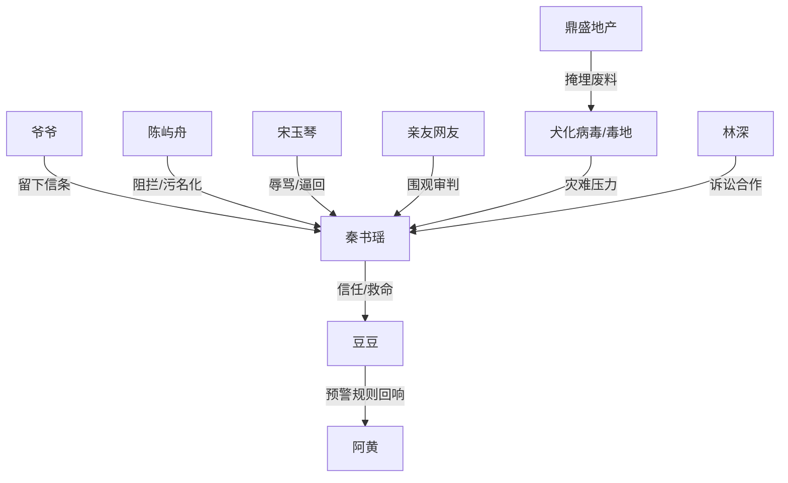

# 角色标签图谱

## 角色清单

### 秦书瑶 — 清醒逃生大女主

- 叙事功能: 唯一相信狗预警并采取行动的人；承担逃亡、真相揭示、公共指证。
- 核心标签: 清醒、决绝、创伤幸存者
- 弧光: 被当疯子围剿 → 被证实清醒 → 成为第一证人 → 创伤释怀
- 台词风格: 短句、命令式、冷静质问
- 关键行为: 连夜逃离、拒绝回城、揭露十八年前旧村、参与集体诉讼
- 读者情绪关系: 心疼、代入、替她憋屈，后期爽感跟随她反击兑现

### 陈屿舟 — 傲慢理性丈夫/迟来悔恨者

- 叙事功能: 最大亲密关系压迫源；用常识、事业、舆论和医疗权力围堵女主。
- 核心标签: 自负、功利、后悔
- 弧光: 轻蔑阻拦 → 强制送医 → 被病毒事实击垮 → 低姿态修复
- 台词风格: 前期咆哮和命令，后期颤抖、道歉、哀求
- 关键行为: 扯断牵引绳、发朋友圈、冻结银行卡、GPS追踪、叫救护车
- 读者情绪关系: 前期恨，爆点后看他崩溃产生爽感，结尾保留观察期

### 豆豆 — 高维预警犬/救命锚点

- 叙事功能: 故事核心钩子和生存规则载体。
- 核心标签: 忠诚、敏锐、预警系统
- 弧光: 堵门发抖 → 离城恢复 → 对灾难哀鸣 → 结尾安心遛弯
- 台词风格: 无语言，以身体动作叙事
- 关键行为: 堵门、咬裤脚、盯西北、离城后恢复、结尾主动出门
- 读者情绪关系: 心疼、信任、治愈

### 宋玉琴 — 婆婆型伦理压迫者/反噬承受者

- 叙事功能: 代表传统家庭审判和“不孕羞辱”；电话实锤中完成反噬。
- 核心标签: 刻薄、护子、被困
- 弧光: 破口大骂 → 困在封锁楼 → 轻微犬化 → 低声求原谅
- 台词风格: 辱骂、哭喊、求和
- 关键行为: 骂女主丧门星，后在爆发中心打来求救电话
- 读者情绪关系: 厌恶后转为因果报应的冷感

### 亲妈/闺蜜/同事/网友 — 围观审判共同体

- 叙事功能: 放大女主的社会性孤立，为后期排队道歉积债。
- 核心标签: 从众、轻信、廉价愧疚
- 弧光: 劝回/嘲讽/群踢 → 真相后道歉
- 台词风格: “为你好”式劝导和标签化羞辱
- 关键行为: 逼女主认错、踢出群聊、转发围观
- 读者情绪关系: 憋屈、愤怒，后期“没事”回复形成冷爽

### 林深 — 公共清算推动者

- 叙事功能: 将个人逃生升级为社会追责。
- 核心标签: 调查记者、失子父亲、证据连接者
- 弧光: 带着私人伤痛出现 → 推动集体诉讼
- 台词风格: 克制、沉重、目标明确
- 关键行为: 递交文件，请女主担任第一证人
- 读者情绪关系: 认可、共情，扩展正义面

### 爷爷与阿黄 — 创伤源头/规则奠基者

- 叙事功能: 解释女主为何无条件相信豆豆，构成十八年前与当下的镜像。
- 核心标签: 牺牲、经验、预警
- 弧光: 回忆中守护女主 → 成为女主行动信条
- 台词风格: 民间经验式短句
- 关键行为: 爷爷藏女主，阿黄地窖抓门预警
- 读者情绪关系: 心疼、敬意、催化主题

## 关系网络

## 角色功能对照表（供改编参考）

| 原角色 | 极致标签 | 叙事功能 | 读者情绪功能 | 改编时必须保留的 |
|--------|---------|---------|-------------|---------------|
| 秦书瑶 | 清醒逃生大女主 | 行动核心 | 心疼、代入、爽 | 冷静抢时间，不自证到崩溃 |
| 陈屿舟 | 傲慢理性丈夫 | 亲密压迫 | 恨、后期悔爽 | 用“理性/为你好”作恶 |
| 豆豆 | 高维预警犬 | 规则载体 | 信任、治愈 | 堵门和结尾出门闭环 |
| 宋玉琴 | 刻薄婆婆 | 伦理羞辱 | 厌恶、报应 | 不孕/畜生羞辱或等价伦理刺点 |
| 亲友网友 | 审判共同体 | 社会压迫 | 群体憋屈 | 先围剿后道歉 |
| 林深 | 追责推动者 | 升级公共正义 | 扩展爽点 | 把个人冤屈转为制度清算 |
| 爷爷/阿黄 | 旧创伤镜像 | 规则解释 | 心疼、宿命 | 旧灾难与当前灾难同构 |
