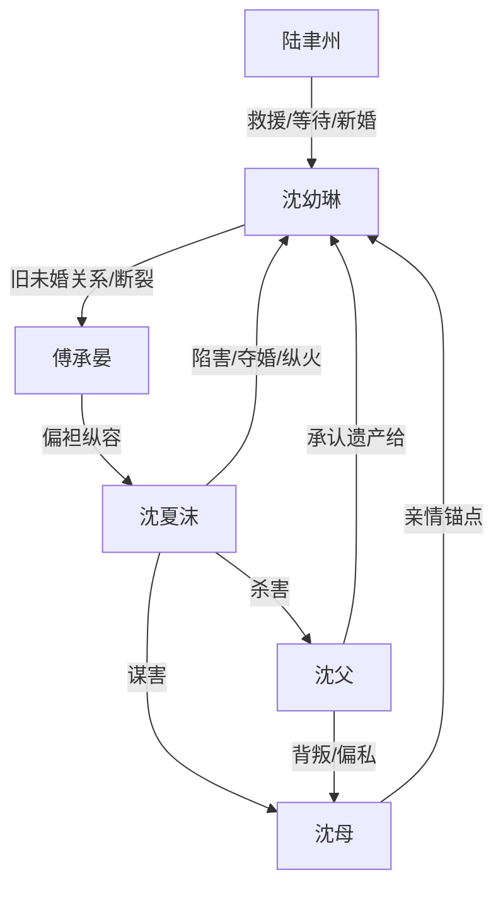

# 角色标签图谱

## 角色清单

### 沈幼琳 — 清醒隐忍型弃爱大女主
- 叙事功能: 承压者、规则反噬执行者、情绪补偿核心。
- 核心标签: 隐忍、孝顺、决绝。
- 弧光: 相信旧爱 → 为母亲忍辱 → 母亲死亡触底 → 彻底转身。
- 台词风格: 前半克制解释，后半短句切割。
- 关键行为: 改婚纱尺码、冲入火场、拉黑傅承晏、嫁给陆聿州。
- 读者情绪关系: 心疼、替她憋屈、期待她不回头。

### 傅承晏 — 迟钝偏心追妻火葬场男主
- 叙事功能: 主要伤害源、悔恨载体。
- 核心标签: 自以为深情、偏心、迟来醒悟。
- 弧光: 掌控女主 → 误信沈夏沫 → 造成不可逆损失 → 追妻失败。
- 台词风格: 理直气壮、命令式、迟来告白。
- 关键行为: 十次盲选沈夏沫、推女主下车、送母亲进精神病院、婚礼继续、后期澄清。
- 读者情绪关系: 恨、厌烦、期待他悔疯。

### 沈夏沫 — 绿茶私生女 / 毒性胜利者
- 叙事功能: 直接反派、挑拨与犯罪执行者。
- 核心标签: 装弱、恶毒、贪婪。
- 弧光: 被偏袒的妹妹 → 夺婚成功 → 纵火暴露 → 杀父伏法。
- 台词风格: 公开委屈，私下挑衅。
- 关键行为: 伪造霸凌、操控肾源、纵火害母、杀父夺遗产。
- 读者情绪关系: 强恨点，等待法律清算。

### 沈母 — 被伤害的亲情锚点
- 叙事功能: 女主忍耐原因、最大情绪债来源。
- 核心标签: 受辱、病弱、母爱。
- 弧光: 被丈夫背叛 → 肾衰依赖救治 → 被陷害入院 → 火场死亡。
- 台词风格: 温柔劝女儿离开。
- 关键行为: 陪女主十年坐冷板凳，劝“不嫁了”。
- 读者情绪关系: 心疼，强化女主复仇正当性。

### 陆聿州 — 稳定守护型港城太子爷
- 叙事功能: 情感补偿、安全感对照组。
- 核心标签: 尊重、专一、克制。
- 弧光: 被女主放弃的联姻对象 → 火场救援者 → 新婚丈夫。
- 台词风格: 温柔短句，不逼迫。
- 关键行为: 救女主、处理母亲后事、等待女主慢慢培养感情。
- 读者情绪关系: 安心、补偿、替女主获得新生。

### 沈父 — 失职父亲 / 伦理清算对象
- 叙事功能: 家庭背叛源、次级反派。
- 核心标签: 偏私、懦弱、迟来流泪。
- 弧光: 包庇私生女 → 默许妻女受辱 → 病危流泪 → 被沈夏沫杀害。
- 台词风格: 家长式斥责。
- 关键行为: 甩女主巴掌，不阻拦送妻入院，遗产最终留给女主。
- 读者情绪关系: 厌恶、有限报应满足。

## 关系网络

## 角色功能对照表（供改编参考）

| 原角色 | 极致标签 | 叙事功能 | 读者情绪功能 | 改编时必须保留的 |
|--------|---------|---------|-------------|---------------|
| 沈幼琳 | 清醒隐忍大女主 | 承压与转身 | 心疼、爽 | 为亲情忍辱后彻底不回头 |
| 傅承晏 | 偏心迟钝男 | 伤害与悔恨 | 恨、看火葬场 | 每次关键选择都错 |
| 沈夏沫 | 绿茶私生女 | 直接作恶 | 强恨点 | 公开装弱+私下威胁 |
| 沈母 | 病弱母亲 | 情绪债核心 | 心疼 | 死亡/不可逆损失 |
| 陆聿州 | 稳定太子爷 | 补偿性新爱 | 安心 | 尊重等待，不强迫 |
| 沈父 | 失职父亲 | 家庭背叛 | 厌恶 | 偏袒反噬、迟来无用 |
