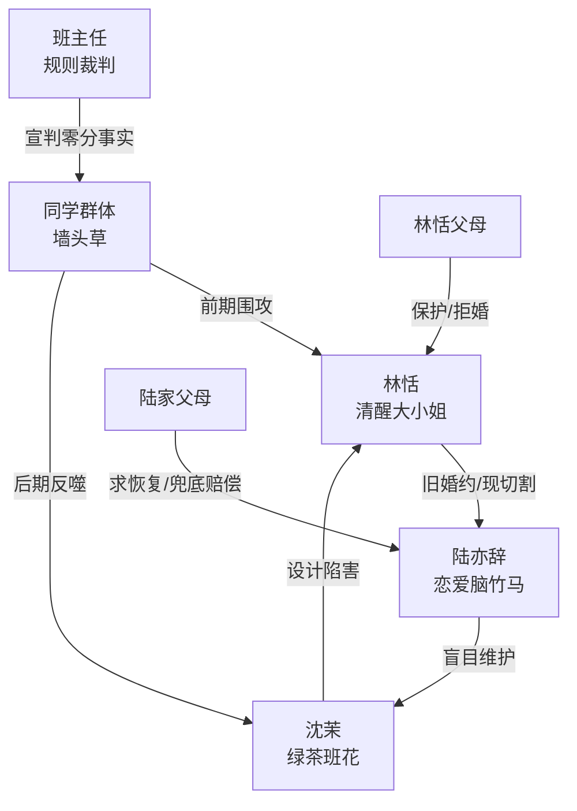

# 角色标签图谱

## 角色清单

### 林恬 — 清醒大小姐/冷静反杀者
- 叙事功能: 第一人称主角，承受群体误判并完成因果回旋。
- 核心标签: 全校第一、林家独女、逻辑清醒。
- 弧光: 被全班围攻 → 卡点自救 → 拒绝求情 → 清北翻篇。
- 台词风格: 短句反问，冷静回敬。
- 关键行为: 要安排表、拦出租车、保住考试、拒绝补考求情、拒绝恢复婚约。
- 读者情绪关系: 心疼、解气、爽。

### 沈茉 — 绿茶班花/自作自受型反派
- 叙事功能: 主压迫者，制造考点错位陷阱。
- 核心标签: 装可怜、嫉妒、蓄谋。
- 弧光: 全班宠爱 → 陷害失手 → 被全班反噬 → 失去高考资格。
- 台词风格: 道歉式甩锅，“都是我的错”但不承担实责。
- 关键行为: 临发车阻止林恬、摔林恬手机、砸自己手机、私聊暴露动机。
- 读者情绪关系: 恨、厌恶、看她崩塌的爽。

### 陆亦辞 — 恋爱脑竹马/自毁型前未婚夫
- 叙事功能: 放大沈茉压迫，提供感情线与家族线回旋。
- 核心标签: 偏听偏信、护绿茶、嘴硬求助。
- 弧光: 威胁退婚 → 当众断生意 → 求林恬帮忙 → 上门道歉失败。
- 台词风格: 训斥、威胁、后期乞求。
- 关键行为: 拒借手机、取消婚约、承诺陆家赔偿、求补考。
- 读者情绪关系: 恨铁不成钢、看回旋打脸的爽。

### 同学群体 — 墙头草审判团
- 叙事功能: 制造群体压迫与后期群体反噬。
- 核心标签: 盲从、道德绑架、不道歉。
- 弧光: 围攻林恬 → 零分崩溃 → 围攻沈茉 → 求林恬帮忙。
- 台词风格: 七嘴八舌、情绪化、推责。
- 关键行为: 阻止林恬看表、骂她斤斤计较、迟到后甩锅。
- 读者情绪关系: 厌恶、反感、看其自食恶果的爽。

### 班主任 — 规则裁判/结果宣判者
- 叙事功能: 权威确认“全班都在城东”和“语文全零”。
- 核心标签: 暴脾气、规则意识、事实宣判。
- 弧光: 事前发电子表 → 事后怒斥全班 → 保住林恬一个。
- 台词风格: 直接、爆裂、判决感强。
- 关键行为: 发考点表、电话催大巴、宣布零分。
- 读者情绪关系: 提供公正感。

### 林恬父母 — 终局保护者/家族资源坐实
- 叙事功能: 终局拒绝恢复婚约，揭示林家真实优势。
- 核心标签: 护女、清醒、有底气。
- 弧光: 后期登场 → 拒绝陆家 → 支持女儿翻篇。
- 台词风格: 冷静但有压迫感。
- 关键行为: 拒陆家进门、扔礼盒、切断关系。
- 读者情绪关系: 安全感、补偿感。

## 关系网络

## 角色功能对照表（供改编参考）

| 原角色 | 极致标签 | 叙事功能 | 读者情绪功能 | 改编时必须保留的 |
|--------|---------|---------|-------------|---------------|
| 林恬 | 清醒大小姐 | 承压、自救、回旋清算 | 心疼与爽 | 不主动害人，但拒绝替加害者兜底 |
| 沈茉 | 绿茶班花 | 设局失败 | 恨点核心 | “装可怜+实质伤害”双层结构 |
| 陆亦辞 | 偏心竹马 | 感情压迫与回头求助 | 打脸爽 | 亲口威胁，后期亲口求 |
| 同学群体 | 墙头草 | 群体压迫/群体反噬 | 群爽 | 前后变脸但不道歉 |
| 班主任 | 权威裁判 | 事实盖章 | 公正感 | 宣布不可逆后果 |
