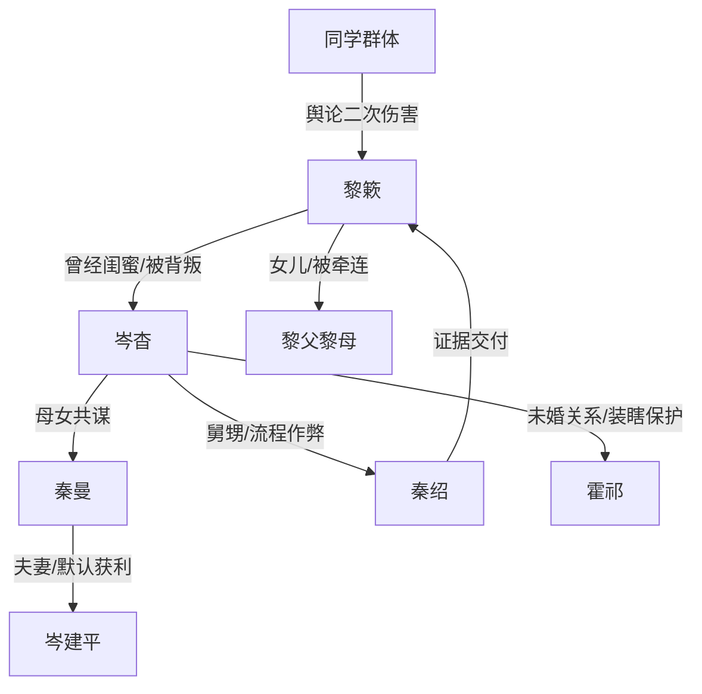

# 角色标签图谱

## 角色清单

### 黎簌 — 清醒复仇型律师女主
- 叙事功能: 受害者、证据持有人、审判者、自我重建者。
- 核心标签: 冷静、记仇、讲公平。
- 弧光: 被偷人生的十八岁少女 → 掌握话语权的律师 → 不被仇恨困住的独立个体。
- 台词风格: 短句、反问、事实列举。
- 关键行为: 去医院、播放录音、逼公开道歉、拒绝私下和解、接受京市交流。
- 读者情绪关系: 心疼、代入、爽。

### 岑杳 — 偷人生的白莲闺蜜
- 叙事功能: 核心施害者，旧情背叛的痛点来源。
- 核心标签: 嫉妒、伪弱、表演型受害者。
- 弧光: 顶名额上岸者 → 旧事翻车求洗白 → 失去偷来成果。
- 台词风格: 哭腔、示弱、旧情绑架。
- 关键行为: 记密码、删志愿、顶专项名额、污蔑黎簌、吞药求同情、写信忏悔。
- 读者情绪关系: 恨、厌恶、看她崩塌的爽。

### 秦曼 — 道德绑架型恶母
- 叙事功能: 放大压迫，承担家庭共谋和舆论羞辱。
- 核心标签: 护短、蛮横、倒打一耙。
- 弧光: 逼黎簌负责 → 被录音和秦绍揭穿 → 卖房赔偿。
- 台词风格: 高音量命令、受害者倒置。
- 关键行为: 堵黎家、拉横幅、逼澄清、阻止报警、求谅解。
- 读者情绪关系: 恨，期待被打脸。

### 霍祁 — 装瞎的白月光旁观者
- 叙事功能: 情感线旧伤、旁观者责任样本。
- 核心标签: 逃避、自恋式善良、迟来的愧疚。
- 弧光: 当年相信岑杳 → 医院求黎簌救场 → 承认逃避并离开。
- 台词风格: 低声、迟疑、道歉。
- 关键行为: 五年前被岑杳利用叫走黎簌，五年后求黎簌澄清，后整理辱骂者名单。
- 读者情绪关系: 厌、复杂、轻度惋惜。

### 秦绍 — 迟到的证人共犯
- 叙事功能: 第二证据源，完成共犯链闭环。
- 核心标签: 钻流程、迟来赎罪、病危自首。
- 弧光: 出主意者 → 失眠五年 → 肝癌晚期自首。
- 台词风格: 短促、认罪式。
- 关键行为: 指导删志愿、保存录音转账、交 U 盘、自首。
- 读者情绪关系: 不原谅，但接受其证据功能。

### 岑建平 — 沉默获利的父亲
- 叙事功能: 证明“不出声也是共犯”。
- 核心标签: 默认、软弱、利益优先。
- 弧光: 站在后面抽烟 → 带钱私了 → 被黎簌拒绝。
- 台词风格: 哽咽、求情、试图套旧恩。
- 关键行为: 默认女儿顶名额、拿十二万求放过秦曼。
- 读者情绪关系: 厌恶、轻蔑。

### 同学群体 — 二次伤害的看客
- 叙事功能: 群体舆论暴力载体。
- 核心标签: 跟风、补票、怕丢脸。
- 弧光: 群里辱骂黎簌 → 真相后私下道歉 → 被要求公开道歉。
- 台词风格: 轻飘飘、甩锅式。
- 关键行为: 五年前骂她嫉妒，五年后私信“希望别介意”。
- 读者情绪关系: 憋屈转冷爽。

### 黎簌父母 — 被牵连的无辜家人
- 叙事功能: 放大岑杳行为后果，支撑女主不原谅的正当性。
- 核心标签: 爱女、受害、温情归处。
- 弧光: 父亲住院母亲白头 → 终于看见女儿清白 → 家常饭修复。
- 台词风格: 日常、朴素。
- 关键行为: 承受网暴和病痛，真相后说“咱闺女终于清白了”。
- 读者情绪关系: 心疼、补偿欲。

## 关系网络

## 角色功能对照表（供改编参考）

| 原角色 | 极致标签 | 叙事功能 | 读者情绪功能 | 改编时必须保留的 |
|--------|---------|---------|-------------|---------------|
| 黎簌 | 清醒律师女主 | 反杀执行者 | 爽、心疼 | 冷静短句、证据分批释放、不原谅 |
| 岑杳 | 偷人生白莲 | 核心施害者 | 恨、恶心 | 曾经亲密+偷走关键人生机会 |
| 秦曼 | 恶母帮凶 | 道德绑架 | 强恨点 | 倒打一耙、阻止报警、公开羞辱旧债 |
| 霍祁 | 装瞎旁观者 | 情感旧伤 | 厌、复杂 | “不是没选择，是选轻松” |
| 秦绍 | 共犯证人 | 证据闭环 | 爽点工具 | 迟来自首+硬证据 |
| 岑建平 | 沉默获利者 | 私了诱惑 | 冷爽 | 拿旧恩绑架被拒 |
| 同学群体 | 跟风看客 | 舆论清算 | 补偿爽 | 私下道歉必须转公开 |
