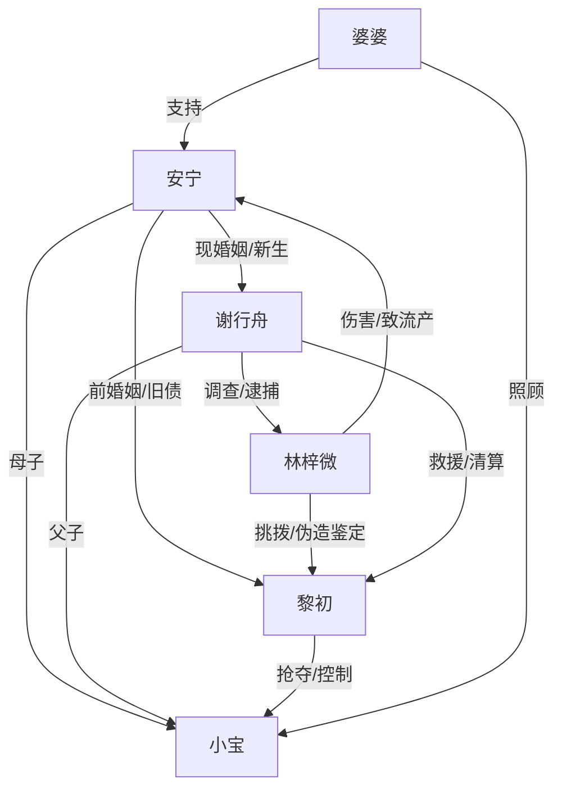

# 角色标签图谱

## 角色清单

### 安宁 — 清醒再婚复仇女主
- 叙事功能: 第一视角承压者、旧债见证者、清算发起者。
- 核心标签: 清醒、护子、非圣母
- 弧光: 被前夫拿捏的妻子 → 失去软肋后彻底离开 → 用新家庭和法律完成清算
- 台词风格: 克制反问，情绪峰值时直接骂醒。
- 关键行为: 离婚消失、保护小宝、讲出旧案、起诉黎初、探监补刀。
- 读者情绪关系: 心疼、代入、爽。

### 黎初 — 自负前夫/迟钝霸总反派
- 叙事功能: 主要压迫源和误判源。
- 核心标签: 傲慢、控制欲、享受追捧
- 弧光: 以为女主闹脾气 → 抢子触法 → 被现任身份碾压 → 入狱破产
- 台词风格: 漫不经心、命令式、把伤害说成规矩。
- 关键行为: 掀合同、抢手机、抢孩子、伪善复婚、信任林梓微、入狱崩塌。
- 读者情绪关系: 恨、等他后悔、等他被打脸。

### 谢行舟 — 军警现任/安全感兑现器
- 叙事功能: 身份反差爆发点、法律清算执行者、女主新生活证明。
- 核心标签: 强保护、行动派、正义
- 弧光: 隐身丈夫 → 定位救援 → 公权力压制 → 温柔陪伴
- 台词风格: 直接、护短、带职业威慑。
- 关键行为: 夜路救安宁、军车截停、控制黎初、查林梓微、带安宁回家。
- 读者情绪关系: 安全感、发糖、爽。

### 林梓微 — 绿茶秘书/旧债制造者
- 叙事功能: 第三者压力源、旧流产债务源、伪造鉴定触发器。
- 核心标签: 装弱、嫉妒、阴毒
- 弧光: 受宠秘书 → 挑衅正妻 → 伪造鉴定 → 入狱发疯
- 台词风格: 表面委屈，关键处甩锅。
- 关键行为: 拦安宁上楼、薅头发致流产、伪造亲子鉴定、求饶。
- 读者情绪关系: 恨、厌恶、期待清算。

### 小宝 — 新生家庭与母性软肋
- 叙事功能: 当前最高情绪债载体。
- 核心标签: 幼小、体弱、无辜
- 弧光: 被保护对象 → 被抢走 → 被救回
- 台词风格: 无。
- 关键行为: 哭闹预警、被抢、被追回。
- 读者情绪关系: 心疼、焦虑、护犊欲。

### 婆婆 — 新家庭秩序背书者
- 叙事功能: 暗示谢行舟家庭背景，提供安全感。
- 核心标签: 稳、护短、见过风浪
- 弧光: 带娃后盾 → 危机后接回小宝
- 台词风格: 轻松笃定。
- 关键行为: 安慰安宁、照顾小宝。
- 读者情绪关系: 放心、温暖。

## 关系网络

## 角色功能对照表（供改编参考）

| 原角色 | 极致标签 | 叙事功能 | 读者情绪功能 | 改编时必须保留的 |
|--------|---------|---------|-------------|---------------|
| 安宁 | 清醒再婚复仇女主 | 承压与清算 | 心疼、代入、爽 | 不回头、不原谅、护子 |
| 黎初 | 自负前夫 | 压迫与误判 | 恨、等待报应 | “她只是闹”的核心误判 |
| 谢行舟 | 军警现任 | 降维救援 | 安全感、打脸 | 身份保密+权力压制 |
| 林梓微 | 绿茶秘书 | 旧债与新债制造 | 厌恶、等她翻车 | 伪装无辜+实质伤害 |
| 小宝 | 无辜幼子 | 情绪炸点 | 心疼、紧张 | 被抢走造成触底 |
| 婆婆 | 后盾长辈 | 安全感铺垫 | 温暖 | 暗示现任背景 |
