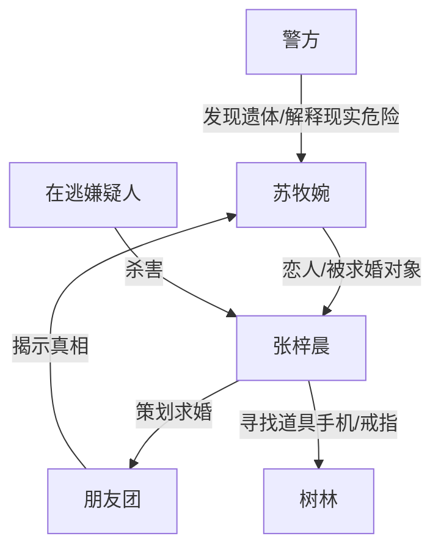

# 角色标签图谱

## 角色清单

### 苏牧婉 — 恐惧直觉型女主
- 叙事功能: 第一视角承载悬疑、恐惧、误判和最终痛感。
- 核心标签: 敏感、执拗、爱人优先
- 弧光: 轻视短信 → 恐惧阻止 → 被困等待 → 发现真相后崩溃
- 台词风格: 急促、重复、带哭腔，常用“万一”“不能”
- 关键行为: 反复阻止男友下车；报警；最终下车触发求婚局曝光。
- 读者情绪关系: 先替她紧张，后替她心碎。

### 张梓晨 — 理性保护者/笨拙浪漫策划者
- 叙事功能: 女主的安全感来源、认知对抗者、反转核心和 BE 牺牲者。
- 核心标签: 沉稳、固执、笨拙浪漫
- 弧光: 安抚女友 → 否定短信 → 恐惧失控 → 独自赴险 → 死亡揭真情
- 台词风格: 前期理性安抚，中段烦躁强硬，后期温和低声。
- 关键行为: 策划死亡短信求婚；下车找道具手机和戒指；遭遇逃犯遇害。
- 读者情绪关系: 从“气他不信”转为“心疼他死得太冤”。

### 小雨 — 反转揭示者/朋友团代表
- 叙事功能: 负责解释求婚局，把灵异悬疑翻成恶作剧真相。
- 核心标签: 兴奋、粗心、见证者
- 弧光: 欢快现身 → 解释计划 → 意识不对 → 崩溃哭泣
- 台词风格: 口语化、高兴奋度，带“惊喜不惊喜”式网感。
- 关键行为: 第一个冲到女主面前宣布求婚惊喜。
- 读者情绪关系: 短暂迁怒，随后成为恐惧气氛的参照。

### 大周与朋友团 — 错位欢呼者
- 叙事功能: 制造“恐怖现场突然变求婚现场”的荒诞反转。
- 核心标签: 起哄、参与者、无知
- 弧光: 躲藏等待 → 欢呼出现 → 集体沉默
- 台词风格: 起哄式、轻松化。
- 关键行为: 带灯光和彩灯出现；拨打男友电话失败。
- 读者情绪关系: 让读者感到荒诞、恼火和寒意。

### 中年警官 — 现实清算者
- 叙事功能: 把求婚局拉回刑案现实，给出死亡确认和逃犯信息。
- 核心标签: 冷静、权威、事实宣告
- 弧光: 到场询问 → 宣布遗体 → 推断凶案
- 台词风格: 平稳、职业化、无情绪。
- 关键行为: 要求辨认遗体；出示道具手机；说明在逃嫌疑人。
- 读者情绪关系: 带来最终确认的恐惧和绝望。

### 在逃嫌疑人 — 隐形真凶
- 叙事功能: 让“假预言”被现实兑现，完成最终 BE。
- 核心标签: 暴力、不可控、真实危险
- 弧光: 新闻背景一句带过 → 结尾实体化为凶手
- 台词风格: 无台词
- 关键行为: 在林中杀害张梓晨。
- 读者情绪关系: 恨，但不是主要戏份；主要作用是命运式现实暴击。

## 关系网络

## 角色功能对照表（供改编参考）

| 原角色 | 极致标签 | 叙事功能 | 读者情绪功能 | 改编时必须保留的 |
|--------|---------|---------|-------------|---------------|
| 苏牧婉 | 恐惧直觉型女主 | 第一视角承压 | 紧张、心疼、无力 | 她的直觉必须多次正确但无法说服对方 |
| 张梓晨 | 笨拙浪漫牺牲者 | 反转核心 | 先气后疼 | 他必须既是设局者又是真受害者 |
| 小雨 | 误把恐怖当浪漫的揭示者 | 解释局 | 荒诞错位 | 她必须兴奋揭露计划，随后笑容凝固 |
| 朋友团 | 错位欢呼者 | 群体反差 | 反讽、寒意 | 欢呼与死亡必须紧邻 |
| 警方 | 现实确认者 | 权威落锤 | 绝望确认 | 遗体、道具、真凶线索必须由权威落地 |
| 逃犯 | 隐形真凶 | 现实变量 | 恐惧实体化 | 前文必须有轻微危险提示 |
