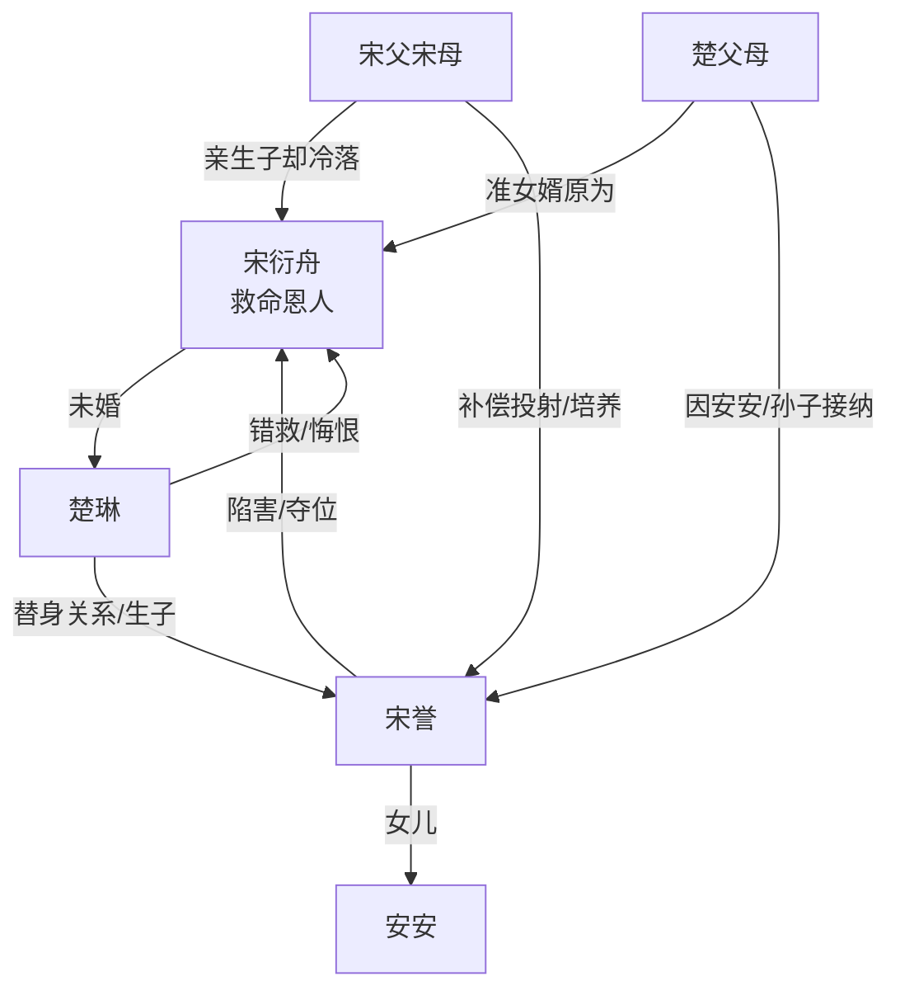

# 角色标签图谱

## 角色清单

### 宋衍舟 — 重伤救命恩人/被替代的真少爷
- 叙事功能: 情绪承债者、道德坐标中心、最终离场者
- 核心标签: 烧伤幸存者、救命恩人、清醒脱离
- 弧光: 期待回家 → 发现被替代 → 濒死死心 → 不原谅离开
- 台词风格: 少、冷、压抑，关键处一针见血
- 关键行为: 回国、质问、录音、醒后离开
- 读者情绪关系: 心疼、憋屈、希望他被补偿但更希望他自由

### 楚琳 — 忘恩负义未婚妻/自我开脱型背叛者
- 叙事功能: 爱情线背叛源、悔恨线承载者
- 核心标签: 愧疚变质、替身依赖、迟来悔悟
- 弧光: 资助治疗 → 找替身生子 → 错救宋誉 → 曝光宋誉
- 台词风格: 前期闪躲，后期平静冷断
- 关键行为: 护宋誉、救宋誉、发现录音、曝光兽药
- 读者情绪关系: 恨、失望、期待她悔但不配被原谅

### 宋誉 — 鸠占鹊巢替身/主动夺位反派
- 叙事功能: 主要施害者、所有证据清算对象
- 核心标签: 替身、伪装受害、野心寄生
- 弧光: 被偏爱者 → 继续陷害 → 证据锤死 → 被两家抛弃
- 台词风格: 私下恶毒，公开委屈，擅长装弱
- 关键行为: 炫耀玉坠、摔杯陷害、拉人跳池、买兽药
- 读者情绪关系: 极恨，期待彻底清算

### 父亲 — 偏心补偿型父权/迟来清醒者
- 叙事功能: 家庭背叛放大器、法律清算执行者
- 核心标签: 偏心、愧疚错投、迟来护子
- 弧光: 责怪亲子 → 偏爱侄子 → 医院崩塌 → 告宋誉
- 台词风格: 命令式、粗暴，后期决绝
- 关键行为: 给宋誉 10% 股份、恢复监控、宣布起诉
- 读者情绪关系: 恨其糊涂，接受其清算但不接受和解

### 母亲 — 情绪化偏心母亲
- 叙事功能: 亲情伤害具象化
- 核心标签: 软弱、迁怒、迟来崩溃
- 弧光: 让儿子将就 → 捶打质问 → 哭晕悔恨
- 台词风格: 先埋怨后哭诉
- 关键行为: 忘记出院、让男主住客厅、责骂男主
- 读者情绪关系: 心寒、失望

### 安安 — 错误关系的具象化孩子
- 叙事功能: 替身家庭合法化符号、无知施害者
- 核心标签: 刁蛮、被灌输、替身之女
- 弧光: 攻击男主 → 病房打男主 → 很快忘记宋誉
- 台词风格: 小孩式恶意，直接骂“男狐狸精”
- 关键行为: 撞伤男主、病房捶打男主
- 读者情绪关系: 厌烦，但主要恨源转移到教唆她的宋誉

### 楚父 — 利益型长辈
- 叙事功能: 楚家立场变化的标尺
- 核心标签: 重孙导向、现实、翻脸
- 弧光: 偏袒宋誉 → 孙子流产后翻脸
- 台词风格: 打圆场、现实权衡
- 关键行为: 替宋誉辩解，后带人教训宋誉
- 读者情绪关系: 轻蔑，视作利益清算参与者

## 关系网络

## 角色功能对照表（供改编参考）

| 原角色 | 极致标签 | 叙事功能 | 读者情绪功能 | 改编时必须保留的 |
|--------|---------|---------|-------------|---------------|
| 宋衍舟 | 重伤救命恩人 | 承债与离场 | 心疼、代偿 | 为对方付出不可逆身体代价 |
| 楚琳 | 忘恩背叛者 | 爱情伤害源 | 恨与悔 | 曾经爱过，后来用替身自我开脱 |
| 宋誉 | 鸠占鹊巢替身 | 主反派 | 极恨、爽点靶心 | 主动设局、夺物、夺身份 |
| 父母 | 偏心错投者 | 亲情伤害源 | 心寒 | 把补偿给替代品 |
| 安安 | 错误关系具象 | 刺痛主角 | 烦躁、荒唐 | 孩子称呼形成身份暴击 |
| 医生/证据 | 外部真相锤 | 悔恨触发器 | 爽、释压 | 必须有专业/客观第三方拆穿借口 |
