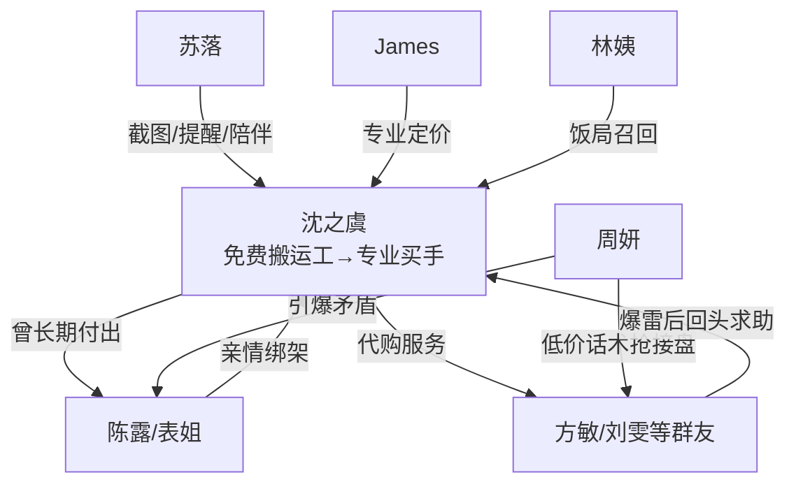

# 角色标签图谱

## 角色清单

### 沈之虞 — 清醒边界型大女主

- 叙事功能: 第一人称主角，被长期白嫖者，也是价值重估和边界重建的执行者。
- 核心标签: 克制、专业、原则感
- 弧光: 免费搬运工 → 沉默退场者 → 高端买手顾问 → 有原则的好人
- 台词风格: 短句、平静、少解释但一针见血
- 关键行为: 退群、拒绝提供渠道、匿名引导避雷、拒绝再次兜底、当面切断金钱往来
- 读者情绪关系: 心疼、代入、替她松一口气、最终爽

### 周妍 — 想赢型新人/低价神话制造者

- 叙事功能: 引爆长期矛盾的外部变量，替女主接盘，也让群友贪便宜心理暴露。
- 核心标签: 绿茶话术、贪认可、经验不足
- 弧光: 群内救世主 → 采购直播者 → 被骗垫钱者 → 道歉者
- 台词风格: 甜腻客气，常用“没别的意思哈”“对不起大家”
- 关键行为: 质疑女主报价、索要信息、收定金、发假渠道、赔偿定金、承认想赢
- 读者情绪关系: 前期讨厌，后期轻微怜悯但不洗白

### 陈露/表姐 — 亲情剥削者

- 叙事功能: 最核心的情绪债来源；她让“熟人白嫖”升级为亲情背刺。
- 核心标签: 理所当然、软绑架、亏欠逃避
- 弧光: 亲密表姐 → 带头怀疑者 → 求兜底者 → 被边界隔开的人
- 台词风格: 表面亲近，关键时刻把责任推给女主“你为什么不解释”
- 关键行为: 拉周妍进群、附和质疑、怀孕不告知、用“一家人”要求继续帮忙、饭局道歉
- 读者情绪关系: 最主要恨点和痛点

### 方敏 — 跟风型受益者

- 叙事功能: 代表普通群友的势利与短视，是 M3 回旋最直观的承接者。
- 核心标签: 下单积极、跟风质疑、反悔求助
- 弧光: 高频受益者 → 质疑女主 → 踩坑后回头求购
- 台词风格: 功利、直接、缺少歉意
- 关键行为: 要求退精粹水、附和“赚了不少”、爆雷后求女主再买
- 读者情绪关系: 让读者产生“活该”的轻爽感

### 苏落 — 清醒友军

- 叙事功能: 递送信息、替读者发声、见证女主改变。
- 核心标签: 仗义、嘴快、清醒
- 弧光: 愤怒旁观者 → 协助匿名避雷 → 陪女主买衣服 → 见证成长
- 台词风格: 口语化强，情绪外放
- 关键行为: 发截图、提供渠道风险、匿名扩散避雷帖、陪女主逛街
- 读者情绪关系: 代替读者骂人，提供陪伴感

### James — 职业价值认证者

- 叙事功能: 将女主被白嫖的能力转化为市场价值，完成补偿性爽点。
- 核心标签: 专业认可、资源入口、正向定价
- 弧光: 商场顾问 → 合作邀约者 → 高端客户入口
- 台词风格: 礼貌、专业、直接谈价值
- 关键行为: 邀请女主做时薪制采购顾问，引荐买手团队机会
- 读者情绪关系: 提供“她值得更好”的补偿满足

### 林姨 — 旧亲情环境的缓冲者

- 叙事功能: 提供饭局场景，让女主与表姐完成最终边界摊牌。
- 核心标签: 长辈热络、无意施压、旧温情
- 弧光: 邀约者 → 饭局背景温度
- 台词风格: 长辈式不容拒绝
- 关键行为: 叫女主回家吃饭
- 读者情绪关系: 缓和冲突，让结尾不至于只剩冷硬

## 关系网络

## 角色功能对照表（供改编参考）

| 原角色 | 极致标签 | 叙事功能 | 读者情绪功能 | 改编时必须保留的 |
|--------|---------|---------|-------------|---------------|
| 沈之虞 | 清醒边界型大女主 | 承压、退场、价值重估 | 心疼与爽感承接 | 克制、不正面撒泼、最终立边界 |
| 周妍 | 想赢型新人 | 引爆旧秩序 | 恨点与反噬载体 | 低价神话、索要经验、最终承认想赢 |
| 陈露 | 亲情剥削者 | 情绪债核心 | 最痛背刺 | 曾经亲密、后续怀疑、用一家人绑架 |
| 方敏 | 跟风受益者 | 群体势利样本 | 活该式爽点 | 要退货、爆雷后求恢复 |
| 苏落 | 清醒友军 | 信息递送与情绪出口 | 陪伴、替读者骂 | 截图、提醒、陪伴成长 |
| James | 专业认证者 | 价值补偿 | “她值得”爽点 | 正向付费、专业认可、职业机会 |
