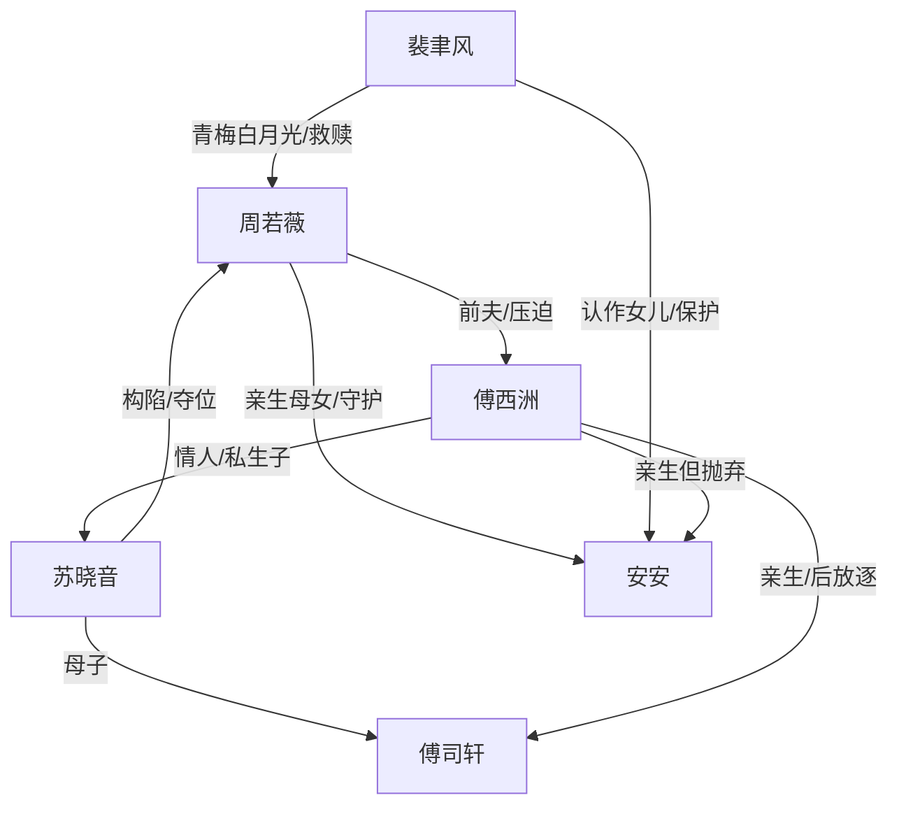

# 角色标签图谱

## 角色清单

### 周若薇 — 重生护女大女主
- 叙事功能: 第一人称承压者、情绪债载体、最终清算者。
- 核心标签: 被背叛正妻、护崽母亲、重生复仇者。
- 弧光: 被骗三十年含恨而死 → 重生守女受尽折辱 → 切断旧婚姻成为裴太太。
- 台词风格: 前期急切哀求，后期短句打脸。
- 关键行为: 产房抢女、拒养私生子、献血保女、悬崖断情、婚礼揭真相。
- 读者情绪关系: 心疼、代入、期待她翻盘。

### 傅西洲 — 迟来悔恨型渣夫
- 叙事功能: 最大压迫源之一，温度反转对象。
- 核心标签: 偏心丈夫、被救命恩绑架的伪深情、迟来悔夫。
- 弧光: 自认爱苏晓音 → 反复伤妻女 → 失去后发现爱妻 → 清算苏晓音但永失周若薇。
- 台词风格: 命令式、指责式，后期卑微哀求。
- 关键行为: 换子默许、逼献血、封医院、鞭打逼认子、悬崖选择苏晓音母子。
- 读者情绪关系: 恨、恶心、期待悔疯。

### 苏晓音 — 白莲绿茶情人
- 叙事功能: 阴谋推动者、换子执行者、女主污名化发动机。
- 核心标签: 养妹情人、私生子母亲、装柔弱恶女。
- 弧光: 以救命恩占位 → 构陷女主 → 绑架局败露 → 被送出国自生自灭。
- 台词风格: 哭腔、示弱、道德绑架。
- 关键行为: 生下傅司轩、构陷坠楼、宴会精神病化女主、策划绑架。
- 读者情绪关系: 恨、期待被揭穿。

### 裴聿风 — 深情白月光/降维救赎者
- 叙事功能: 女主新身份载体、权力翻盘工具、情感补偿对象。
- 核心标签: 青梅竹马、豪门话事人、护妻狂魔。
- 弧光: 错过女主 → 等她多年 → 悬崖救母女 → 公开给名分和保护。
- 台词风格: 温柔、轻松，面对反派时冷硬。
- 关键行为: 接电话回国、悬崖救人、婚礼认妻女、封杀傅家。
- 读者情绪关系: 爽、安慰、补偿感。

### 傅司轩 — 私生子/白眼狼因果载体
- 叙事功能: 换子阴谋的活证据，女主前世死亡帮凶。
- 核心标签: 私生子、假养子、前世毒害者。
- 弧光: 前世被女主养大后毒杀她 → 今生被拒养 → 与苏晓音一同被放逐。
- 台词风格: 婴儿期无有效台词；前世揭露时冷酷。
- 关键行为: 前世下毒，今生被用于构陷女主。
- 读者情绪关系: 厌恶、报应期待。

### 安安 — 被夺回的亲生女儿
- 叙事功能: 女主行动动机、核心情绪债债权人。
- 核心标签: 亲女、被抹除者、补偿对象。
- 弧光: 前世被调换致死 → 今生被抢回仍濒死 → 成为裴家小公主。
- 台词风格: 婴儿无台词，以啼哭、发烧、呼吸承载情绪。
- 关键行为: 被女主保护、被悬崖吊起、婚礼亮相。
- 读者情绪关系: 心疼、保护欲、补偿期待。

## 关系网络

## 角色功能对照表（供改编参考）

| 原角色 | 极致标签 | 叙事功能 | 读者情绪功能 | 改编时必须保留的 |
|--------|---------|---------|-------------|---------------|
| 周若薇 | 重生护女正妻 | 承压与反击 | 心疼、爽 | 护女优先于复仇 |
| 傅西洲 | 偏心悔夫 | 压迫与悔恨 | 恨、看他悔 | 悬崖/选择题式抛弃 |
| 苏晓音 | 绿茶情人 | 构陷与夺位 | 恨、等揭穿 | 柔弱外壳+主动害人 |
| 裴聿风 | 深情白月光 | 身份翻盘 | 补偿、爽 | 能公开重置女主身份 |
| 傅司轩 | 私生白眼狼 | 旧债证据 | 厌恶 | 前世伤害女主 |
| 安安 | 被抹除亲女 | 核心债权人 | 心疼 | 被迫否认身份的伤口 |
