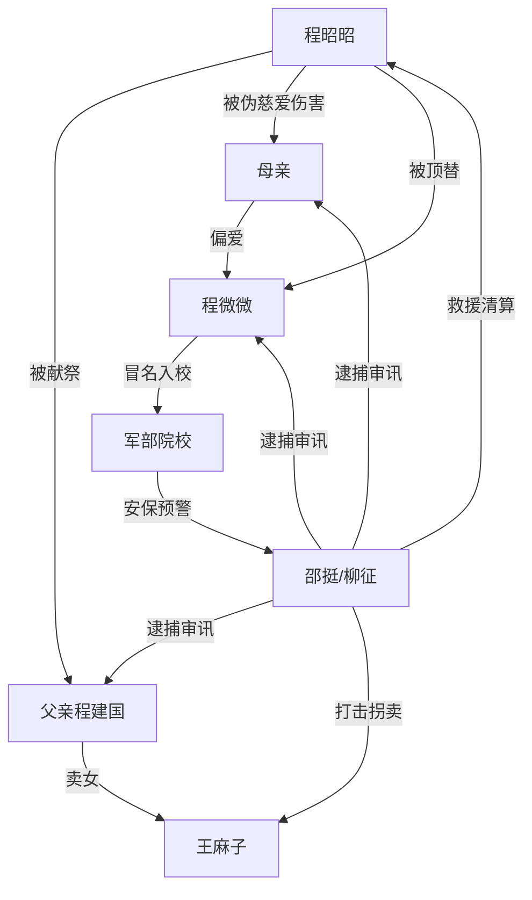

# 角色标签图谱

## 角色清单

### 程昭昭 — 清醒隐忍大女主
- 叙事功能: 受害者、设局者、规则升级者
- 核心标签: 高分、隐忍、冷静复仇
- 弧光: 渴望被爱 → 确认被献祭 → 借军部规则清算 → 断亲独行
- 台词风格: 沙哑短句、反问、冷静定性
- 关键行为: 改报军部院校、延迟触发预警、拒绝谅解
- 读者情绪关系: 心疼、代入、爽

### 程微微 — 被偏爱的窃取者
- 叙事功能: 直接受益者、冒名者、反派崩塌样本
- 核心标签: 嘴甜、嫉妒、愚蠢炫耀
- 弧光: 炫耀顶替 → 入校被捕 → 审讯甩锅 → 牢狱结局
- 台词风格: 装乖、撒娇、崩溃尖叫
- 关键行为: 拿身份证通知书、发朋友圈拍到雷达阵列
- 读者情绪关系: 恨、鄙夷、痛快

### 父亲程建国 — 愚昧权威型父亲
- 叙事功能: 家庭压迫规则制定者
- 核心标签: 冷血、算计、父权
- 弧光: 下令卖女 → 以为家务事 → 审讯嘴硬 → 失控求饶
- 台词风格: 命令式、理所当然、甩锅
- 关键行为: 毒哑女儿、联系人贩子、要求她救妹妹
- 读者情绪关系: 恨、反感、期待惩罚

### 母亲 — 伪慈爱献祭者
- 叙事功能: 情感刀口，制造“爱过吗”的痛点
- 核心标签: 偏心、哭戏、伪牺牲
- 弧光: 哭着下药 → 塞平安符 → 审讯装可怜 → 日记暴露真实偏爱
- 台词风格: 哭诉、道德绑架、诅咒
- 关键行为: 给女主下药、求妹妹从轻、日记补刀
- 读者情绪关系: 心寒、愤怒

### 王麻子 — 人贩子与肉体威胁
- 叙事功能: 将家庭背叛具象成生理危险
- 核心标签: 猥琐、暴力、买卖妇女
- 弧光: 花钱买人 → 地窖施暴 → 军部突入被抓
- 台词风格: 粗鄙、威胁、求饶
- 关键行为: 绑架、殴打、性侵威胁
- 读者情绪关系: 恨、恐惧、期待被碾压

### 邵挺/柳征 — 公权力清算者
- 叙事功能: 规则定性、救援、清算执行
- 核心标签: 军部、秩序、权威
- 弧光: 救援迟到道歉 → 定义间谍入侵 → 通报罪证
- 台词风格: 简短、法律化、压迫感强
- 关键行为: 救女主、挂断父母电话、通报罪名
- 读者情绪关系: 安全感、爽感

## 关系网络

## 角色功能对照表（供改编参考）

| 原角色 | 极致标签 | 叙事功能 | 读者情绪功能 | 改编时必须保留的 |
|--------|---------|---------|-------------|---------------|
| 程昭昭 | 清醒隐忍大女主 | 受害与设局 | 心疼转爽 | 前期受害、后期拒绝原谅 |
| 程微微 | 被偏爱的窃取者 | 冒名受益 | 恨 | 炫耀与自爆证据 |
| 父亲 | 冷血父权 | 决策压迫 | 恨 | “为了家/妹妹”逻辑 |
| 母亲 | 伪慈爱偏心者 | 情感伤害 | 心寒 | 哭着伤害与日记补刀 |
| 王麻子 | 人贩子 | 生理危机 | 恐惧与憎恶 | 地窖/性侵威胁 |
| 军部人员 | 公权力 | 降维清算 | 爽 | 定性罪名的权威金句 |
