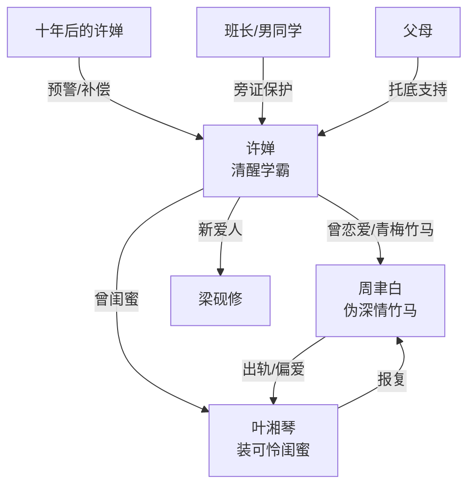

# 角色标签图谱

## 角色清单

### 许婵 — 清醒学霸/命运改写者

- 叙事功能: 第一人称主角，承受背叛并执行反杀。
- 核心标签: 学霸、清醒、克制
- 弧光: 天真信任 → 验证背叛 → 冷静反杀 → 走向新人生
- 台词风格: 短句反问，冷静砸脸。
- 关键行为: 测试消失笔、调换笔袋、公开分手、拒绝复合、告诉叶湘琴真相。
- 读者情绪关系: 心疼、代入、爽。

### 周聿白 — 伪深情竹马/自作孽反噬者

- 叙事功能: 核心施害者，制造背叛和消失笔阴谋。
- 核心标签: 青梅竹马、偏心、伪悔恨
- 弧光: 温柔男友表象 → 背叛曝光 → 落榜崩塌 → 迟到悔恨 → 永失清大
- 台词风格: 前期哄骗，后期辩解和求饶。
- 关键行为: 送消失笔、陪叶湘琴、忘买女主车票、质问女主、求复合。
- 读者情绪关系: 恨、厌恶、看其反噬获得爽感。

### 叶湘琴 — 装可怜闺蜜/被偏爱者反噬者

- 叙事功能: 第三者和次级施害者，推动关系背叛显影。
- 核心标签: 绿茶、卖惨、失控
- 弧光: 被女主照顾的闺蜜 → 插足者 → 落榜受害者 → 持刀报复者
- 台词风格: 委屈、求情、道德绑架。
- 关键行为: 和周聿白喝酒接吻、求女主借钱复读、得知真相后闹上楼。
- 读者情绪关系: 恨，后期带一点因果反噬的复杂感。

### 十年后的许婵 — 预警者/命运校正器

- 叙事功能: 提供开篇 Hook 和结尾闭环。
- 核心标签: 先知、痛苦见证者、补偿者
- 弧光: 怒斥过去的自己 → 结尾给出幸福确认
- 台词风格: 信息倾泻，短句警告。
- 关键行为: 揭露消失笔和背叛未来，结尾确认新人生。
- 读者情绪关系: 制造紧张和最终安心。

### 梁砚修 — 新爱人/补偿型伴侣

- 叙事功能: 结尾情感补偿，证明女主不是失去爱情，而是错过错的人。
- 核心标签: 包容、坦诚、稳定
- 弧光: 后期出现 → 接纳过去 → 给女主新的亲密关系
- 台词风格: 轻松、体贴、带一点吃醋。
- 关键行为: 看见旧吊篮和照片后不误会，要求补合照。
- 读者情绪关系: 安心、甜。

### 班长/男同学/父母/刘姨 — 旁证与社会围观系统

- 叙事功能: 提供证词、群体舆论和现实反应。
- 核心标签: 旁证、保护、围观
- 弧光: 辅助女主确认真相和见证反噬。
- 台词风格: 生活化。
- 关键行为: 班长背女主去医务室、男同学告知接吻、妈妈提示改密码、刘姨传递刺伤消息。
- 读者情绪关系: 提供安全感和现实可信度。

## 关系网络

## 角色功能对照表（供改编参考）

| 原角色 | 极致标签 | 叙事功能 | 读者情绪功能 | 改编时必须保留的 |
|--------|---------|---------|-------------|---------------|
| 许婵 | 清醒学霸 | 主角/反杀执行者 | 代入、爽、心疼 | 先验证再反击，拒绝原谅 |
| 周聿白 | 伪深情竹马 | 核心施害者 | 恨、等报应 | 表面温柔与实际偏心的反差 |
| 叶湘琴 | 绿茶闺蜜 | 第三者/次级债务人 | 厌恶、看反噬 | 卖惨和道德绑架 |
| 十年后的许婵 | 预警者 | Hook 和闭环 | 紧张、安心 | 开头预警+结尾补偿 |
| 梁砚修 | 稳定新爱人 | 情感补偿 | 甜、治愈 | 不误会，尊重女主过去 |
