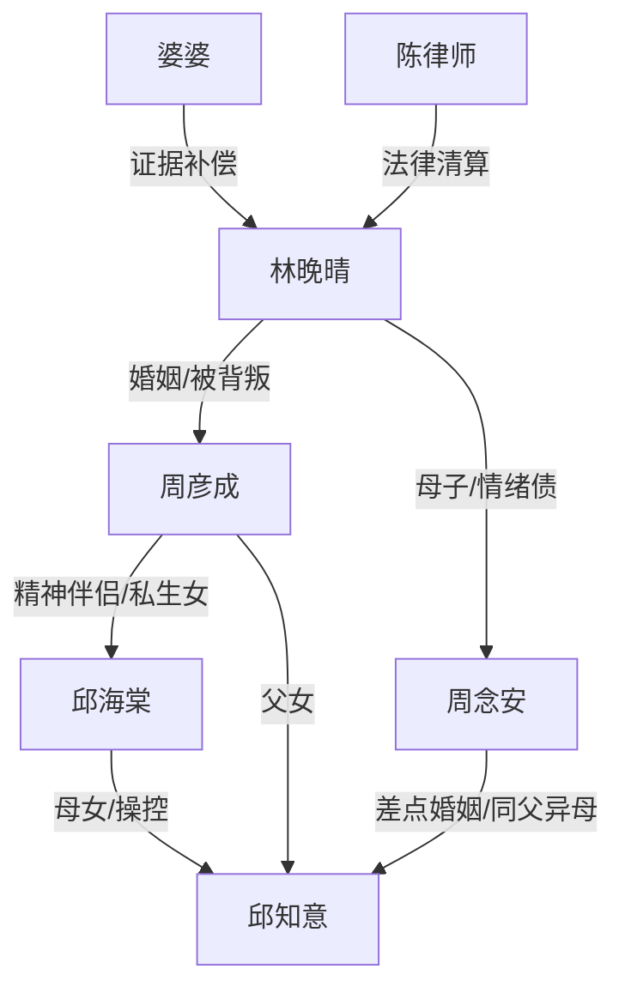

# 角色标签图谱

## 角色清单

### 林晚晴 — 清醒反杀型母亲
- 叙事功能: 第一视角主角、被剥削者、证据链组织者。
- 核心标签: 隐忍三十年、冷静留证、财产清算。
- 弧光: 把亏欠当亲情 → 发现自己被工具化 → 建立边界并离场。
- 台词风格: 短句、反问、冷讽。
- 关键行为: 隐瞒彩票、拍照留证、报警、找律师、做鉴定、离婚。
- 读者情绪关系: 心疼、代入、爽。

### 周彦成 — 软饭型精神出轨丈夫
- 叙事功能: 核心背叛者，家庭谎言源头。
- 核心标签: 懦弱、自怜、转移财产。
- 弧光: 被两女供养的中心 → 谎言崩塌 → 为钱下跪。
- 台词风格: 回避、卖惨、道德绑架。
- 关键行为: 隐瞒私生女、纵容邱海棠、索要彩票钱。
- 读者情绪关系: 厌恶、鄙夷、痛快看其崩塌。

### 周念安 — 被宠坏的白眼狼儿子
- 叙事功能: 女主情绪债最痛来源，也是后段有限补偿点。
- 核心标签: 索取型、认知被污染、迟来醒悟。
- 弧光: 指责母亲 → 被血缘真相击碎 → 归还财物并开始偿还。
- 台词风格: 前期尖锐任性，后期哑、短、羞愧。
- 关键行为: 抢手机、让母亲道歉、透露彩票线索、后期作证与还钱。
- 读者情绪关系: 前期恨，后期复杂但不可完全原谅。

### 邱海棠 — 绿茶操盘型旧闺蜜
- 叙事功能: 外部反派、情绪价值伪装者、舆论战发动者。
- 核心标签: 假瘸、卖惨、剧本型操控。
- 弧光: “灵魂伴侣”圣母姿态 → 私生女曝光 → 直播翻车被警方带走。
- 台词风格: 温柔施舍、道德高位、镜头表演。
- 关键行为: 三十年插足、操控周彦成、骗钱、直播污蔑。
- 读者情绪关系: 强恨点，打脸爽点来源。

### 邱知意 — 被当筹码的准儿媳
- 叙事功能: 伦理炸弹载体，揭开“差点兄妹结婚”的爆点。
- 核心标签: 利己、冷脸、工具人觉醒。
- 弧光: 帮邱海棠逼女主 → 发现身世 → 直播反水作证。
- 台词风格: 前期理直气壮，后期尖锐破防。
- 关键行为: 推女主、索要道歉、直播站台、最终揭露母亲。
- 读者情绪关系: 前期讨厌，后期作为证据工具缓和。

### 婆婆 — 迟来偿债者
- 叙事功能: 关键证人，提供出生证明和历史真相。
- 核心标签: 瘫痪、知情、愧疚。
- 弧光: 沉默十五年 → 交出证据 → 公开作证。
- 台词风格: 短、断、带临终感。
- 关键行为: 让女主拿红本，向民警承认证据。
- 读者情绪关系: 复杂，同情但有迟来愧疚。

### 陈律师 — 降维执行者
- 叙事功能: 法律背书与清算工具。
- 核心标签: 专业、冷静、证据化。
- 弧光: 咨询律师 → 入场递文件 → 推进离婚和返还。
- 台词风格: 法律术语、克制。
- 关键行为: 整理财产清单、赠与撤销、公开视频和鉴定。
- 读者情绪关系: 安全感、爽感放大器。

## 关系网络

## 角色功能对照表（供改编参考）

| 原角色 | 极致标签 | 叙事功能 | 读者情绪功能 | 改编时必须保留的 |
|--------|---------|---------|-------------|---------------|
| 林晚晴 | 清醒反杀母亲 | 主角/清算者 | 代入、心疼、爽 | 冷静留证，不哭闹 |
| 周彦成 | 软饭精神出轨男 | 谎言源头 | 恨、鄙夷 | 自怜与索取并存 |
| 周念安 | 白眼狼儿子 | 最痛亲情债 | 憋屈、复杂补偿 | 前期伤母，后期有限还债 |
| 邱海棠 | 绿茶旧闺蜜 | 主反派 | 强恨点 | 卖惨人设和直播翻车 |
| 邱知意 | 私生女准儿媳 | 伦理炸弹 | 惊悚、反转 | 与儿子差点结婚 |
| 婆婆 | 迟来证人 | 真相钥匙 | 迟来公道 | 交出核心证据 |
| 陈律师 | 法律执行者 | 反杀背书 | 安全感 | 证据链和财产清算 |
