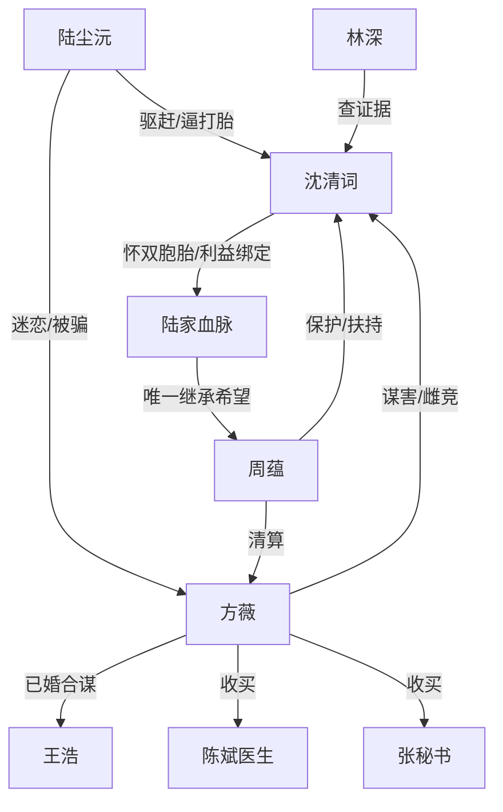

# 角色标签图谱

## 角色清单

### 沈清词 — 清醒逐利替身女主

- 叙事功能: 信息差持有者、反杀执行者、读者代入主体。
- 核心标签: 清醒、会算账、行动快。
- 弧光: 被驱逐替身 → 孕球筹码持有人 → 陆家核心利益共同体。
- 台词风格: 短句、反问、冷静补刀。
- 关键行为: 停止流产、调查陈斌、投靠周蕴、布置监控、保留证据。
- 读者情绪关系: 爽、佩服、代入“血赚”。

### 陆尘沅 — 恋爱脑金主/被反噬男主

- 叙事功能: 前期压迫者，中期被打脸对象，后期被骗局反噬的惩罚样本。
- 核心标签: 傲慢、恋爱脑、迟钝。
- 弧光: 驱赶替身 → 强逼打胎 → 绝育真相坐实 → 白月光信仰崩塌 → 精神崩溃。
- 台词风格: 命令式、冷嘲式，后期失语。
- 关键行为: 给支票赶人、逼女主打胎、检查确认、公开证据报警。
- 读者情绪关系: 前期恨，中期爽看崩塌，后期不需要原谅。

### 方薇 — 蛇蝎白月光/伪女主

- 叙事功能: 主反派、压迫源、阴谋源。
- 核心标签: 绿茶、婚骗、狠毒。
- 弧光: 病弱白月光 → 质疑血脉 → 已婚骗局曝光 → 买凶下药 → 入狱。
- 台词风格: 柔弱、退让、假善良。
- 关键行为: 劝女主拿钱走、质疑孩子、买通医生和秘书、谋害孕妇。
- 读者情绪关系: 恨、厌、期待被撕穿。

### 周蕴 — 豪门商人婆婆/规则掌权人

- 叙事功能: 高阶权力背书，负责把女主信息优势转为现实权力。
- 核心标签: 冷静、利益至上、护血脉。
- 弧光: 怀疑女主 → 核实证据 → 保护孕妇 → 清算内鬼 → 接纳女主。
- 台词风格: 克制、压迫感强、决策直接。
- 关键行为: 核实陈斌证据、安排检查、举办家宴、审问张秘书、转股份。
- 读者情绪关系: 安全感、爽文权力感。

### 林深 — 隐形工具人侦探

- 叙事功能: 证据供给者。
- 核心标签: 靠谱、嘴严、高效率。
- 弧光: 被女主曾经帮助的人 → 关键时刻回报女主。
- 台词风格: 信息汇报式。
- 关键行为: 查陈斌流水、查方薇已婚、提供文件链。
- 读者情绪关系: 稳、解压。

### 张秘书 — 内鬼证人

- 叙事功能: 方薇谋害升级的实锤入口。
- 核心标签: 贪财、胆小、被收买。
- 弧光: 周蕴心腹 → 下药内鬼 → 跪地供出方薇。
- 台词风格: 恭敬转恐惧。
- 关键行为: 给补品下红花、供述方薇计划。
- 读者情绪关系: 恨、推动清算。

## 关系网络

## 角色功能对照表（供改编参考）

| 原角色 | 极致标签 | 叙事功能 | 读者情绪功能 | 改编时必须保留的 |
|--------|---------|---------|-------------|---------------|
| 沈清词 | 清醒替身女主 | 信息差反杀 | 爽、代入 | 不恋爱脑，只算利益 |
| 陆尘沅 | 傲慢金主 | 压迫与被反噬 | 恨、打脸爽 | 逼女主放弃唯一筹码 |
| 方薇 | 蛇蝎白月光 | 主阴谋源 | 恨、期待清算 | 伪善外壳逐层剥落 |
| 周蕴 | 豪门掌权人 | 权力背书 | 安全感 | 先利益后感情 |
| 林深 | 证据工具人 | 推动调查 | 稳定爽感 | 高效提供证据 |
| 张秘书 | 内鬼 | 谋害证据入口 | 危机与清算 | 被监控锁死并供出主谋 |
