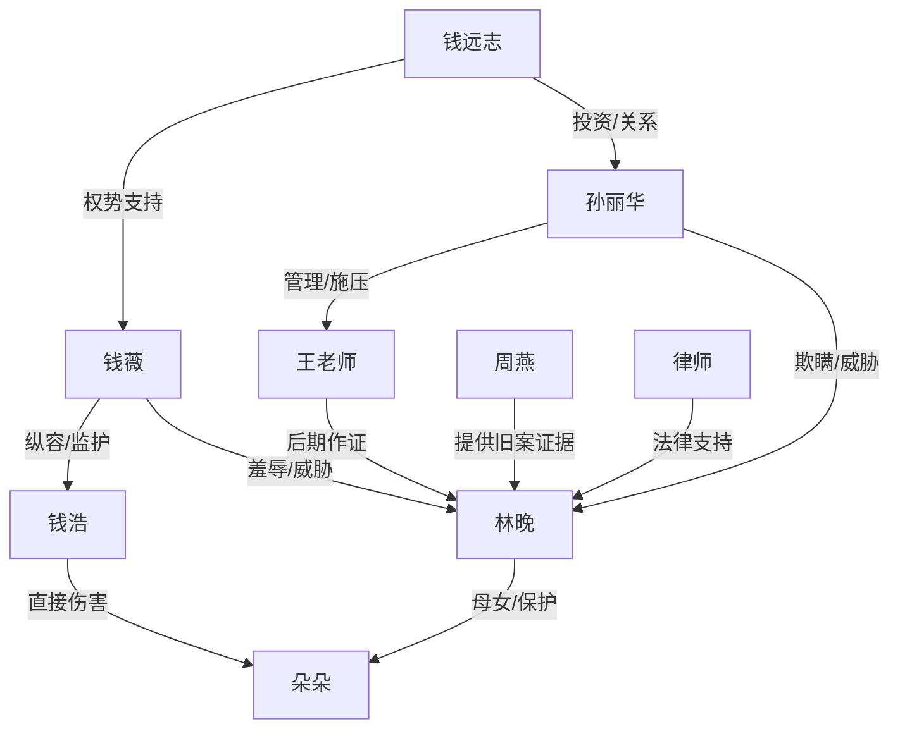

# 角色标签图谱

## 角色清单

### 林晚 — 清醒护女单亲妈妈
- 叙事功能: 受害方主视角、取证者、清算发动机。
- 核心标签: 单亲、贫穷但硬、证据意识强。
- 弧光: 慌乱母亲 → 冷静取证者 → 联合受害者的清算者。
- 台词风格: 短句、直接、少废话。
- 关键行为: 拒签协议、报警、录音、拔 SD 卡、提交证据。
- 读者情绪关系: 心疼、代入、期待她反杀。

### 朵朵 — 被伤害的幼童/情绪核心
- 叙事功能: 全文情绪债来源，清算正当性的根。
- 核心标签: 四岁、无辜、受伤后仍依赖妈妈。
- 弧光: 重伤昏迷 → 说出真相 → 回归安全童年。
- 台词风格: 儿童化、短、软。
- 关键行为: 说出“老师不在”“哥哥打我”。
- 读者情绪关系: 心疼、保护欲、愤怒触发器。

### 孙丽华 — 权势园长/系统性包庇者
- 叙事功能: 第一反派，负责遮掩、威胁、伪证、毁证。
- 核心标签: 专业假面、冷血、会控场。
- 弧光: 体面园长 → 慌乱抢证 → 刑拘获刑。
- 台词风格: 前期温和官腔，后期威胁冷硬。
- 关键行为: 递意外协议、谎称监控坏、指使王老师、关闭主系统。
- 读者情绪关系: 恨、厌恶、期待被公开揭穿。

### 钱薇 — 嚣张富太/施害儿童监护人
- 叙事功能: 阶层羞辱和金钱压迫载体。
- 核心标签: 有钱、傲慢、轻视穷人。
- 弧光: 扔钱威胁 → 法庭沉默 → 承担赔偿。
- 台词风格: 轻蔑、短促、羞辱性强。
- 关键行为: 扔五万、说“你一个洗碗工”、试图拦截 SD 卡。
- 读者情绪关系: 恨、想看她当众失语。

### 钱浩 — 恶童/被纵容的暴力源
- 叙事功能: 直接伤害朵朵，揭示家庭和园方纵容。
- 核心标签: 暴力、无同理、被保护。
- 弧光: 打人后吃饼干 → 监控中被定格为证据。
- 台词风格: 基本无台词，靠动作塑造。
- 关键行为: 用铁皮卡车砸朵朵后脑勺。
- 读者情绪关系: 愤怒，但主要恨点落在纵容他的成年人。

### 王老师 — 怯懦失职者/次级债务人
- 叙事功能: 失职和伪证承载者，后期补充真相。
- 核心标签: 年轻、胆怯、失职。
- 弧光: 脱岗 → 做伪证 → 配合调查 → 道歉。
- 台词风格: 犹豫、断裂、省略号多。
- 关键行为: 十四分钟后才进教室，被迫说谎，后期作证。
- 读者情绪关系: 怒其失职，但因补证获得有限宽恕。

### 周燕 — 受害者联盟引线
- 叙事功能: 扩大案件规模，从单案变成系统性伤害。
- 核心标签: 曾妥协、被唤醒、愿作证。
- 弧光: 不敢声张 → 递出证据 → 联合家长作证。
- 台词风格: 压低声音、带愧疚。
- 关键行为: 提供彤彤伤照、联系苗苗和东东家长。
- 读者情绪关系: 同情、认可、群体爽感。

### 律师 — 专业外援/证据链整理者
- 叙事功能: 把林晚的直觉和证据转化为司法路径。
- 核心标签: 专业、有女儿、低调善意。
- 弧光: 提供建议 → 整理控告 → 法庭代理。
- 台词风格: 冷静、精准。
- 关键行为: 指导备份、提交控告、庭审发问。
- 读者情绪关系: 安心、爽点合法化。

### 钱远志 — 背后权力黑手
- 叙事功能: 隐形压迫源，最终追加清算。
- 核心标签: 投资人、关系网、压事。
- 弧光: 幕后施压 → 后续被查。
- 台词风格: 平静客气但带威胁。
- 关键行为: 打招呼、施压饭店、试图压案。
- 读者情绪关系: 期待更高层报应。

## 关系网络

## 角色功能对照表（供改编参考）

| 原角色 | 极致标签 | 叙事功能 | 读者情绪功能 | 改编时必须保留的 |
|--------|---------|---------|-------------|---------------|
| 林晚 | 清醒护女单亲妈妈 | 取证反杀主角 | 心疼与爽感承接 | 弱势身份 + 证据意识 + 不和解 |
| 朵朵 | 无辜受害幼童 | 情绪债核心 | 心疼与保护欲 | 具体伤害细节与童言证词 |
| 孙丽华 | 体面冷血园长 | 系统性遮掩 | 主要恨点 | 协议、伪证、毁证三件套 |
| 钱薇 | 嚣张富太 | 阶层羞辱 | 打脸期待 | 扔钱、羞辱职业、抢证据 |
| 王老师 | 怯懦失职者 | 伪证与补证 | 复杂情绪 | 失职事实 + 后期作证 |
| 周燕 | 被唤醒家长 | 群体证据 | 同盟爽点 | 旧案证据和“你不是一个人” |
| 律师 | 专业外援 | 司法路径 | 安全感 | 备份/控告/庭审清算 |
