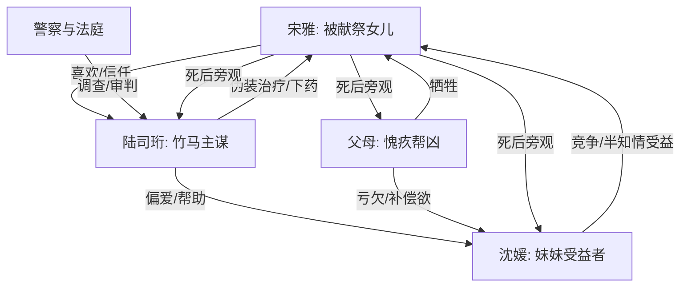

# 角色标签图谱

## 角色清单

### 宋雅 — 被献祭的清醒学霸亡灵

- 叙事功能: 受害者、灵魂旁观者、情绪债核心载体
- 核心标签: 学霸、十八岁、被家人牺牲
- 弧光: 信任亲人和竹马 → 发现真相赴死 → 旁观悔恨 → 彻底断缘
- 台词风格: 极少，临死前平静应答，“好”“我爱你”
- 关键行为: 吞下百草枯；留下钱、笔记、遗书；死后旁观众人余生
- 读者情绪关系: 心疼、替她不甘、希望亏欠者终生悔恨

### 陆司珩 — 伪善竹马/温柔施害者

- 叙事功能: 主谋反派，负责把“爱”伪装成伤害
- 核心标签: 竹马、偏爱沈媛、理性犯罪
- 弧光: 温柔守护者假象 → 合谋下药主谋 → 审讯崩塌 → 监狱悔恨
- 台词风格: 低声、温润、合理化，“一年而已”
- 关键行为: 找医生做假化验单；安排药物；放置百草枯；诱导父母同意
- 读者情绪关系: 恨、恶心、期待其悔疯

### 母亲 — 愧疚驱动的帮凶母亲

- 叙事功能: 家庭伦理撕裂核心；让“母爱”变成伤害
- 核心标签: 愧疚、软弱、迟来崩溃
- 弧光: 默认牺牲宋雅 → 抱尸崩溃 → 余生梦魇
- 台词风格: 哭喊、质问、自责
- 关键行为: 同意宋雅继续“睡一个月”；尸前痛打陆司珩；承认自己是帮凶
- 读者情绪关系: 又恨又痛，不能原谅但能理解其崩塌

### 父亲 — 沉默共犯/迟来悔父

- 叙事功能: 沉默型帮凶，承担“知道但不阻止”的罪
- 核心标签: 逃避、懦弱、沉默
- 弧光: 假装看窗外 → 签字同意 → 法庭空洞 → 余生自毁
- 台词风格: 少话、断裂、低声
- 关键行为: 知情沉默；签字；葬礼道歉；长期抽烟自毁
- 读者情绪关系: 恨其懦弱，接受其余生惩罚

### 沈媛 — 被送走的替代女儿/灰色受益者

- 叙事功能: 伦理动机源头，制造“谁都受伤但宋雅最无辜”的复杂度
- 核心标签: 被遗弃、受益者、半知情
- 弧光: 焦虑竞争者 → 承认知情 → 放弃 A 大 → 终生念念不忘
- 台词风格: 道歉、迟疑、低声
- 关键行为: 知道宋雅会错过高考却接受；葬礼磕头；改志愿；给女儿取名念念
- 读者情绪关系: 复杂，恨其自私，也看见她被遗弃的伤

### 警察/法官 — 现实秩序

- 叙事功能: 揭露罪链、给出有限清算
- 核心标签: 冷静、制度、有限正义
- 弧光: 调查 → 追问 → 判决七年
- 台词风格: 审讯式、冷
- 关键行为: 问出沈媛知情程度；让陆司珩直面毁掉人生
- 读者情绪关系: 期待正义，同时因判决偏轻产生二次不甘

## 关系网络

## 角色功能对照表（供改编参考）

| 原角色 | 极致标签 | 叙事功能 | 读者情绪功能 | 改编时必须保留的 |
|--------|---------|---------|-------------|---------------|
| 宋雅 | 被献祭学霸亡灵 | 受害核心、旁观者 | 心疼、不甘 | 无辜、优秀、主动赴死、死后不复仇 |
| 陆司珩 | 伪善竹马 | 主谋施害者 | 恨、期待崩塌 | 曾经温柔、现实残忍、“一年而已”逻辑 |
| 母亲 | 愧疚帮凶 | 伦理撕裂 | 痛恨与心痛 | 知情、哭、迟来承认帮凶 |
| 父亲 | 沉默共犯 | 罪责补足 | 厌恶懦弱 | 知情沉默、余生自毁 |
| 沈媛 | 灰色受益者 | 复杂化仇恨 | 纠结、二次痛感 | 被送走、半知情、放弃战利品 |
| 警察/法庭 | 有限正义 | 现实清算 | 不甘 | 判决不能完全偿命 |
