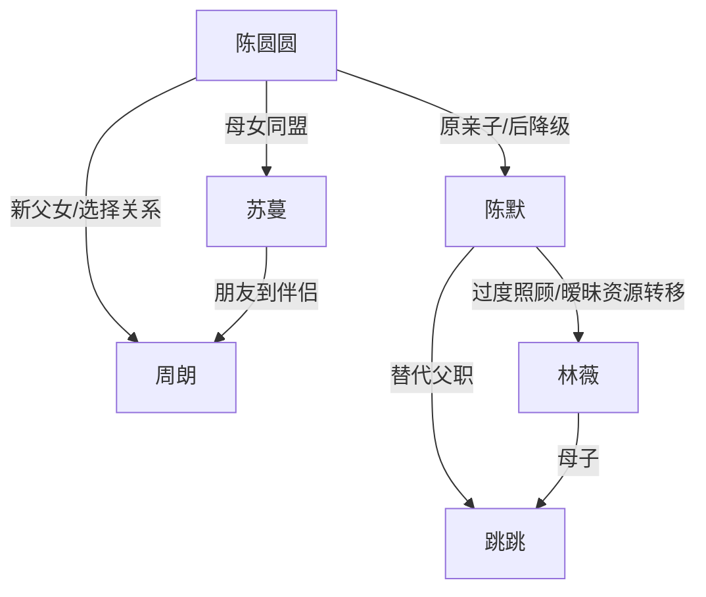

# 角色标签图谱

## 角色清单

### 陈圆圆 — 清醒受伤小孩
- 叙事功能: 第一视角承伤者、称呼反转执行者、法庭真相证人。
- 核心标签: 懂事被压迫、童言审判、主动选择。
- 弧光: 等爸爸来 → 叫叔叔反击 → 公开说真话 → 选择新爸爸。
- 台词风格: 短、直、复述事实，不做成人化控诉。
- 关键行为: 家长会喊叔叔、运动会喊周朗爸爸、社区舞台公开真相、法庭表达选择、结尾不原谅。
- 读者情绪关系: 心疼、代入、爽、保护欲。

### 陈默 — 失职亲爸/自我感动型施害者
- 叙事功能: 情绪债来源，亲情规则破坏者，被称呼反噬的对象。
- 核心标签: 偏心、失约、推责。
- 弧光: 自以为助人 → 被女儿降级 → 社死与败诉 → 失去家庭。
- 台词风格: “特殊情况”“再给一次机会”“我保证”，解释多于行动。
- 关键行为: 让女儿叫叔叔、陪跳跳、威胁抚养权、法庭哭求、最后道歉。
- 读者情绪关系: 恨、憋屈、后期轻微唏嘘但不值得原谅。

### 苏蔓 — 觉醒护女妈妈
- 叙事功能: 法律反击者、家庭边界建立者、情绪安全岛。
- 核心标签: 隐忍取证、冷静清算、保护女儿。
- 弧光: 忍耐观察 → 被运动会击穿 → 三年证据亮出 → 赢得抚养权。
- 台词风格: 平静、具体、证据化。
- 关键行为: 带周朗救场、写证据清单、联系律师公证、法庭争抚养权。
- 读者情绪关系: 心疼、信任、爽。

### 周朗 — 稳定补偿型新爸爸
- 叙事功能: 正向父职对照组，偿还圆圆被亏欠的陪伴债。
- 核心标签: 准时、蹲下说话、承诺兑现。
- 弧光: 临时救场朋友 → 稳定陪伴者 → 被圆圆认证为爸爸。
- 台词风格: 温柔解释，少承诺，多行动。
- 关键行为: 陪跑、写作业、换锁、做蛋糕、雕木像、每天接送。
- 读者情绪关系: 安心、治愈、补偿爽。

### 林薇 — 受益型第三者/道德模糊压迫者
- 叙事功能: 夺取父爱资源的外部诱因。
- 核心标签: 示弱、依赖、默认占有。
- 弧光: 红眼求助 → 社区台前享受父爱 → 舆论压力下退场。
- 台词风格: 表面客气，常用“一个人带孩子不容易”。
- 关键行为: 让跳跳接受陈默父职，社区录视频。
- 读者情绪关系: 反感、厌恶。

### 跳跳 — 被偏爱的小孩
- 叙事功能: 父爱转移的可见载体。
- 核心标签: 被补偿、占有、无辜与刺痛并存。
- 弧光: 叫陈默爸爸 → 舞台喊爱 → 被舆论卷入。
- 台词风格: 直白炫耀。
- 关键行为: 喊爸爸、坐购物车、运动会受伤、社区合唱。
- 读者情绪关系: 不主要恨他，主要恨成人用他剥夺圆圆。

## 关系网络

## 角色功能对照表（供改编参考）

| 原角色 | 极致标签 | 叙事功能 | 读者情绪功能 | 改编时必须保留的 |
|--------|---------|---------|-------------|---------------|
| 陈圆圆 | 清醒受伤小孩 | 承伤与反击执行者 | 心疼、爽、保护欲 | 儿童视角说真话，不成人化 |
| 陈默 | 失职亲爸 | 情绪债来源 | 恨、后期失落余味 | 曾经好、后来反复失约 |
| 苏蔓 | 觉醒妈妈 | 证据清算者 | 安全感、痛快 | 取证链、护女边界 |
| 周朗 | 稳定新爸爸 | 补偿父职 | 治愈、安心 | 用行动兑现，不用霸总资源 |
| 林薇 | 示弱受益者 | 外部夺取诱因 | 反感 | “可怜”话术与默认占有 |
| 跳跳 | 被偏爱孩子 | 父爱转移载体 | 刺痛 | 具体占有原本属于主角的东西 |
