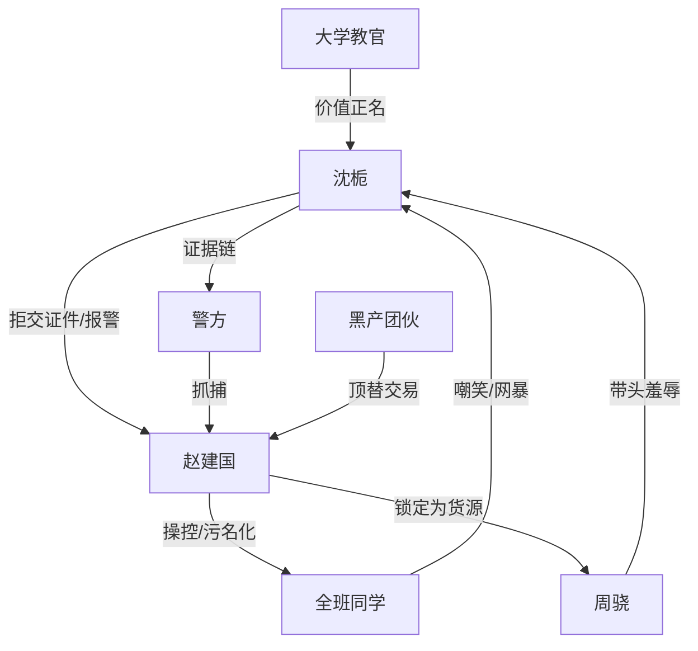

# 角色标签图谱

## 角色清单

### 沈栀 — 被污名化的清醒大女主
- 叙事功能: 主视角、证据链发动机、全篇价值反转核心。
- 核心标签: 高防备、冷静、漏洞识别者
- 弧光: 被骂神经病 → 证明全班危机 → 被专业系统接纳
- 台词风格: 短句、证据编号、强边界
- 关键行为: 拒交准考证、录音截图、报警、识别假证与站位、协助警方抓捕
- 读者情绪关系: 前期心疼，后期爽，结尾敬佩

### 赵建国/老赵 — 慈爱面具下的组织犯罪节点
- 叙事功能: 主压迫者，制造“老师为你好”的伪善规则。
- 核心标签: 伪善、操控、黑产内应
- 弧光: 慈爱班主任 → 威胁学生 → 被捕犯罪嫌疑人
- 台词风格: 道德绑架、权威压迫、当众污名化
- 关键行为: 收证件、发确认书、煽动全班、安排宾馆牛奶和车辆
- 读者情绪关系: 恨、恶心、期待清算

### 周骁 — 群体霸凌的代表受害者
- 叙事功能: 前期带头嘲笑，后期成为“优质货源”，完成因果反讽。
- 核心标签: 班长、傲慢、被利用
- 弧光: 嘲笑沈栀 → 被药倒错过首科 → 发短信道歉
- 台词风格: 大声嘲讽、跟风攻击
- 关键行为: 带头揭沈栀旧事、视频辱骂、最终道歉
- 读者情绪关系: 前期恨，后期复杂但不要求主角原谅

### 李浩 — 群体恶意的放大器
- 叙事功能: 补强校园霸凌强度。
- 核心标签: 跟风、粗鄙、无脑
- 弧光: 模仿羞辱沈栀 → 家长向沈栀求助
- 台词风格: 脏话、嘲弄、情绪化
- 关键行为: 拍确认书、视频辱骂、父亲求助
- 读者情绪关系: 厌恶、反感

### 带队刑警 — 官方采信与正义执行者
- 叙事功能: 让主角证据链进入公权力执行阶段。
- 核心标签: 谨慎、专业、行动力
- 弧光: 核验证据 → 采信判断 → 指挥抓捕
- 台词风格: 急促、流程化、命令式
- 关键行为: 接沈栀、调监控、下达封控抓捕命令
- 读者情绪关系: 安全感、爽点兑现

### 大学教官 — 价值正名者
- 叙事功能: 结尾主题落点，将“病态防备”转化为职业能力。
- 核心标签: 稳定、识才、制度接纳
- 弧光: 审视档案 → 承认沈栀价值
- 台词风格: 平稳、短句、有分量
- 关键行为: 接纳沈栀进入网络安全与身份犯罪侦查专业
- 读者情绪关系: 补偿、释然

## 关系网络

## 角色功能对照表（供改编参考）

| 原角色 | 极致标签 | 叙事功能 | 读者情绪功能 | 改编时必须保留的 |
|--------|---------|---------|-------------|---------------|
| 沈栀 | 被污名化的清醒者 | 主角/证据链核心 | 心疼→爽→敬佩 | 缺陷即武器 |
| 老赵 | 伪善权威 | 压迫者/黑产节点 | 恨 | “为你好”的压迫面具 |
| 周骁 | 带头霸凌者 | 群体误判代表 | 恨→反讽 | 先骂最狠，后期受害最重 |
| 李浩 | 跟风恶意 | 群体羞辱放大器 | 厌恶 | 粗鄙跟风嘴脸 |
| 警方 | 公权力执行 | 爽点兑现 | 安全感 | 从质疑到采信的过程 |
| 教官 | 正名者 | 主题收束 | 补偿 | 最后一锤价值确认 |
