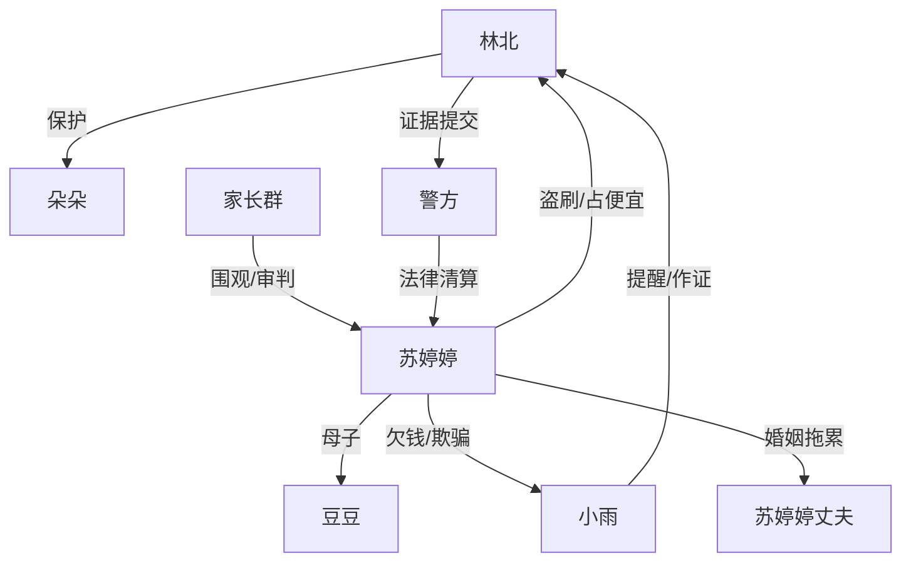

# 角色标签图谱

## 角色清单

### 林北 — 冷静证据型妈妈
- 叙事功能: 第一人称主角，承受盗刷、设计反杀、完成法律清算。
- 核心标签: 清醒、克制、证据控
- 弧光: 被当冤大头 → 设密码布控 → 报警清算 → 平静收束
- 台词风格: 短句、反问、法律和事实压迫
- 关键行为: 设置消费密码、截图保存、拒绝给密码、报警提交证据
- 读者情绪关系: 心疼她被盗刷，期待她反杀，最终获得爽感和认同

### 苏婷婷 — 熟人吸血型热心妈妈
- 叙事功能: 施害者，制造情绪债和道德愤怒。
- 核心标签: 贪便宜、虚荣、赖账
- 弧光: 群里立大方人设 → 盗刷挂账 → 当众崩盘 → 被拘留社交出局
- 台词风格: 先热情大方，后推脱哀求，再威胁
- 关键行为: 偷记卡号、48 元测试、晒余额、组织生日会、索要密码、上门假道歉
- 读者情绪关系: 引发强烈厌恶和追责欲

### 小雨 — 见证者兼助攻
- 叙事功能: 提供外部视角、现场直播、替女主在群里说出真相。
- 核心标签: 仗义、清醒、旁证
- 弧光: 怀疑 → 支持女主 → 借钱垫付 → 群里作证
- 台词风格: 直接、网聊化
- 关键行为: 私聊提醒、现场直播、群里还原真相、愿意作证
- 读者情绪关系: 提供陪伴感和群体正义感

### 苏婷婷丈夫 — 现实压力引爆器
- 叙事功能: 将苏婷婷的虚荣代价具体化为家庭崩盘。
- 核心标签: 疲惫、暴躁、被拖累
- 弧光: 被蒙在鼓里 → 收银台暴怒 → 借钱结账 → 提离婚
- 台词风格: 粗暴、直接
- 关键行为: 花呗借钱、当众摔手机、提出离婚
- 读者情绪关系: 一定程度上让读者看到反派代价外溢

### 豆豆 — 无辜承受者
- 叙事功能: 让结尾从纯爽转入伦理余味。
- 核心标签: 无辜、被牵连、孩子
- 弧光: 被妈妈用作虚荣中心 → 被迁怒推倒 → 承受母亲犯错后果
- 台词风格: 稚嫩、少量
- 关键行为: 哭、拉妈妈衣角、拘留后瘦了一圈
- 读者情绪关系: 心疼，削弱过度复仇的残酷感

### 朵朵 — 主角守护对象
- 叙事功能: 证明女主的卡、钱和边界是为了自己的孩子。
- 核心标签: 天真、被保护、家庭温度
- 弧光: 被排除在生日会外 → 最终由妈妈用自己的卡带她玩
- 台词风格: 孩子气
- 关键行为: 问能否去游乐场，结尾梦话想玩滑梯
- 读者情绪关系: 给故事提供温暖落点

## 关系网络

## 角色功能对照表（供改编参考）

| 原角色 | 极致标签 | 叙事功能 | 读者情绪功能 | 改编时必须保留的 |
|--------|---------|---------|-------------|---------------|
| 林北 | 冷静证据型妈妈 | 设局反杀 | 爽、认同 | 不当场撕破，先固化证据 |
| 苏婷婷 | 熟人吸血鬼 | 制造压迫和赖账 | 恨、恶心 | 先小额测试，再大额占便宜 |
| 小雨 | 仗义旁证 | 外部见证 | 陪伴、助爽 | 私聊确认+群里补刀 |
| 丈夫 | 现实压力引爆器 | 当众崩盘催化 | 解气 | 让反派代价家庭化 |
| 豆豆 | 无辜孩子 | 余味承载 | 心疼 | 不让结局只有机械复仇 |
| 朵朵 | 主角孩子 | 情感动机 | 温暖 | 结尾回到“自己的孩子” |
