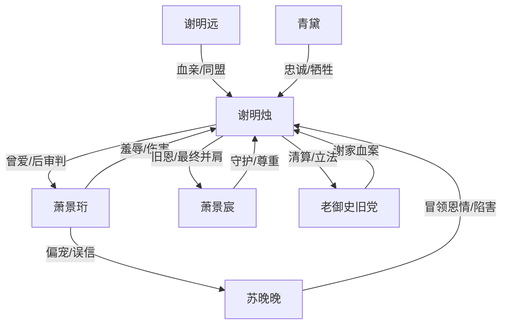

# 角色标签图谱

## 角色清单

### 谢明烛 — 清醒废后 / 复仇大女主
- 叙事功能: 承受压迫、积累情绪债、执行权力反杀与价值升华
- 核心标签: 隐忍、决绝、自立
- 弧光: 误信帝王真心 → 被毁至绝境 → 颠覆旧朝 → 拒绝绑定 → 创办女学
- 台词风格: 冷静短句，审判式反问
- 关键行为: 递信宁王、吹骨哨、当殿拒绝萧景珩、废旧律、弃天道眼
- 读者情绪关系: 心疼、敬佩、爽

### 萧景珩 — 负心帝王 / 自恋施害者
- 叙事功能: 制造所有主要情绪债，后半承担悔恨偿债
- 核心标签: 自卑、忘恩、权欲
- 弧光: 被救少年 → 登基帝王 → 负心施害 → 废帝疯悔 → 流放病死
- 台词风格: 居高临下、推责、后期哀求
- 关键行为: 夺凤冠、断指、鞭刑、误认救命恩、越狱求见
- 读者情绪关系: 恨、期待报应、后期看其崩溃获得爽感

### 苏晚晚 — 白莲贵妃 / 冒名顶替者
- 叙事功能: 外部第三者刺激温度归零，推动真相爆炸
- 核心标签: 温婉假皮、恶毒、贪婪
- 弧光: 奉茶宫女 → 贵妃 → 当殿撕皮 → 从犯
- 台词风格: 怯怯哭诉，关键时刻尖声揭真相
- 关键行为: 夺凤冠凤印、踩手、碎牌位、害青黛、阉谢明远、冒领救命恩
- 读者情绪关系: 厌恶、恨、期待被揭穿

### 萧景宸 — 隐忍宁王 / 迟到但不占有的守护者
- 叙事功能: 提供权力反转载体与健康情感对照
- 核心标签: 克制、深情、尊重
- 弧光: 冷宫废后之子 → 宁王起兵 → 新君 → 退位寻她
- 台词风格: 低声、稳、少承诺多行动
- 关键行为: 保存旧袄十年、率玄甲军入宫、支持新政、十年后携女学名录来江南
- 读者情绪关系: 安慰、补偿、认可

### 谢明远 — 被毁血脉 / 共建新秩序者
- 叙事功能: 将谢家血债推至不可饶恕，也承接后期制度建设
- 核心标签: 残损、清醒、坚韧
- 弧光: 被藏江南的弟弟 → 遭阉割 → 轮椅递账册 → 守京中秩序
- 台词风格: 虚弱但坚定
- 关键行为: 交出旧部名册、接掌京中商号与监察线
- 读者情绪关系: 心疼、补偿欲

### 青黛 — 忠仆 / 情绪触底催化剂
- 叙事功能: 以无辜之死推动女主“不再隐忍”
- 核心标签: 忠诚、无辜、牺牲
- 弧光: 心腹宫女 → 被诬杖责 → 惨死
- 台词风格: 忍痛安慰女主
- 关键行为: 替谢明烛递信、临死仍说不疼
- 读者情绪关系: 心疼、愤怒

## 关系网络

## 角色功能对照表（供改编参考）

| 原角色 | 极致标签 | 叙事功能 | 读者情绪功能 | 改编时必须保留的 |
|--------|---------|---------|-------------|---------------|
| 谢明烛 | 清醒废后 | 承债与清算主体 | 心疼转爽 | 先隐忍后断情，最终拒绝依附 |
| 萧景珩 | 负心帝王 | 施害与悔恨载体 | 恨与报应快感 | 自卑导致厌恶见证者 |
| 苏晚晚 | 白莲冒名者 | 第三者与真相雷管 | 厌恶 | 冒领救命恩、主动害人 |
| 萧景宸 | 克制新君 | 权力反转与健康对照 | 补偿 | 尊重女主选择，不强留 |
| 谢明远 | 被毁血脉 | 不可逆伤害与后续事业 | 心疼 | 身体被毁但主体不灭 |
| 青黛 | 忠仆牺牲 | 触底催化 | 愤怒 | 无辜惨死推动女主爆发 |
