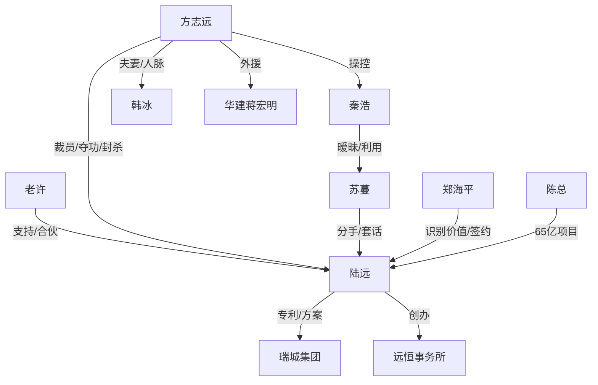

# 角色标签图谱

## 角色清单

### 陆远 — 冷静技术大佬/被裁反杀者
- 叙事功能: 主角、价值被低估者、证据链掌控者。
- 核心标签: 技术硬核、克制、规则反杀。
- 弧光: 抱纸箱离职 → 个人专利被重估 → 创办远恒 → 集团掌舵人。
- 台词风格: 短、冷、事实优先。
- 关键行为: 拒绝续约、签瑞城、创远恒、公开证据、拒绝方总分包。
- 读者情绪关系: 心疼、爽、敬佩。

### 方志远/方总 — 贪功老板/规则操盘者反被规则碾压
- 叙事功能: 主反派，持续制造压迫和反扑。
- 核心标签: 贪功、算计、人脉迷信。
- 弧光: 裁员夺功 → 封杀压价 → 行业围堵 → 公开崩塌 → 破产求活。
- 台词风格: 威胁、说教、利益诱导。
- 关键行为: 裁掉陆远、删名、诱签竞业、卡资质、拉华建、现场诬告。
- 读者情绪关系: 恨、厌恶、最终看他坠落获得爽感。

### 秦浩 — 窃位同事/能力空心人
- 叙事功能: 方总的执行工具，衬托陆远不可替代。
- 核心标签: 冒领、无能、墙头草。
- 弧光: 接替陆远位置 → 评审露怯 → 假求职录音 → 失业转行。
- 台词风格: 圆滑、试探、底气不足。
- 关键行为: 接项目、和苏蔓暧昧、带录音设备面试。
- 读者情绪关系: 轻蔑、解气。

### 老许/许国良 — 行业老友/见证者
- 叙事功能: 信息通道、团队基石、情绪陪衬。
- 核心标签: 仗义、老练、懂行。
- 弧光: 恒创内部提醒者 → 远恒合伙骨干 → 集团副总裁。
- 台词风格: 直白、带江湖经验。
- 关键行为: 爆料、发截图、加入远恒、协助项目推进。
- 读者情绪关系: 信任、温暖。

### 周正国 — 甲方项目管理者/规则执行者
- 叙事功能: 引出专利反转，提供合法合作通道。
- 核心标签: 专业、谨慎、讲规则。
- 弧光: 核实主创 → 推动瑞城转向陆远 → 长期合作。
- 台词风格: 商务、清楚、压迫感低。
- 关键行为: 电话找陆远、会议确认授权、持续对接。
- 读者情绪关系: 安心、助攻爽。

### 郑海平 — 瑞城董事长/价值识别者
- 叙事功能: 权力背书和项目资源提供者。
- 核心标签: 果断、识人、重结果。
- 弧光: 当场终止恒创 → 支持陆远组队 → 长期签约。
- 台词风格: 少而重。
- 关键行为: 展示评估报告、签框架协议、奠基仪式递水。
- 读者情绪关系: 爽点放大器。

### 苏蔓 — 势利前女友/旧情断点
- 叙事功能: 私人背叛线，补充主角低谷。
- 核心标签: 摇摆、现实、被利用。
- 弧光: 裁员后冷静分手 → 与秦浩暧昧 → 被方总利用套话 → 被识破。
- 台词风格: 试探、委婉、回避核心。
- 关键行为: 发日料朋友圈、提冷静、假复合套话。
- 读者情绪关系: 失望、轻蔑。

### 韩冰 — 协会人脉/夫人权力线
- 叙事功能: 扩展方总的人脉压迫，最终婚姻反噬。
- 核心标签: 势利、圈层打压、虚伪体面。
- 弧光: 沙龙和协会贬低陆远 → 被事实打脸 → 离婚撤离。
- 台词风格: 阴阳怪气、圈层话术。
- 关键行为: 卡资质舆论、沙龙贬低、离婚电话。
- 读者情绪关系: 厌恶、解气。

## 关系网络

## 角色功能对照表（供改编参考）

| 原角色 | 极致标签 | 叙事功能 | 读者情绪功能 | 改编时必须保留的 |
|--------|---------|---------|-------------|---------------|
| 陆远 | 冷静技术大佬 | 被夺功者与反杀者 | 心疼→爽 | 专属硬资产/专利/不可替代能力 |
| 方总 | 贪功老板 | 主压迫源 | 恨与报应期待 | 夺功、封杀、低价诱回、公开反扑 |
| 秦浩 | 窃位草包 | 替代者反衬 | 轻蔑 | 占位但不懂核心技术 |
| 老许 | 忠诚老友 | 信息与团队支撑 | 安心 | 关键截图/内部消息/跟随创业 |
| 瑞城方 | 规则甲方 | 权威背书 | 爽点放大 | 用文件和项目选择主角 |
| 苏蔓 | 势利旧爱 | 私人背叛 | 断情爽 | 低谷分手，后期套话失败 |
