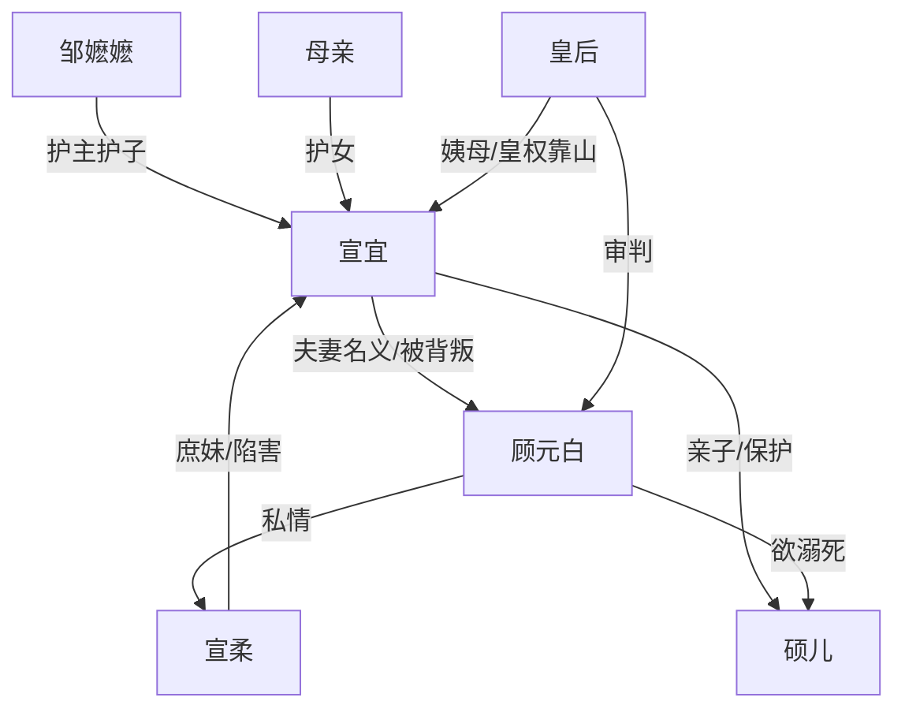

# 角色标签图谱

## 角色清单

### 宣宜 — 重生清醒主母
- 叙事功能: 第一视角复仇者，承担受害、布证、清算、补偿全链路。
- 核心标签: 清醒、隐忍、护子
- 弧光: 临终被骗一生 → 重生保子布证 → 当众清算顾家
- 台词风格: 冷、短、带审判感
- 关键行为: 买通接生嬷嬷、换回亲子、满月宴引皇后见证、公开族谱与证人。
- 读者情绪关系: 心疼她前世被夺一切，爽于她今生精准复仇。

### 顾元白 — 伪深情陈世美
- 叙事功能: 核心施害者，制造婚姻背叛、换子、杀婴、名分夺取。
- 核心标签: 伪君子、薄情、攀附
- 弧光: 尽在掌握 → 当众败露 → 跪求活命 → 赐死
- 台词风格: 前期温柔哄骗，后期威胁狡辩，末期哀求。
- 关键行为: 换子、掐死亲子、杖责乳母与岳母、要溺死硕儿、伪造族谱名分。
- 读者情绪关系: 极强恨点，最终被骂名和皇权清算带来爽感。

### 宣柔 — 白莲庶妹/反噬情妇
- 叙事功能: 前期陷害女主，后期爆料反咬顾元白。
- 核心标签: 白莲、嫉恨、失控
- 弧光: 装柔弱夺子 → 发现亲子被杀 → 与顾元白互咬 → 疯癫死亡
- 台词风格: 前期“姐姐”式委屈，后期撕裂控诉。
- 关键行为: 假摔陷害、争抢孩子、揭露婚前私情和避孕汤药。
- 读者情绪关系: 前期恨，后期作为反噬工具带来补充爽感。

### 硕儿 — 被夺回的亲子
- 叙事功能: 情绪债核心载体，女主复仇的正当性与补偿对象。
- 核心标签: 无辜、嫡子、未来
- 弧光: 前世被害 → 今生被换回 → 险被溺死 → 归入宣家
- 台词风格: 婴儿无台词，以哭声和伤痕制造心疼。
- 关键行为: 无，作为被争夺对象推动所有冲突升级。
- 读者情绪关系: 心疼、保护欲、期待补偿。

### 邹嬷嬷 — 忠仆/牺牲者
- 叙事功能: 加重顾元白罪孽，替女主与孩子挡灾。
- 核心标签: 忠诚、年迈、牺牲
- 弧光: 护主护子 → 被家法打死
- 台词风格: 急切护主
- 关键行为: 传报孩子被抱走，死前提醒女主救孩子。
- 读者情绪关系: 心疼与愤怒，抬高顾元白必死合理性。

### 宣宜母亲 — 诰命母亲/护女者
- 叙事功能: 家族靠山与二次情绪债载体。
- 核心标签: 护女、尊贵、刚烈
- 弧光: 赶来护女 → 被绑受刑 → 得救
- 台词风格: 直骂、刚硬
- 关键行为: 当众揭顾元白苟且，受刑不屈。
- 读者情绪关系: 心疼、敬重、期待顾元白偿债。

### 皇后姨母 — 皇权审判者
- 叙事功能: 将私宅内斗升级为国家法度清算。
- 核心标签: 威严、护短、公正
- 弧光: 卡点入场 → 救人 → 查证 → 推动圣旨
- 台词风格: 威压强，短句命令。
- 关键行为: 带禁卫入场，查看族谱，救下宣家母女与硕儿。
- 读者情绪关系: 安全感和爽点放大器。

## 关系网络

## 角色功能对照表（供改编参考）

| 原角色 | 极致标签 | 叙事功能 | 读者情绪功能 | 改编时必须保留的 |
|--------|---------|---------|-------------|---------------|
| 宣宜 | 重生清醒主母 | 布局复仇 | 心疼转爽 | 前世惨死、今生护子、证据反杀 |
| 顾元白 | 伪深情陈世美 | 核心施害 | 强恨点 | 温柔面具与残忍行为并存 |
| 宣柔 | 白莲庶妹 | 陷害与反噬 | 恨点+爆料爽点 | 假柔弱、夺子、后期互咬 |
| 硕儿 | 被夺亲子 | 情绪债载体 | 保护欲 | 前世被害/今生险死/最终补偿 |
| 皇后 | 皇权审判者 | 降临清算 | 安全感 | 公开见证与权力压制 |
