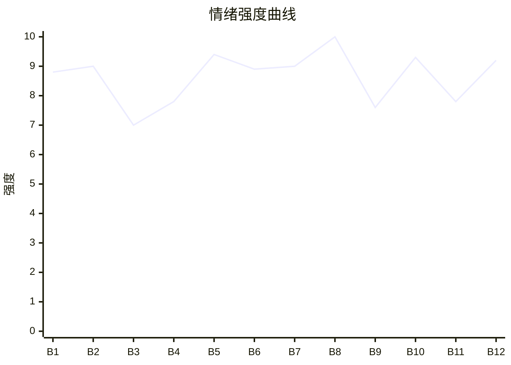

# Beat Sheet 节拍器

## 全文概况

- 总字数: 约 15500 字
- 节拍数: 12 幕
- 核心母题（Logline）: 女主沈甜在婚礼上被未婚夫和女兄弟公开羞辱，为守住尊严离场，却接连发现八年爱情的骗局、职业被毁、奶奶因救命钱被刷走而死，最终在男主悔恨哀求时选择新生活。
- 情绪模式: 极致羞辱 → 旧爱回忆 → 真相刺穿 → 二次加害 → 亲人死亡 → 男主追悔 → 女主不回头

## 节拍详表

### Beat 1: 婚礼抢婚当真 [开篇-第1章前段]
- **字数**: 约 1200 字（占比 7.7%）
- **核心事件**: 楚窈窈抢到手捧花，当众向谢与光“求婚”，女主拿话筒宣布当真。
- **情绪标签**: 震惊、羞辱、冷醒
- **情绪强度**: 8.8/10
- **情绪方向**: ⚡突变
- **冲突类型**: 大转折
- **悬念钩子**: 女主当真后，婚礼如何收场？
- **叙事速度**: 快
- **对话占比**: 65%
- **reversal_mechanism**: [M3, M5]
- **hook_strength**: 9.0/10（极端度 2.6/3，信息密度 2.8/3，悬念尖锐度 1.8/2，节奏利落度 1.8/2）
- **关键句**: “不是要抢婚吗，我当真了。”
- **原文摘录**: 婚礼上，我抛出的手捧花被谢与光的女兄弟抢到了。她挑眉，“我是不是得求个婚？”“谢与光，跟兄弟走不？”伴郎们起哄“亲一个”，还爆出昨晚单身派对“埋过胸，抱着睡一张床”。谢与光说“闹什么，我媳妇还在这呢”，耳根却红了。楚窈窈说“小媳妇要气哭咯”。谢与光刮我鼻尖：“乖，开个玩笑而已，别那么小气。”我拿过话筒：“不是要抢婚吗，我当真了。”三天后，他在民政局前红了眼，而我再也没有回头。

### Beat 2: 婚礼现场围剿 [第1章中后段]
- **字数**: 约 1400 字（占比 9.0%）
- **核心事件**: 谢家、伴郎、楚窈窈共同把越界包装成玩笑，谢与光威胁换新娘。
- **情绪标签**: 憋屈、愤怒、失望
- **情绪强度**: 9.0/10
- **情绪方向**: ↑上升
- **冲突类型**: 大转折
- **悬念钩子**: 谢与光真会换新娘吗？
- **叙事速度**: 快
- **对话占比**: 55%
- **reversal_mechanism**: [M3]
- **hook_strength**: null
- **关键句**: “今天你要是敢走，这个婚礼立马就能换个新娘！”
- **原文摘录**: 谢与光拉住我，责问“窈窈就开个玩笑，你至于吗？”我质问“埋胸、抱着睡一张床也是开玩笑吗？”谢与光夺话筒警告我闭嘴。楚窈窈用“两岁洗澡”把越界轻飘飘带过。谢母说楚窈窈才是属意儿媳，嫌我小门小户、没有家教。女主想起父母当年为救谢与光去世。楚窈窈假意要走，谢与光追上去抱住她，反过来责怪我把人气走。我摘下婚戒：“她不用走，我走。”谢与光怒道婚礼能立刻换新娘。

### Beat 3: 出走与旧爱滤镜 [第2章前中段]
- **字数**: 约 1300 字（占比 8.4%）
- **核心事件**: 女主离开婚礼，在出租车上回忆谢与光八年来的帮助和爱意。
- **情绪标签**: 茫然、心痛、怀旧
- **情绪强度**: 7.0/10
- **情绪方向**: ↓下降
- **冲突类型**: 微冲突
- **悬念钩子**: 这么深的羁绊为何会走到婚礼崩盘？
- **叙事速度**: 中
- **对话占比**: 20%
- **reversal_mechanism**: [M5]
- **hook_strength**: null
- **关键句**: “阳光下，他白金色的头发闪着光，就这样强势地闯入我的世界。”
- **原文摘录**: 我提裙奔出宴会厅，坐上出租车，却不知道能去哪。父母去世、奶奶车祸、高额赔偿时，是谢与光塞给我银行卡；他让女主假扮女友，三年里女主追着还钱，照顾他飙车受伤、滑雪断腿。奶奶大雪走失时，他发动上万人寻找，把奶奶送去医院。女主第一次没有反驳“女朋友”称呼。这段回忆抬高了爱情正峰，也让后续崩塌更痛。

### Beat 4: 接亲群视频刺穿 [第2章后段]
- **字数**: 约 800 字（占比 5.2%）
- **核心事件**: 女主看到楚窈窈顶替自己敬酒，决定去查谢与光藏的箱子。
- **情绪标签**: 冷却、怀疑、决断
- **情绪强度**: 7.8/10
- **情绪方向**: ↑上升
- **冲突类型**: 微冲突
- **悬念钩子**: 箱子里到底是什么“惊喜”？
- **叙事速度**: 快
- **对话占比**: 10%
- **reversal_mechanism**: [M6]
- **hook_strength**: null
- **关键句**: “有件事，我必须弄清楚。”
- **原文摘录**: 昨晚谢与光在奶奶床前承诺爱我一辈子，可手机里伴郎发来视频：楚窈窈穿红金旗袍，挽着谢与光给宾客敬酒。群里起哄“般配”“直接领证气死某人”。女主关机，屏幕映出冰冷的脸，改去君庭别苑查谢与光藏起来的箱子。

### Beat 5: 箱子真相与父母之死 [第3章前中段]
- **字数**: 约 1500 字（占比 9.7%）
- **核心事件**: 女主打开箱子，发现楚窈窈才是谢与光多年挚爱，父母之死源于他告白失败后醉酒落海。
- **情绪标签**: 崩塌、荒唐、愤怒
- **情绪强度**: 9.4/10
- **情绪方向**: ⚡突变
- **冲突类型**: 大转折
- **悬念钩子**: 谢与光会选择女主还是楚窈窈？
- **叙事速度**: 中快
- **对话占比**: 45%
- **reversal_mechanism**: [M5, M6]
- **hook_strength**: null
- **关键句**: “我失去了爸妈，又被他骗了八年！”
- **原文摘录**: 女主试谢与光生日、纪念日、自己生日都打不开箱子，输入楚窈窈生日却开了。里面是相册、十把跑车钥匙、项链。照片背后写着“此生挚爱，愿你璀璨”，日期正是女主父母去世那天。谢与光承认喜欢过楚窈窈，告白失败后在海边喝醉被浪卷走。女主意识到父母两条命源自这场荒唐暗恋，也意识到谢与光是因愧疚才接近自己。

### Beat 6: 拉黑失败与囚禁 [第3章后段]
- **字数**: 约 1200 字（占比 7.7%）
- **核心事件**: 谢与光刚烧相册、拉黑楚窈窈，接到电话后立刻反咬女主网暴，并关押她清手机。
- **情绪标签**: 窒息、荒谬、恐惧
- **情绪强度**: 8.9/10
- **情绪方向**: ↑上升
- **冲突类型**: 大转折
- **悬念钩子**: 女主被关一夜后会发生什么？
- **叙事速度**: 快
- **对话占比**: 50%
- **reversal_mechanism**: [M3]
- **hook_strength**: null
- **关键句**: “你先冷静一晚，明天我会让保姆放你出来。”
- **原文摘录**: 谢与光烧掉相册，称以后不再联系楚窈窈，又当面拉黑删除。可楚窈窈电话打来，他说最后一次做了断。三分钟后他回来，指责女主上传抢手捧花视频害楚窈窈被骂“汉子茶”。他要女主发道歉声明，承认嫉妒污蔑。女主拒绝后，他抢走手机，清空相册，把女主扛进储物间，关到第二天。

### Beat 7: 假证网暴与职业被毁 [第4章前段]
- **字数**: 约 1100 字（占比 7.1%）
- **核心事件**: 女主出来后发现谢与光晒假结婚证、AI 换脸反咬，学校将她辞退。
- **情绪标签**: 眩晕、愤怒、屈辱
- **情绪强度**: 9.0/10
- **情绪方向**: ↑上升
- **冲突类型**: 大转折
- **悬念钩子**: 职业被毁后，女主还会失去什么？
- **叙事速度**: 快
- **对话占比**: 35%
- **reversal_mechanism**: [M3, M6]
- **hook_strength**: null
- **关键句**: “当沈老师哪有当谢太太舒服。”
- **原文摘录**: 女主开机后满屏电话短信。热搜第一是谢与光晒假结婚证和童年合照，宣称“青梅竹马，如愿以偿”。热搜第二是“女教师承认因嫉妒 ai 换脸”。视频把女主和楚窈窈的脸调换，网民骂她小三、不配当老师。教务处来电辞退女主。谢与光却说“不正好？我又不是养不起你”，还提到要孩子。

### Beat 8: 奶奶死亡情绪核爆 [第4章中后段]
- **字数**: 约 1700 字（占比 11.0%）
- **核心事件**: 奶奶急救需 50 万，谢与光冻结副卡并刷走女主工资卡给楚窈窈买包，奶奶错过黄金窗口期去世。
- **情绪标签**: 绝望、崩溃、恨
- **情绪强度**: 10.0/10
- **情绪方向**: ⚡突变
- **冲突类型**: 大转折
- **悬念钩子**: 谢与光知道真相后会怎样？
- **叙事速度**: 极快
- **对话占比**: 40%
- **reversal_mechanism**: [M3, M5, M6]
- **hook_strength**: null
- **关键句**: “谢与光，那是我奶奶的救命钱！”
- **原文摘录**: 医院通知奶奶脑血瘤破裂，特效抑制剂一针 50 万，黄金窗口只剩三分钟。女主先刷副卡，被告知冻结；再刷自己工资卡，余额不足。谢与光来电说为庆祝楚窈窈夺冠，买包刷了女主的卡，“就当是你送窈窈的礼物”。女主嘶吼那是奶奶救命钱，谢与光嗤笑“小家子气”。护士说“请节哀”，奶奶盖白布被推出手术室。

### Beat 9: 谢与光归家落空 [第4章末-第5章]
- **字数**: 约 1700 字（占比 11.0%）
- **核心事件**: 谢与光赶回家准备哄女主领证，却发现女主消失，仍笃定她会来民政局。
- **情绪标签**: 讽刺、期待反噬、隐隐不安
- **情绪强度**: 7.6/10
- **情绪方向**: ↓下降后↑
- **冲突类型**: 微冲突
- **悬念钩子**: 民政局等待会不会落空？
- **叙事速度**: 中
- **对话占比**: 20%
- **reversal_mechanism**: [M5]
- **hook_strength**: null
- **关键句**: “我一定会来。谢与光无比笃定。”
- **原文摘录**: 谢与光在巴黎庆功宴上还笑着说 AI 换脸、假证都是为了让楚窈窈参赛，自己得回去哄媳妇。回家后发现早餐凉了、床没睡过、饭菜两天没动。他发消息威胁五分钟不回就让假证变真，随后又去民政局等女主。他骑上初见时的机车，回忆自己第一次为女主停下，拍民政局自拍，笃定女主一定会来。

### Beat 10: 男主得知奶奶死讯 [第6章]
- **字数**: 约 1600 字（占比 10.3%）
- **核心事件**: 谢与光等到民政局关门，看到医院视频，确认奶奶因付款失败去世，开始恐慌。
- **情绪标签**: 迟来的恐惧、懊悔、崩塌
- **情绪强度**: 9.3/10
- **情绪方向**: ⚡突变
- **冲突类型**: 大转折
- **悬念钩子**: 女主去了哪里？男主如何面对她？
- **叙事速度**: 快
- **对话占比**: 35%
- **reversal_mechanism**: [M5, M6]
- **hook_strength**: null
- **关键句**: “心里最后一丝侥幸被掐灭。”
- **原文摘录**: 民政局关门女主未出现。伴郎发来医院视频，年轻女人穿婚纱跌坐缴费窗口，医护推着白布担架说“赵云秀家属，请节哀”。谢与光赶到医院，医生确认赵云秀昨天去世，原因是卡被冻结、支付不了特效抑制剂，错过黄金窗口期。谢与光意识到自己“临时借用”女主卡的钱，正好害死奶奶，恐慌地打电话却变成空号。

### Beat 11: 南城疗伤与新家感 [第7章]
- **字数**: 约 1500 字（占比 9.7%）
- **核心事件**: 女主带奶奶骨灰回南城，遇见陆承舟，被一顿糖醋排骨重新托住。
- **情绪标签**: 哀伤、温暖、被接住
- **情绪强度**: 7.8/10
- **情绪方向**: ↓下降后缓升
- **冲突类型**: 微冲突
- **悬念钩子**: 谢与光会撞见女主被别人安慰吗？
- **叙事速度**: 慢
- **对话占比**: 30%
- **reversal_mechanism**: [M5]
- **hook_strength**: null
- **关键句**: “直到筷子夹起排骨放入口中，世界才又重新活了过来。”
- **原文摘录**: 南城回南天，女主抱着奶奶骨灰盒回老楼，想起奶奶为她拖干台阶。她失去亲人、爱人、事业，靠门坐下。陆承舟出现，请她去家里，做糖醋排骨。他记得她小时候爱吃，也记得父亲教他的味道。女主从饭里感到家的感觉。奶奶下葬那天，木棉花开，陆承舟陪她送最后一程。谢与光撞见他抱住女主。

### Beat 12: 派出所清算与最终拒绝 [第8章-全文完]
- **字数**: 约 2700 字（占比 17.4%）
- **核心事件**: 谢与光殴打陆承舟，被女主在派出所逐条清算；一月后哀求复合，女主彻底拒绝并开启新生活。
- **情绪标签**: 痛快、清醒、释然
- **情绪强度**: 9.2/10
- **情绪方向**: ↑上升后平稳
- **冲突类型**: 大转折
- **悬念钩子**: 无，完成闭环
- **叙事速度**: 中快
- **对话占比**: 55%
- **reversal_mechanism**: [M3, M5, M6]
- **hook_strength**: null
- **关键句**: “我家人的三条命，你拿什么还？”
- **原文摘录**: 谢与光冲来打陆承舟，质问女主有没有心。女主冷回他已和楚窈窈领证。派出所里，女主拿热搜假证给警察看，谢与光辩称是假证。女主逐条说出 AI 换脸、刷卡买包、害奶奶抢救不及时去世、引导网友害她失业，并点明“十年前我爸妈为了救你丢了命。十年后，你又害死了我奶奶。”谢与光崩溃道歉。一个月后他再求复合，女主说三条命横亘在中间，自己无法原谅，最终头也不回走向新生活。

## 情绪曲线可视化

## 节拍密度检测

- 平均每 1290 字一个节拍
- 微冲突密度: 每约 1900 字一次
- 大转折密度: 每约 1550 字一次
- 判定: 符合高频节拍器标准；情绪转折略偏密，适合短篇追读。

## 反转机制清单(Reversal Mechanisms)

从 prompts/patterns/reversal-mechanisms.md 的 8 大机制中命中以下机制:

| 机制 ID | 机制名 | 承载 Beat | 关键段落/金句 | 等价改编提示 |
|--------|--------|-----------|--------------|-------------|
| M3 | 因果回旋反讽 | Beat 1-2, Beat 6-8, Beat 12 | “不是要抢婚吗，我当真了。” / “我家人的三条命，你拿什么还？” | 施害者的轻飘飘规则必须被女主原样反打：玩笑变当真，假证变寻衅证据，刷卡变人命债。 |
| M5 | 温度反转曲线 | Beat 3, Beat 5, Beat 8-12 | “我一定会来。谢与光无比笃定。”到“他已经永远地失去了我。” | 必须保留正峰旧爱、归零背叛、负值悔恨三段，男主不能突然悔悟成功。 |
| M6 | 多层递进反转 | Beat 4-5, Beat 7-8, Beat 10, Beat 12 | 箱子真相、AI 假证、奶奶死亡、派出所清算 | 层数不能少：情感反转 → 舆论/职业反转 → 人命反转 → 价值观反转。 |
