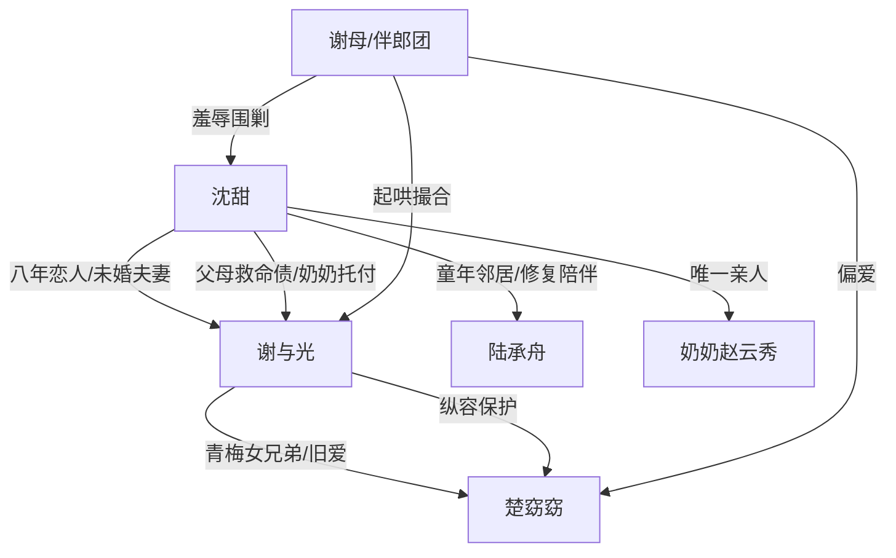

# 角色标签图谱

## 角色清单

### 沈甜 — 清醒断爱女主
- 叙事功能: 承受羞辱与失去，最终完成道德清算和自我重建。
- 核心标签: 重情、清醒、底线感强
- 弧光: 期待婚礼的新娘 → 被连续剥夺的受害者 → 不回头的新生者
- 台词风格: 短句质问，结尾冷静清算
- 关键行为: 当真抢婚、查箱子、拒绝道歉声明、报警、最终拒绝复合
- 读者情绪关系: 心疼、代入、爽

### 谢与光 — 迟钝傲慢追妻火葬场男主
- 叙事功能: 制造核心伤害，并在后半段承担悔恨与失去。
- 核心标签: 自以为是、拎不清、迟来深情
- 弧光: 笃定女主不会走 → 伤害升级 → 真相砸脸 → 永久失去
- 台词风格: 轻慢安抚、威胁、后期哀求
- 关键行为: 纵容抢婚、藏楚窈窈相册、AI 换脸、刷走救命钱、民政局空等
- 读者情绪关系: 恨、憋屈、后期看他崩溃获得爽感

### 楚窈窈 — 汉子茶女兄弟/越界青梅
- 叙事功能: 引爆婚礼冲突，持续挑衅并诱发谢与光选择错误。
- 核心标签: 轻佻、挑衅、被偏爱
- 弧光: 抢手捧花挑衅 → 被保护参赛 → 继续污蔑女主
- 台词风格: 玩笑包装攻击，茶味强
- 关键行为: 抢花求婚、婚礼敬酒、电话反咬、群里嘲讽奶奶死讯
- 读者情绪关系: 恨、厌恶

### 陆承舟 — 温柔竹马/修复型男二
- 叙事功能: 提供“家”的补偿和新生活秩序，反衬谢与光的伤害。
- 核心标签: 温柔、稳、克制
- 弧光: 旧邻居重逢 → 做饭陪伴 → 保护女主 → 帮她重建生活
- 台词风格: 少问多做，温和坚定
- 关键行为: 收留女主、做糖醋排骨、陪下葬、挡下拳头、推荐工作
- 读者情绪关系: 安慰、补偿、信任

### 奶奶赵云秀 — 亲情锚点/情绪核爆载体
- 叙事功能: 连接女主过去创伤、婚姻承诺和最终不可原谅的死亡债。
- 核心标签: 慈爱、清醒片刻、苦命
- 弧光: 婚前托付 → 急救失败 → 骨灰归乡
- 台词风格: 温柔朴素
- 关键行为: 握住两人手、拒绝两千万感谢费、童年为女主拖干台阶
- 读者情绪关系: 心疼、愤怒引爆点

### 谢母/伴郎团 — 群体压迫者
- 叙事功能: 扩大羞辱场，证明男主伤害不是偶发，而是圈层共犯。
- 核心标签: 势利、起哄、无边界
- 弧光: 婚礼起哄 → 群聊嘲讽 → 推动舆论伤害
- 台词风格: 刻薄、轻浮、看热闹
- 关键行为: 起哄亲吻、爆单身派对、贬低女主出身、传播视频
- 读者情绪关系: 厌恶、助推复仇期待

## 关系网络

## 角色功能对照表（供改编参考）

| 原角色 | 极致标签 | 叙事功能 | 读者情绪功能 | 改编时必须保留的 |
|--------|---------|---------|-------------|---------------|
| 沈甜 | 清醒断爱女主 | 承债与清算 | 心疼+爽 | 不回头、不原谅、有职业热爱 |
| 谢与光 | 迟钝傲慢男主 | 制造伤害与悔恨 | 恨+看火葬场 | 轻慢话术、迟来崩溃、失去不可逆 |
| 楚窈窈 | 汉子茶女兄弟 | 引爆越界 | 厌恶 | 玩笑包装、公开挑衅、被男主优先保护 |
| 陆承舟 | 温柔竹马 | 情感补偿 | 安全感 | 少说多做、家感、克制守护 |
| 奶奶 | 亲情锚点 | 情绪核爆 | 心疼 | 死亡必须由男主行为间接导致 |
