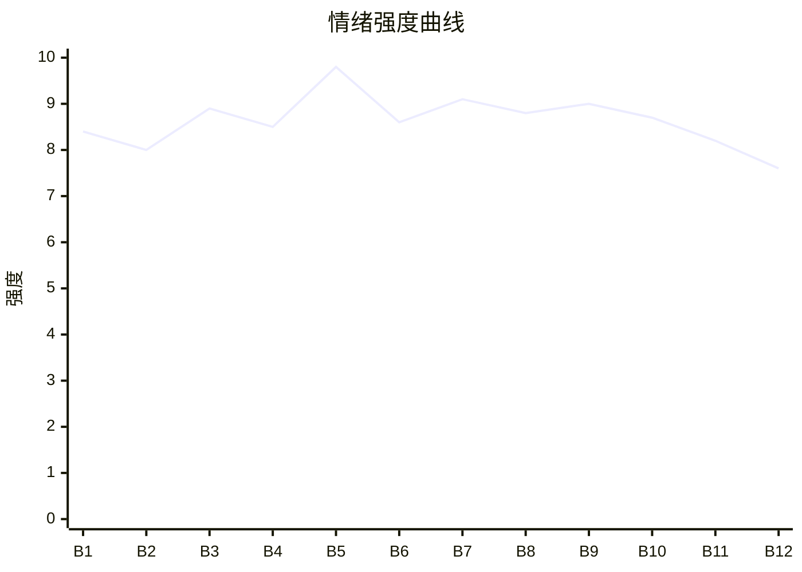

# Beat Sheet 节拍器

## 全文概况

- 总字数: 约 10300 字
- 节拍数: 12 幕
- 核心母题（Logline）: 林雨桐在父亲临终时被未婚夫反复抛下，为了守住父亲与自尊，退婚离开，并让迟来的真相把偏心者压垮。
- 情绪模式: 极致打压 → 临终缺席触底 → 恩情真相揭露 → 迟来悔恨清算 → 女主自我重建

## 节拍详表

### Beat 1: 视频暴击与未婚夫缺席 [开篇-章1前半]
- **字数**: 约 850 字（占比 8.3%）
- **核心事件**: 女主返乡探望病危父亲，刷到未婚夫护送白月光三百公里的视频。
- **情绪标签**: 震惊、恶心、背叛
- **情绪强度**: 8.4/10
- **情绪方向**: ⚡突变
- **冲突类型**: 大转折
- **悬念钩子**: 周牧言到底是忙，还是故意抛下她？
- **叙事速度**: 快
- **对话占比**: 30%
- **reversal_mechanism**: [M5]
- **hook_strength**: 8.7/10（极端度 2.6，信息密度 2.8，悬念 1.7，节奏 1.6）
- **关键句**: “却有时间，去给他的白月光，当了三百公里的护花使者。”
- **原文摘录**: 父亲重病，女主独自开车五百公里回老家；刷到沈知意视频：“新手期第一天上路，前男友跟了我整整三百公里”；车牌指向周牧言；他早上以公司项目为由取消同行，却此时发来“高速堵吗？路上注意安全”。

### Beat 2: 咖啡腕表与顺路谎言 [章1后半]
- **字数**: 约 900 字（占比 8.7%）
- **核心事件**: 沈知意继续晒证据，周牧言用“顺路”搪塞，女主赶到医院。
- **情绪标签**: 憋屈、心冷、危险
- **情绪强度**: 8.0/10
- **情绪方向**: ↓下降
- **冲突类型**: 微冲突
- **悬念钩子**: 父亲能否撑到周牧言来？
- **叙事速度**: 快
- **对话占比**: 38%
- **reversal_mechanism**: [M3, M5]
- **hook_strength**: null
- **关键句**: “顺路三百公里吗？周牧言。”
- **原文摘录**: 女主看到沈知意晒服务区咖啡和周牧言腕表；医生催她尽快赶到；她差点错过出口；周牧言电话第一句不是关心父亲，而是问她是否看见网上视频，并说“她今天第一次跑长途，我只是顺路”。

### Beat 3: 抢救室外的羞辱与救命钱被刷空 [章2]
- **字数**: 约 1050 字（占比 10.2%）
- **核心事件**: 父亲抢救，周牧言陪沈知意；治疗费紧急，副卡被沈知意酒店消费刷空。
- **情绪标签**: 羞辱、绝望、愤怒
- **情绪强度**: 8.9/10
- **情绪方向**: ↓下降
- **冲突类型**: 大转折
- **悬念钩子**: 女主如何凑齐父亲救命钱？
- **叙事速度**: 中快
- **对话占比**: 42%
- **reversal_mechanism**: [M3, M5]
- **hook_strength**: null
- **关键句**: “女士，不好意思，这张卡的额度昨晚已经被刷空了。”
- **原文摘录**: 抢救室红灯亮起，亲戚追问周牧言；视频里沈知意装委屈，周牧言说不能丢下她；医生要求签字缴费；婚礼尾款被周牧言挪走，副卡又被温泉酒店消费刷空；沈知意发来好友申请。

### Beat 4: 白月光软刀与医院楼下施压 [章3]
- **字数**: 约 950 字（占比 9.2%）
- **核心事件**: 沈知意发照片示弱炫耀，周牧言姗姗来迟，却要求女主“别闹”。
- **情绪标签**: 恶心、清醒、孤立
- **情绪强度**: 8.5/10
- **情绪方向**: →平稳高压
- **冲突类型**: 微冲突
- **悬念钩子**: 周牧言会在父亲面前如何表演？
- **叙事速度**: 中
- **对话占比**: 45%
- **reversal_mechanism**: [M5]
- **hook_strength**: null
- **关键句**: “她每个字都像一把裹着棉花的软刀子。”
- **原文摘录**: 沈知意道歉并发周牧言递药照片；周牧言只转一部分钱；沈知意晒卡地亚；表姐借钱赶来；周牧言到医院楼下，不愿上楼被亲戚盘问，递银行卡说“别闹了”。

### Beat 5: 临终等候与彻底触底 [章4]
- **字数**: 约 1250 字（占比 12.1%）
- **核心事件**: 周牧言在父亲面前演体贴，转身斥责女主；沈知意来电后他离开，父亲临终未等到他。
- **情绪标签**: 绝望、心死、冷静
- **情绪强度**: 9.8/10
- **情绪方向**: ↓下降至谷底
- **冲突类型**: 大转折
- **悬念钩子**: 父亲留下的旧信封里是什么？
- **叙事速度**: 中快
- **对话占比**: 43%
- **reversal_mechanism**: [M5, M6]
- **hook_strength**: null
- **关键句**: “他最后一直看着病房门口的方向，像还在等那个答应过会陪我一起回来的女婿。”
- **原文摘录**: 父亲把女主的手交到周牧言手里；周牧言出门即质问“现在满意了吗”；沈知意称药物过敏，周牧言甩开女主赶去；父亲凌晨一点零三分离开；女主摘下订婚戒指，护士递来父亲旧信封。

### Beat 6: 葬礼对峙与救命恩人伏笔 [章5]
- **字数**: 约 1050 字（占比 10.2%）
- **核心事件**: 周牧言葬礼迟到，沈知意装无辜；旧照片揭出父亲曾救周母。
- **情绪标签**: 荒唐、冷笑、期待反杀
- **情绪强度**: 8.6/10
- **情绪方向**: ↑上升
- **冲突类型**: 大转折
- **悬念钩子**: 周家知道父亲是救命恩人后会怎样？
- **叙事速度**: 中
- **对话占比**: 40%
- **reversal_mechanism**: [M6]
- **hook_strength**: null
- **关键句**: “救了她的人，是我父亲。”
- **原文摘录**: 周牧言问“为什么不告诉我”；女主回“我告诉过你”；沈知意在灵堂道歉，表姐揭穿朋友圈；旧报纸和照片显示父亲曾从车祸中救出周母陈婉清。

### Beat 7: 车站真相爆发与第一次清算 [章6]
- **字数**: 约 950 字（占比 9.2%）
- **核心事件**: 周母认出旧照片，周牧言得知林父是周家恩人，女主用“不信”戳穿他。
- **情绪标签**: 痛快、冷峻、不可挽回
- **情绪强度**: 9.1/10
- **情绪方向**: ↑上升
- **冲突类型**: 大转折
- **悬念钩子**: 周牧言是否还会选择沈知意？
- **叙事速度**: 快
- **对话占比**: 50%
- **reversal_mechanism**: [M3, M6]
- **hook_strength**: null
- **关键句**: “你不是不知道我爸病重。你只是不信。”
- **原文摘录**: 周牧言拦住女主求机会；周母赶到并认出照片；周牧言惨白，明白父亲等的是女婿也是恩人后代；女主说“你欠他的，已经没机会还了”；沈知意再来电，女主拉黑周牧言。

### Beat 8: 退婚文件与资金真相 [章7]
- **字数**: 约 1050 字（占比 10.2%）
- **核心事件**: 女主搬出婚房，摆出解除婚约协议与资金明细，揭开父亲暗中资助周牧言。
- **情绪标签**: 清算、压垮、讽刺
- **情绪强度**: 8.8/10
- **情绪方向**: ↑上升
- **冲突类型**: 大转折
- **悬念钩子**: 沈知意的人设会不会塌？
- **叙事速度**: 中
- **对话占比**: 42%
- **reversal_mechanism**: [M6]
- **hook_strength**: null
- **关键句**: “他引以为傲的、白手起家的事业，背后竟然有他最看不起的、我那个小县城父亲的支撑。”
- **原文摘录**: 女主留婚纱和退婚协议；周牧言质问“就因为这一次”；女主展示公司垫资、婚房首付、父亲五十万转账；沈知意出现，助理来电称视频被扒并非偶遇。

### Beat 9: 白月光人设坍塌与“我说过”回旋 [章8]
- **字数**: 约 1150 字（占比 11.2%）
- **核心事件**: 网上扒出沈知意设局，周牧言回忆过去多次忽视女主求助，周母当面质问沈知意。
- **情绪标签**: 反讽、迟来崩溃、痛快
- **情绪强度**: 9.0/10
- **情绪方向**: ↑上升
- **冲突类型**: 大转折
- **悬念钩子**: 女主身体问题会成为周牧言下一层悔恨吗？
- **叙事速度**: 中快
- **对话占比**: 36%
- **reversal_mechanism**: [M3, M6]
- **hook_strength**: null
- **关键句**: “我说过。是你自己，嫌我小题大做。”
- **原文摘录**: 网友扒出沈知意并非新手；她故意同日出发，诱导周牧言选择她；周牧言拿证据求女主相信自己被骗；女主说“可结果就是，你缺席了”；周母质问沈知意；周牧言看到女主体检复查单。

### Beat 10: 病痛补刀与现实代价 [章9]
- **字数**: 约 950 字（占比 9.2%）
- **核心事件**: 周牧言得知女主病痛与父亲去世夜晕倒，公司危机、沈知意背刺同时降临。
- **情绪标签**: 悔恨、报应、疲惫
- **情绪强度**: 8.7/10
- **情绪方向**: ↑上升后转稳
- **冲突类型**: 微冲突
- **悬念钩子**: 女主是否会接受“重新开始”？
- **叙事速度**: 中
- **对话占比**: 34%
- **reversal_mechanism**: [M3, M5]
- **hook_strength**: null
- **关键句**: “周牧言，你的重新开始，是从我的结束里偷来的。”
- **原文摘录**: 周牧言看到“子宫肌瘤”复查单；得知女主守灵后晕倒，而他给沈知意剥橘子；公司因他多次处理前女友私事而失去合作；沈知意转投下家；女主收到南方公司入职通知。

### Beat 11: 墓园补偿与彻底切割 [章10前半]
- **字数**: 约 850 字（占比 8.3%）
- **核心事件**: 女主离京前告别父亲，周牧言只能通过表姐归还钱款，沈知意狼狈败退。
- **情绪标签**: 克制、释然、清偿
- **情绪强度**: 8.2/10
- **情绪方向**: ↓回落
- **冲突类型**: 微冲突
- **悬念钩子**: 女主新生活能否真正开始？
- **叙事速度**: 中
- **对话占比**: 32%
- **reversal_mechanism**: [M5]
- **hook_strength**: null
- **关键句**: “他终于学会了用行动来补偿。却已经没有资格，亲手把这些东西递到我的面前。”
- **原文摘录**: 女主在墓前烧工作通知；周牧言交还钱款文件；周母道歉；沈知意资源被取消，求周牧言被拒；周牧言说最该心软的人已被自己弄丢。

### Beat 12: 南方新生与结尾金句 [章10后半]
- **字数**: 约 1250 字（占比 12.1%）
- **核心事件**: 女主离开京市，多年后拥有工作室，周牧言仍在长途寻找，女主彻底释怀。
- **情绪标签**: 释然、余痛、重生
- **情绪强度**: 7.6/10
- **情绪方向**: ↓平稳落地
- **冲突类型**: 无
- **悬念钩子**: 无，完成闭环
- **叙事速度**: 慢
- **对话占比**: 15%
- **reversal_mechanism**: [M3, M5]
- **hook_strength**: null
- **关键句**: “人生不是所有迟来的后悔，都值得被原谅。”
- **原文摘录**: 女主无声离开；周牧言写很多信但未寄出；多年后女主在海滨小城有设计工作室，父亲照片旁放栀子花；朋友提起周牧言仍独自开长途；女主不追问，心口漫长冬雨终于停了。

## 情绪曲线可视化

## 节拍密度检测

- 平均每 858 字一个节拍
- 微冲突密度: 每约 1280 字一次
- 大转折密度: 每约 1470 字一次
- 判定: 符合高频节拍器标准；虽然篇幅偏长，但每章均有证据型爆点推动。

## 反转机制清单(Reversal Mechanisms)

| 机制 ID | 机制名 | 承载 Beat | 关键段落/金句 | 等价改编提示 |
|--------|--------|-----------|--------------|-------------|
| M3 | 因果回旋反讽 | Beat 2, 7, 9, 10, 12 | “我说过。” / “是你自己，嫌我小题大做。” / “人生不是所有迟来的后悔，都值得被原谅。” | 必须保留施害者规则被原样反打的句式，结尾用同结构金句完成回旋。 |
| M5 | 温度反转曲线 | Beat 1-5, 10-12 | “他最后一直看着病房门口的方向” / “已经没有资格，亲手把这些东西递到我的面前。” | 必须写出曾经亲密关系的正温，再写归零缺席，最后让对方进入不可逆悔恨。 |
| M6 | 多层递进反转 | Beat 5-9 | 旧信封、救命恩人、五十万转账、沈知意设局 | 反转层数不能少，需按“死亡触底 → 恩情真相 → 资金真相 → 白月光坍塌”逐层升维。 |
