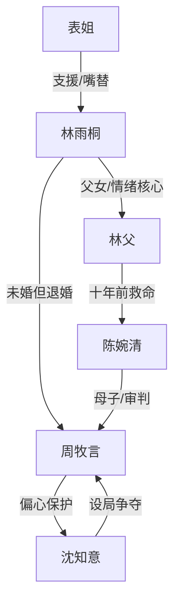

# 角色标签图谱

## 角色清单

### 林雨桐 — 清醒断舍离女主
- 叙事功能: 第一视角承压者、证据链见证者、最终切割者
- 核心标签: 克制、孝顺、清醒
- 弧光: 依赖未婚关系 → 被父亲死亡击醒 → 离开并重建人生
- 台词风格: 短句、反问、冷静落锤
- 关键行为: 独自奔丧、借钱救父、退婚、搬离京市
- 读者情绪关系: 心疼、代入、痛快

### 周牧言 — 迟钝偏心未婚夫
- 叙事功能: 情绪债主要制造者、迟来悔恨承担者
- 核心标签: 偏心、自辩、迟悔
- 弧光: 自以为体面深情 → 借口被逐层拆穿 → 悔恨但失去资格
- 台词风格: 先是不耐烦与指责，后是求饶式检讨
- 关键行为: 护送沈知意、缺席临终、挪用钱款、后期还款赎罪
- 读者情绪关系: 恨、鄙夷、看其崩溃获得爽感

### 沈知意 — 茶系白月光
- 叙事功能: 外部诱因、矛盾放大器、偏心选择的靶子
- 核心标签: 装弱、设局、抢占资源
- 弧光: 被网友捧成柔弱白月光 → 路线与人设被扒 → 资源坍塌
- 台词风格: 软刀式道歉，句句把责任推给女主
- 关键行为: 发视频、晒咖啡项链、装病叫走周牧言、误导舆论
- 读者情绪关系: 厌恶、期待被揭穿

### 林父 — 沉默恩人父亲
- 叙事功能: 道德坐标、情绪债核心、后半反转钥匙
- 核心标签: 隐忍、善良、无私
- 弧光: 病危等待 → 临终失望 → 死后真相成为清算重锤
- 台词风格: 虚弱、简短、关心女儿
- 关键行为: 临终等待周牧言、留下旧信封、曾救周母并资助周牧言
- 读者情绪关系: 心疼、敬重、替他不值

### 陈婉清 — 周母/恩情见证人
- 叙事功能: 真相认证者、外部道德审判者
- 核心标签: 愧疚、清醒、惩戒
- 弧光: 不知情 → 认出救命恩人 → 公开掌掴儿子并清算沈知意
- 台词风格: 悔痛、直接、带长辈权威
- 关键行为: 认出旧照片，质问沈知意，向女主道歉
- 读者情绪关系: 缓解憋屈，提供公正见证

### 表姐 — 女主现实支撑者
- 叙事功能: 支援者、吐槽嘴替、证据补充者
- 核心标签: 直爽、护短、清醒
- 弧光: 借钱救急 → 灵堂揭穿 → 代收补偿文件
- 台词风格: 直白尖锐
- 关键行为: 连夜借钱、葬礼怼沈知意、陪女主墓园告别
- 读者情绪关系: 爽、安心

## 关系网络

## 角色功能对照表（供改编参考）

| 原角色 | 极致标签 | 叙事功能 | 读者情绪功能 | 改编时必须保留的 |
|--------|---------|---------|-------------|---------------|
| 林雨桐 | 清醒断舍离女主 | 承压与切割 | 心疼、代入、痛快 | 不回头、不复合、不靠歇斯底里取胜 |
| 周牧言 | 迟钝偏心未婚夫 | 制债与悔恨 | 恨、爽 | 先自辩再崩溃，悔恨必须迟到 |
| 沈知意 | 茶系白月光 | 诱导选择 | 厌恶 | 软刀装弱、社交平台炫耀、最终人设塌 |
| 林父 | 沉默恩人父亲 | 道德锚点 | 心疼 | 临终等待与死后真相双重重锤 |
| 周母 | 迟到审判者 | 认证真相 | 爽 | 必须由她认证恩情，不能只靠女主自述 |
| 表姐 | 现实支援者 | 嘴替与援助 | 解气 | 在女主最孤立时提供实际帮助 |
