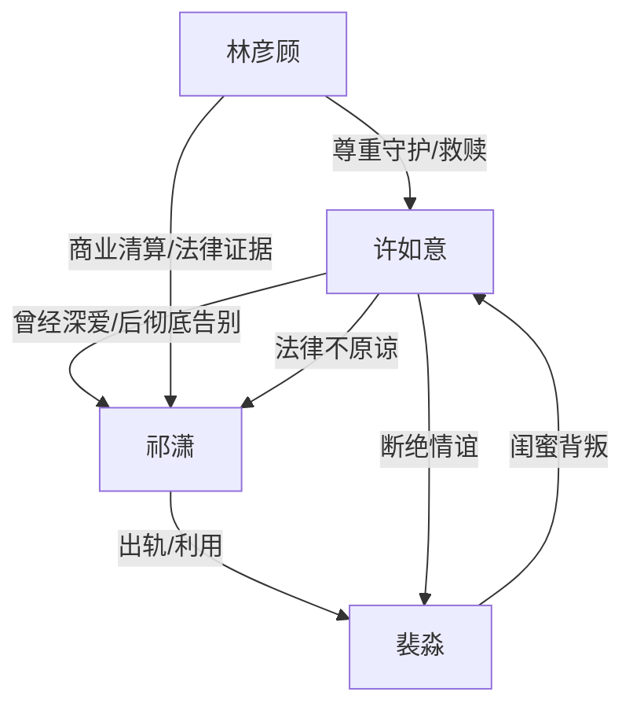

# 角色标签图谱

## 角色清单

### 许如意 — 创伤清醒女主
- 叙事功能: 承载受害者视角、情绪债累积与最终告别。
- 核心标签: 创伤、清醒、重生
- 弧光: 依赖祁潇 → 被反复摧毁 → 麻木离开 → 重新相信爱
- 台词风格: 前期追问崩溃，后期平静拒绝。
- 关键行为: 签离婚协议、逃往巴黎、拒绝复合、坚持法律清算。
- 读者情绪关系: 心疼、代入、替她松一口气。

### 祁潇 — 偏执控制型追妻火葬场男主
- 叙事功能: 最大施害者与后期悔恨对象。
- 核心标签: 自私、控制、迟来悔恨
- 弧光: 被救者/丈夫 → 施害者 → 追悔者 → 囚徒/疯癫者
- 台词风格: 前期冷酷指责，后期卑微求饶。
- 关键行为: 出轨摊牌、恶犬惩罚、照片刺激、非法囚禁。
- 读者情绪关系: 恨、怒、期待报应。

### 裴淼 — 绿茶闺蜜/伪治疗推手
- 叙事功能: 亲密关系背刺者，推动极端刺激方案。
- 核心标签: 背叛、伪善、私心
- 弧光: 闺蜜 → 第三者 → 推手 → 自首者
- 台词风格: 柔弱辩解、哭诉求情。
- 关键行为: 勾搭祁潇、提出刺激治疗、公开照片、求女主放过祁潇。
- 读者情绪关系: 恨、恶心、看她失去一切的爽。

### 林彦顾 — 尊重型救赎男主
- 叙事功能: 安全感补偿与清算执行者。
- 核心标签: 克制、护短、尊重
- 弧光: 追求者 → 守护者 → 清算者 → 伴侣
- 台词风格: 温和但有边界，关键时强硬。
- 关键行为: 宴会维护、解释真心、曝光祁潇证据、陪伴疗愈。
- 读者情绪关系: 安心、补偿、嗑糖。

## 关系网络

## 角色功能对照表（供改编参考）

| 原角色 | 极致标签 | 叙事功能 | 读者情绪功能 | 改编时必须保留的 |
|--------|---------|---------|-------------|---------------|
| 许如意 | 创伤清醒女主 | 被伤害后出走重生 | 心疼、爽、释怀 | 不原谅，不回头 |
| 祁潇 | 偏执控制丈夫 | 施害与火葬场 | 恨、看报应 | “为你好”的控制逻辑 |
| 裴淼 | 绿茶闺蜜 | 二次背叛 | 恶心、愤怒 | 亲密背刺与伪善辩解 |
| 林彦顾 | 尊重型救赎者 | 补偿与清算 | 安心、甜 | 尊重边界，不强迫 |
