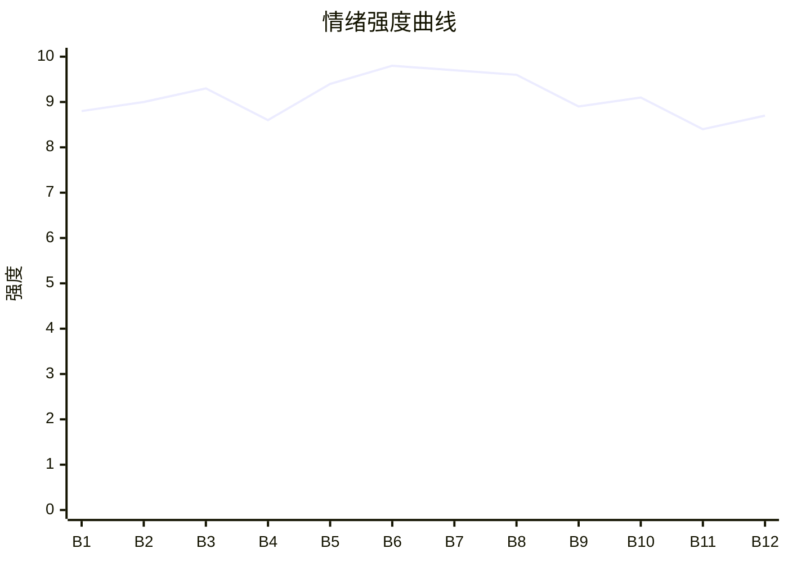

# Beat Sheet 节拍器

## 全文概况

- 总字数: 约 11800 字
- 节拍数: 12 幕
- 核心母题（Logline）: 女儿江暖暖长期替哥哥承受母亲惩罚，最终被关水缸溺亡；死后真相经直播、警察、监控与庭审公开，母亲失去孩子、家庭与自由。
- 情绪模式: 极致打压 → 死亡触底 → 证据揭盖 → 群体审判 → 迟来悔恨被拒绝

## 节拍详表

### Beat 1: 极端规则开场：哥哥犯错，妹妹受罚 [第1章开头]
- **字数**: 约 850 字（占比 7.2%）
- **核心事件**: 开篇快速建立母亲的教育逻辑：两个哥哥犯错，暖暖被针扎、鞭打、罚跪。
- **情绪标签**: 震惊、心疼、憋屈
- **情绪强度**: 8.8/10
- **情绪方向**: ⚡突变
- **冲突类型**: 大转折
- **悬念钩子**: 母亲要把暖暖关进水缸逼哥哥听话，读者想知道她会不会真的死。
- **叙事速度**: 快
- **对话占比**: 15%
- **reversal_mechanism**: [M3]
- **hook_strength**: 9.0/10（极端度 3/3，信息密度 2.5/3，悬念 1.8/2，节奏 1.7/2）
- **关键句**: “哥哥不听话，妹妹受罚，很合理啊。”
- **原文摘录**: 妈妈对两个哥哥很严格。早上，她五点把哥哥们拉起来，让他们背书。哥哥们不愿意起。她就拿着绣花针，扎进我的胳膊。鲜血飙出，哥哥们吓坏了，连忙爬起来坐在桌前。期末考试，大哥错了一道送分题，我挨了十鞭子。二哥只考了第二，我被罚跪在榴莲上，膝盖血肉模糊。妈妈得意地笑着，说她这个教育方法真不错。后来，大哥想把志愿填到外省，二哥说要私奔。妈妈气坏了，把我塞进水缸里，往里面灌水。她拍视频扬言他们不听话，就会活活把我淹死。她经常给我讲杀鸡儆猴的故事，让我当好里面的那只鸡。妈妈，我这只鸡当得还算合格吧？

### Beat 2: 志愿表勒索：大哥梦想被迫让位 [第1章中后段]
- **字数**: 约 1100 字（占比 9.3%）
- **核心事件**: 母亲用水缸里的暖暖逼大哥改志愿，并直播“教育方法”。
- **情绪标签**: 窒息、愤怒、无力
- **情绪强度**: 9.0/10
- **情绪方向**: ↑上升
- **冲突类型**: 大转折
- **悬念钩子**: 大哥改完志愿后，母亲却丢掉钥匙，说明她并不打算立刻救暖暖。
- **叙事速度**: 快
- **对话占比**: 45%
- **reversal_mechanism**: [M3, M5]
- **hook_strength**: null
- **关键句**: “你要是执意报省外的学校，就看着你妹被淹死吧。”
- **原文摘录**: 水淹到小腿，门外传来大哥急促的声音。他求妈妈先把暖暖放出来，志愿的事再商量。妈妈说没得商量，拿出手机给他看水缸里的我。大哥朝屋内吼：“暖暖，你会被淹死的，快出来啊！”我刚想推开盖子，却听见妈妈说：“江暖暖，你敢！”我立马缩回去。大哥跪下求她，说暖暖无辜。妈妈回答：“我知道暖暖无辜啊，但，谁让你不听话呢。”她递出志愿表，提醒大哥暖暖已经两天没吃饭。大哥咬着后槽牙改了志愿。妈妈又开直播展示：“家人们看到了吗，以后孩子不愿意改志愿就这样做！包灵的。”大哥要开门救我，却被妈妈把钥匙丢进排水管道。

### Beat 3: 二哥被召回：水位升到胸口 [第2章]
- **字数**: 约 1050 字（占比 8.9%）
- **核心事件**: 母亲用针扎视频逼二哥分手，随后继续把暖暖留在水缸。
- **情绪标签**: 恐惧、饥饿、被遗弃
- **情绪强度**: 9.3/10
- **情绪方向**: ↑上升
- **冲突类型**: 微冲突升级为大转折
- **悬念钩子**: 母亲离开后水龙头未关，暖暖被呛醒。
- **叙事速度**: 中快
- **对话占比**: 50%
- **reversal_mechanism**: [M3, M5]
- **hook_strength**: null
- **关键句**: “暖暖，你这只鸡还要继续发挥你的价值。”
- **原文摘录**: 妈妈给二哥发去一段视频，那是我被关进水缸之前，她用绣花针扎我脑袋。二哥很快出现，说自己已经分手，只是想气气她。妈妈擦掉他的眼泪，说他们的行为关乎妹妹生命。水已经淹到我的胸口，我推开盖子，对上妈妈的眼睛。她问：“暖暖，连你也不听妈妈的话是吧？”我被狠狠推回水里。我说饿，妈妈却说哥哥们内心不服气，我这只鸡还要继续发挥价值。她承诺回来给我带大鸡腿，关掉水龙头，把盖子盖上。脚步声远去，我盯着红外摄像头唱歌。迷糊睡着后，我被水呛醒。妈妈没有拧紧水龙头。我推盖子，盖子纹丝不动。我的眼泪和求救声一起混进水里。

### Beat 4: 回忆补刀：杀鸡儆猴的童年系统 [第3章]
- **字数**: 约 1150 字（占比 9.7%）
- **核心事件**: 通过餐厅与童年回忆，补全母亲多年虐待的规则来源。
- **情绪标签**: 心疼、愤怒、荒诞
- **情绪强度**: 8.6/10
- **情绪方向**: →平稳高压
- **冲突类型**: 微冲突
- **悬念钩子**: 母亲亲口承认不是怕打坏哥哥，而是舍不得打哥哥。
- **叙事速度**: 中
- **对话占比**: 35%
- **reversal_mechanism**: [M5]
- **hook_strength**: null
- **关键句**: “傻孩子，妈哪舍得打你们啊。”
- **原文摘录**: 妈妈带哥哥们去了豪华餐厅，大哥提出给暖暖带吃的。镜头转入童年：哥哥们出去踢球，我向妈妈展示母亲节胸针，还没说完快乐，就被脱掉上衣。荆条一下下抽在背上。妈妈问：“杀鸡儆猴是什么意思？”我回答：“杀掉鸡，让猴子听话。”她问谁是那只鸡，我说：“我，江暖暖。”哥哥们回来后跪地求情，保证以后学习。后来只要哥哥没考满分，差几分她就打我几下；哥哥游戏多玩一分钟，她就不让我睡觉；哥哥衣服划破，她剪掉我的衣服把我绑在门口。我问为什么，她说哥哥们智商比我高，不能打坏，只能牺牲我。餐桌上哥哥求她以后冲他们来，她笑得温柔：“傻孩子，妈哪舍得打你们啊。”

### Beat 5: 死亡揭示与舆论前置 [第4章]
- **字数**: 约 1200 字（占比 10.2%）
- **核心事件**: 暖暖意识到自己已死；直播私信与爸爸电话推动警察登场。
- **情绪标签**: 悲凉、惊悚、期待清算
- **情绪强度**: 9.4/10
- **情绪方向**: ⚡突变
- **冲突类型**: 大转折
- **悬念钩子**: 警察要求开门，水缸真相即将曝光。
- **叙事速度**: 快
- **对话占比**: 42%
- **reversal_mechanism**: [M4, M6]
- **hook_strength**: null
- **关键句**: “妈，我已经死了，你连我的尸体都不放过吗？”
- **原文摘录**: 我看着手上交错的疤痕，终于明白母亲只是不舍得打哥哥。妈妈手机里有网友私信，担心女儿状态不好，也有人骂她虐待孩子要报警。妈妈回复：“我的女儿怎样不需要你们担心，我自有分寸！”爸爸打电话说水流到外面了。妈妈第一反应是骂我造反，哥哥们还在给我打包鸡腿。她把鸡腿丢给野狗，回家后打开直播，对准满地的水，说要让大家看看我干的好事。弹幕有人骂我。我的灵魂飘在空中苦笑：妈，我已经死了，你连我的尸体都不放过吗？两个警察出现，称有人举报虐童，要求开门查看。

### Beat 6: 水缸揭盖：尸体成为铁证 [第5章]
- **字数**: 约 1050 字（占比 8.9%）
- **核心事件**: 警察、父亲、哥哥进入家门，发现水缸和暖暖尸体。
- **情绪标签**: 惨烈、震惊、崩塌
- **情绪强度**: 9.8/10
- **情绪方向**: ⚡突变
- **冲突类型**: 大转折
- **悬念钩子**: 母亲开始狡辩，监控即将打开。
- **叙事速度**: 快
- **对话占比**: 48%
- **reversal_mechanism**: [M4, M6]
- **hook_strength**: null
- **关键句**: “我安静地坐在水缸底下，身体已经被泡得发白。”
- **原文摘录**: 进门后满地是水，妈妈举着手机直播，直到看见客厅中间的大水缸上压着老旧电视机。爸爸问她为什么搬电视压着，暖暖怎么不出来迎接。妈妈怒吼都不准动，说暖暖在房间睡觉。弹幕开始怀疑。警察问水缸里是什么，妈妈说是腌咸菜。她颤抖的手出卖了她。警察要求打开，她扑在盖子上阻止。她甚至走到我的房间，对空气里的“我”温柔说话。哥哥们看见地上飘着我的头发，大哥跪下，二哥还说妈妈不会这么残忍。警察搬电视，爸爸抱住妈妈。盖子掀开，所有人倒吸冷气。我安静地坐在水缸底下，身体已经被泡得发白。

### Beat 7: 监控反噬：母亲自证虐杀 [第6章]
- **字数**: 约 1300 字（占比 11.0%）
- **核心事件**: 母亲想用监控证明清白，反而播放出她施虐、放水、直播打赌的全过程。
- **情绪标签**: 愤怒、痛快、心碎
- **情绪强度**: 9.7/10
- **情绪方向**: ↑上升
- **冲突类型**: 大转折
- **悬念钩子**: 所有人继续看完死亡全过程，哥哥们的罪疚被引爆。
- **叙事速度**: 中快
- **对话占比**: 38%
- **reversal_mechanism**: [M3, M4, M6]
- **hook_strength**: null
- **关键句**: “这可是板上钉钉的证据，他们不可能放过的。”
- **原文摘录**: 爸爸给妈妈一巴掌，警察质问她怎么可能是孩子自己进水缸、自己盖盖子、自己压电视。妈妈听到“蓄意谋杀”后瘫坐在地，辩称自己关了水龙头，是别人打开了。她打开监控想证明清白，画面却是她用针扎我脑袋。她说：“谁让你哥哥们不听话呢？”我的惨叫声划破天空。大哥咬破下唇，二哥哭着说都是他的错。接着画面记录妈妈让我坐进水缸，她放水，开直播和大家打赌哥哥会不会为了我放弃理想学校。我在水缸里求饶，说怕水。盖子盖上后，红外摄像头记录我脸上的恐慌。我喃喃：“妈妈……我怕黑，以后你能不能不要把我关在黑的地方了？”

### Beat 8: 死亡全过程与家庭共犯 [第7章]
- **字数**: 约 1250 字（占比 10.6%）
- **核心事件**: 监控播放暖暖真正死亡过程；父亲意识到自己的缺席也是共犯；母亲仍甩锅暖暖。
- **情绪标签**: 窒息、愤怒、审判感
- **情绪强度**: 9.6/10
- **情绪方向**: ↑上升
- **冲突类型**: 大转折
- **悬念钩子**: 哥哥们与母亲彻底决裂。
- **叙事速度**: 中
- **对话占比**: 45%
- **reversal_mechanism**: [M4, M5]
- **hook_strength**: null
- **关键句**: “她就是故意陷害我，这个小贱人！”
- **原文摘录**: 二哥说起妈妈曾因他看鬼片，把妹妹关进小黑屋放鬼片吓她。爸爸质问王秋菊在他不在时怎么对女儿，母亲反怪爸爸不着家。监控里传出我的求救：“妈妈！水涨了，你水龙头没拧紧！”我一声声喊妈妈，推盖子，声音渐渐停止。医生到场后下达死亡证明。母亲却说我明明可以掀翻盖子跑走，是故意陷害她。大哥吼她妹妹两天没吃饭，哪里来的力气。哥哥们跪在我身边自责，父亲也扇自己一巴掌，承认如果多关心孩子，也许不会发生。妈妈戴上手铐才开始忏悔，说自己不是有意的，还要照顾两个哥哥。大哥问：“妈，你确定你是在照顾我们吗？”二哥说：“我们宁愿没有你这个妈妈！”

### Beat 9: 庭审清算：哥哥夺回人生 [第8章前半]
- **字数**: 约 1050 字（占比 8.9%）
- **核心事件**: 事件发酵，庭审时哥哥提交证据，并当庭宣布大哥重填边境警察志愿、二哥服兵役。
- **情绪标签**: 解气、悲壮、补偿
- **情绪强度**: 8.9/10
- **情绪方向**: ↓回落后上扬
- **冲突类型**: 大转折
- **悬念钩子**: 母亲失去对儿子的控制后，判决与家庭关系清算继续。
- **叙事速度**: 快
- **对话占比**: 55%
- **reversal_mechanism**: [M3, M6]
- **hook_strength**: null
- **关键句**: “我会成为一名优秀的边境警察，你恭喜我吧。”
- **原文摘录**: 事情在网上掀起惊涛骇浪，妈妈账号被冲烂。我的尸体火化、下葬那天，好多人为我送白花。开庭那天，哥哥们坐在妈妈对立面，递交一条条虐待证据。大哥叫了一声妈，告诉她志愿重新填报了，在边境，他会成为优秀的边境警察。妈妈摇头说不行，太危险太远。大哥没理她，讲起曾经带回流浪狗，被妈妈逼着丢掉；她用牙齿咬妹妹的肉，说让他们看看被狗咬是什么感觉。二哥说自己决定服兵役，还揭穿妈妈不让他谈恋爱，是因为想安排一个温柔懦弱、好掌控的女孩做儿媳。妈妈面如死灰。

### Beat 10: 判决与反讽爆发：她最疼的儿子恨她 [第8章后半]
- **字数**: 约 900 字（占比 7.6%）
- **核心事件**: 母亲被判无期；父亲离婚；哥哥当面反问她生暖暖是否只为惩罚。
- **情绪标签**: 痛快、荒诞、迟来正义
- **情绪强度**: 9.1/10
- **情绪方向**: ↑上升
- **冲突类型**: 大转折
- **悬念钩子**: 母亲回家面对水缸，悔恨是否成立？
- **叙事速度**: 快
- **对话占比**: 50%
- **reversal_mechanism**: [M3, M5]
- **hook_strength**: null
- **关键句**: “谁都有资格恨我，就他们不行！！”
- **原文摘录**: 法官判下无期徒刑，缓刑三天执行。第一天，爸爸拿离婚协议书和妈妈离婚，两个孩子都跟他。妈妈还想争取，爸爸嘲笑她到现在还想着要孩子，因为他们恨死她了。妈妈崩溃大叫：“这些年我从没打过他们，骂过他们。我再生气也只惩罚暖暖！谁都有资格恨我，就他们不行！！”大哥上前扇她一巴掌，问：“你生暖暖，就是为了惩罚她，让我们听话吗！”后文补足母亲重男轻女的根：她曾因自己是女生受白眼，却转身加入重男轻女阵营，不许暖暖学习，让她背杀鸡儆猴。

### Beat 11: 水缸自杀未遂：迟来的“爱”被拆穿 [第9章]
- **字数**: 约 950 字（占比 8.1%）
- **核心事件**: 母亲回家爬进水缸试图自杀，被父亲救起；她说爱暖暖，被父亲否定。
- **情绪标签**: 冷笑、反讽、余痛
- **情绪强度**: 8.4/10
- **情绪方向**: ↓回落
- **冲突类型**: 微冲突
- **悬念钩子**: 母亲最后去墓地，迟来的告别如何被拒绝。
- **叙事速度**: 中
- **对话占比**: 40%
- **reversal_mechanism**: [M3, M5]
- **hook_strength**: null
- **关键句**: “失去暖暖之后，我才知道自己是爱她的。”
- **原文摘录**: 第二天，妈妈回到家里，水缸还安静地摆在客厅。她叫着暖暖，说自己太愚蠢，为什么不检查水龙头，为什么不带我一起吃饭。她拿起我默写杀鸡儆猴的本子，来到水缸前爬进去。水越来越满，我想关水龙头却做不到。爸爸及时回家，把她从水里拉出来。他说不允许她就这么死，这样太便宜。妈妈咳嗽着说：“失去暖暖之后，我才知道自己是爱她的。”她解释说看着暖暖就像看到以前的自己，不知道为什么就想罚她。我哈哈大笑，父亲也觉得好笑。他说：“王秋菊，你别自己骗自己了。你这么说，不就是为了减轻自己的负罪感吗？”

### Beat 12: 墓前生日：最终拒绝和解 [第10章]
- **字数**: 约 1000 字（占比 8.5%）
- **核心事件**: 母亲去墓前告别，拿出暖暖做的胸针和唱摇篮曲，但连暖暖生日都不知道；哥哥们为她过生日，暖暖获得迟来的甜。
- **情绪标签**: 酸涩、释然、终局补偿
- **情绪强度**: 8.7/10
- **情绪方向**: ↓收束
- **冲突类型**: 大转折收束
- **悬念钩子**: 无，情绪闭环。
- **叙事速度**: 慢
- **对话占比**: 45%
- **reversal_mechanism**: [M3, M4, M5]
- **hook_strength**: null
- **关键句**: “看啊，口口声声说爱我的人，连我的生日都不知道。”
- **原文摘录**: 第三天，妈妈去了墓地。我的坟前有好多鲜花。她说忘记给我买花，又拿出那年母亲节我给她做的胸针。我大喊她不配拿着。风把胸针吹进河里，妈妈要去捞，被警察拦住。她在墓前擦我的照片，唱摇篮曲。回忆里，四岁的我问为什么她只哄哥哥不哄我，她说等我五岁、六岁、七岁。一首摇篮曲，我直到死才听到。我说没必要了，我长大了，不想再听。哥哥们来了，一个捧蛋糕，一个拿裙子，给我过生日。妈妈才问今天是暖暖的生日。看啊，口口声声说爱我的人，连我的生日都不知道。哥哥们为我唱歌，祝我下辈子开开心心、健健康康。妈妈被警察拉走。蜡烛熄灭，我吃着蛋糕，好甜。

## 情绪曲线可视化

## 节拍密度检测

- 平均每 983 字一个节拍
- 微冲突密度: 每 1200-1500 字一次
- 大转折密度: 每 900-1200 字一次
- 判定: 符合高频节拍器标准。每章至少一个新虐点、证据点或清算点。

## 反转机制清单(Reversal Mechanisms)

从 prompts/patterns/reversal-mechanisms.md 的 8 大机制中命中以下机制:

| 机制 ID | 机制名 | 承载 Beat | 关键段落/金句 | 等价改编提示 |
|--------|--------|-----------|--------------|-------------|
| M3 | 因果回旋反讽 | Beat 1-3, Beat 9-12 | “哥哥不听话，妹妹受罚，很合理啊。”到哥哥们用自己的人生选择反向否定母亲控制 | 保留施害者规则，并在结尾用同一规则反向审判施害者 |
| M4 | 灵魂线视角 | Beat 5-12 | “我飘在空中，无奈苦笑。妈，我已经死了……” | 死亡必须前置为中段扳机，后续用灵魂旁观揭露真相 |
| M5 | 温度反转曲线 | Beat 2-4, Beat 8-12 | 母亲从“舍不得打哥哥”到“失去暖暖之后才知道爱她” | 显示迟来的悔恨，但不能让主角原谅 |
| M6 | 多层递进反转 | Beat 5-10 | 死亡揭示 → 水缸尸体 → 监控证据 → 庭审判决 | 层数不能少，反转量级需从家庭现场升级到法律/舆论审判 |
