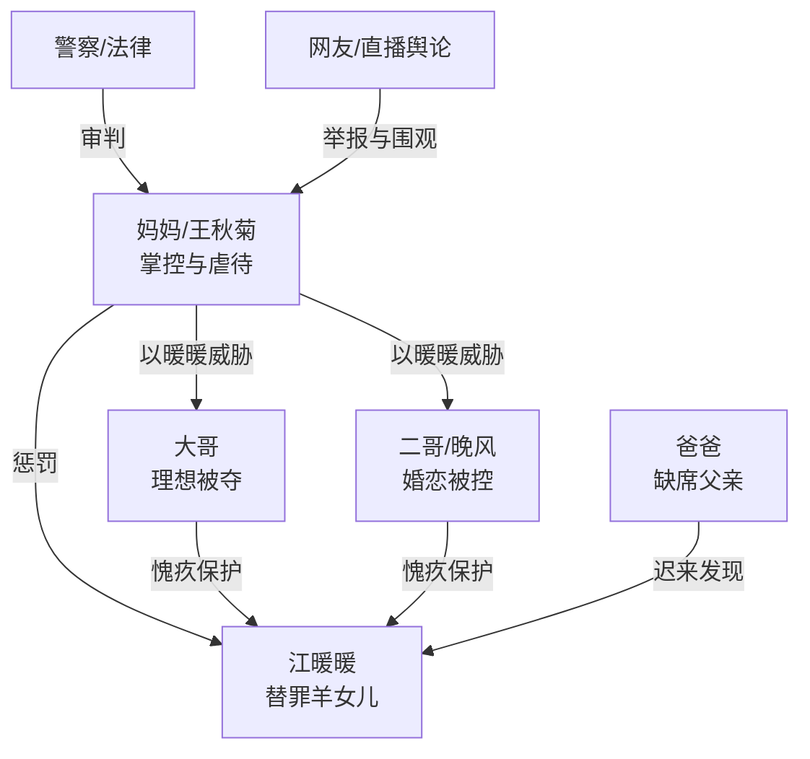

# 角色标签图谱

## 角色清单

### 江暖暖 — 替罪羊女儿/死亡旁观者
- 叙事功能: 受害核心、情绪债载体、死后见证者。
- 核心标签: 乖顺、缺爱、被牺牲。
- 弧光: 被迫当“鸡” → 溺亡 → 旁观真相公开 → 拒绝迟来母爱。
- 台词风格: 童声、短句、低姿态请求。
- 关键行为: 遵守母亲命令、困在水缸、死后旁观清算。
- 读者情绪关系: 极强心疼、保护欲、为她讨回公道的期待。

### 王秋菊/妈妈 — 疯批掌控型母亲
- 叙事功能: 主要施害者，家庭伦理恶的集中体。
- 核心标签: 掌控欲、重男轻女、虐待合理化。
- 弧光: 得意教育者 → 杀女凶手 → 被儿子否定 → 迟来悔恨无人接受。
- 台词风格: 训诫式、直播式、诡辩式。
- 关键行为: 针扎暖暖、逼哥哥屈服、关水缸、直播、狡辩、自杀未遂。
- 读者情绪关系: 恨、厌恶、期待惩罚。

### 大哥 — 愧疚反抗者/理想被夺者
- 叙事功能: 前半被勒索对象，后半清算母亲的证人。
- 核心标签: 心疼妹妹、被控制、最终反抗。
- 弧光: 为妹妹改志愿 → 目睹死亡崩溃 → 重填边境警察志愿。
- 台词风格: 哀求到冷硬。
- 关键行为: 下跪、改志愿、提交证据、扇母亲、夺回人生。
- 读者情绪关系: 心疼、理解、期待他走出控制。

### 二哥/晚风 — 愧疚弟兄/迟来守护者
- 叙事功能: 第二条勒索线，揭示母亲控制婚恋的阴谋。
- 核心标签: 叛逆、愧疚、觉醒。
- 弧光: 假恋爱气母亲 → 被妹妹死亡击垮 → 服兵役脱离控制。
- 台词风格: 哭腔、后期带讽刺。
- 关键行为: 分手道歉、看监控、庭审揭穿婚恋安排。
- 读者情绪关系: 心疼与轻微责备并存。

### 爸爸 — 缺席父亲/迟来共犯认知者
- 叙事功能: 揭开死亡现场、指出母亲悔恨虚伪，同时承担缺席责任。
- 核心标签: 缺席、迟钝、后悔。
- 弧光: 不知情/懒得管 → 发现尸体 → 离婚、救下母亲但拒绝让她轻易死。
- 台词风格: 质问、痛悔、冷判。
- 关键行为: 开门回家、打母亲、签离婚、否定“我爱暖暖”。
- 读者情绪关系: 复杂，既解气也被质疑。

### 警察/法官/网友 — 外部正义系统
- 叙事功能: 将家庭私域暴力转化为公共审判。
- 核心标签: 介入、见证、清算。
- 弧光: 举报线索 → 现场执法 → 法律判决。
- 台词风格: 简短有力。
- 关键行为: 要求开门、掀水缸、固定监控证据、执行押送。
- 读者情绪关系: 提供安全感和清算快感。

## 关系网络

## 角色功能对照表（供改编参考）

| 原角色 | 极致标签 | 叙事功能 | 读者情绪功能 | 改编时必须保留的 |
|--------|---------|---------|-------------|---------------|
| 江暖暖 | 替罪羊女儿 | 承载全部情绪债 | 心疼、保护欲 | 无辜、乖顺、死后拒绝和解 |
| 妈妈 | 疯批掌控母亲 | 施害与诡辩核心 | 恨点 | “惩罚弱者逼强者听话”的规则 |
| 大哥 | 愧疚反抗者 | 被勒索与后期清算 | 补偿爽 | 被迫放弃理想，后期夺回 |
| 二哥 | 迟来守护者 | 第二压迫线 | 悔痛 | 婚恋/自由被控制 |
| 爸爸 | 缺席共犯 | 家庭责任补刀 | 复杂审判 | 缺席责任不能洗白 |
| 警察/网友 | 外部正义 | 公共清算 | 安全感 | 证据公开、法律介入 |
