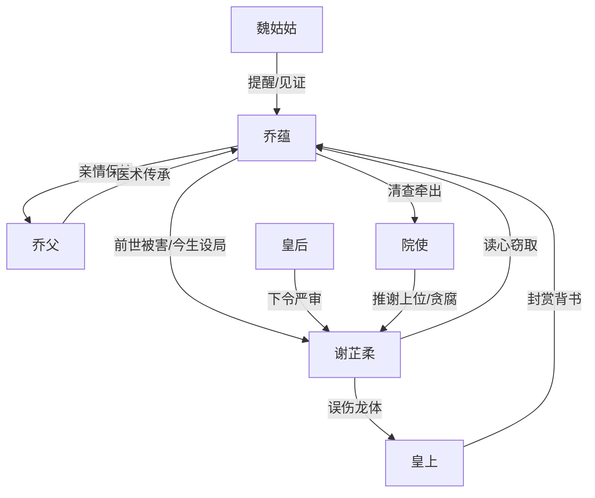

# 角色标签图谱

## 角色清单

### 乔蕴 — 重生清醒医女 / 反杀型大女主
- 叙事功能: 主视角、复仇执行者、真本事承载者。
- 核心标签: 冷静、隐忍、医术扎实。
- 弧光: 被读心术害死的废物医女 → 设局反杀的御医 → 正三品女性医者。
- 台词风格: 克制短句，关键处直刺逻辑。
- 关键行为: 假意举荐谢芷柔、脑内喂正确医案、切换阉割口诀、救治皇帝。
- 读者情绪关系: 心疼、期待、爽。

### 谢芷柔 — 读心穿越女 / 窃取型伪天才
- 叙事功能: 主要反派、金手指反噬载体。
- 核心标签: 贪婪、傲慢、伪善。
- 弧光: 民间医女 → 天降医仙 → 欺君妖女 → 疯癫死囚。
- 台词风格: 前期乖巧柔弱，后期尖叫失控。
- 关键行为: 读心答题、借乔蕴医术上位、对皇帝误施阉割术、供出读心。
- 读者情绪关系: 恨、嘲讽、报应爽。

### 乔院判 / 乔父 — 护女医官 / 被牵连的家族支点
- 叙事功能: 亲情债来源、医术传承者、后期清算受益者。
- 核心标签: 正直、谨慎、爱女。
- 弧光: 前世蒙冤死狱 → 今生受辱沉默 → 升任院使。
- 台词风格: 稳重，危机时短促。
- 关键行为: 初次考校谢芷柔、救治皇帝伤势、交出古法医书。
- 读者情绪关系: 心疼、替他不平、补偿爽。

### 皇上 — 皇权风险 / 最高裁判者
- 叙事功能: 把医术比试升级为生死皇权事故。
- 核心标签: 病弱、威权、知恩。
- 弧光: 被误伤的病人 → 重新信任乔蕴 → 弯腰谢医。
- 台词风格: 简短威严。
- 关键行为: 准许治疗、处置谢芷柔、封赏乔蕴。
- 读者情绪关系: 紧张、权威背书。

### 皇后 — 情绪放大器 / 宫廷清算推动者
- 叙事功能: 将皇帝受伤的私密羞辱转化为宫廷震怒。
- 核心标签: 惊惧、护夫、冷厉。
- 弧光: 期待医治 → 崩溃震怒 → 下令严审。
- 台词风格: 高压命令式。
- 关键行为: 推开谢芷柔、命人押入死牢。
- 读者情绪关系: 强化反派报应合理性。

### 魏姑姑 — 清醒旁观者 / 情绪见证人
- 叙事功能: 识破乔蕴异常，承接复仇后的余味。
- 核心标签: 关切、老练、见证。
- 弧光: 担忧乔蕴折进去 → 见证仇报 → 询问是否后悔。
- 台词风格: 朴素、直接。
- 关键行为: 提醒乔蕴、转述行刑、提出价值问题。
- 读者情绪关系: 安定、温情。

## 关系网络

## 角色功能对照表（供改编参考）

| 原角色 | 极致标签 | 叙事功能 | 读者情绪功能 | 改编时必须保留的 |
|--------|---------|---------|-------------|---------------|
| 乔蕴 | 重生清醒医女 | 设局反杀+真实能力兑现 | 心疼转爽 | 冷静喂错规则、后期凭真本事赢 |
| 谢芷柔 | 读心伪天才 | 金手指反噬对象 | 恨与嘲讽 | 读心/窃取能力必须能被反向利用 |
| 乔父 | 正直父亲 | 情绪债与医术传承 | 心疼补偿 | 前世受害、今生翻身 |
| 皇上 | 最高权力裁判 | 提升风险等级 | 紧张背书 | 反派必须冒犯最高权力 |
| 皇后 | 清算推动者 | 让惩罚立即落地 | 痛快 | 当场震怒并推动严审 |
| 魏姑姑 | 清醒见证人 | 余味收束 | 温情 | 提问“恨/原谅/后悔”类价值问题 |
