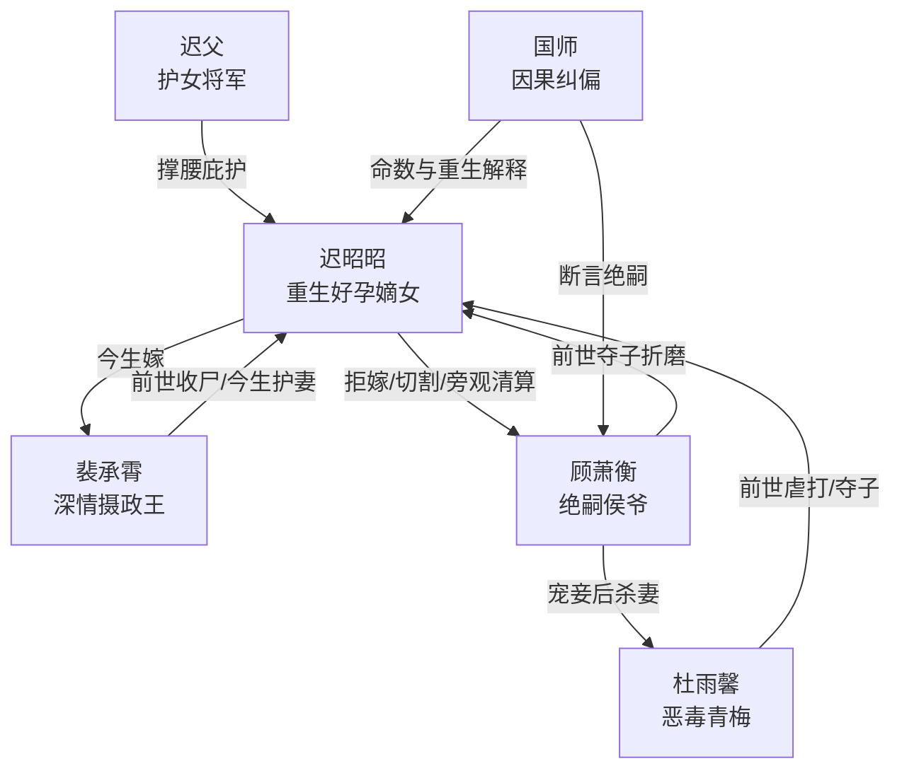

# 角色标签图谱

## 角色清单

### 迟昭昭 — 重生清醒好孕嫡女
- 叙事功能: 第一人称主角，承载前世血债、今生改命与最终补偿。
- 核心标签: 好孕、重生、清醒复仇
- 弧光: 前世依附侯府被夺子至死 → 今生拒嫁改嫁摄政王 → 被守护并旁观恶人伏法
- 台词风格: 冷讽、切割、少解释，关键处用反问。
- 关键行为: 拒绝顾萧衡、选择裴承霄、反击杜雨馨、坦白重生、守住今生孩子。
- 读者情绪关系: 心疼、代入、爽。

### 顾萧衡 — 绝嗣普信追悔侯爷
- 叙事功能: 主反派，前世施害者，今生因子嗣执念自毁。
- 核心标签: 绝嗣、普信、追悔
- 弧光: 施舍女主为妾 → 抢亲纠缠 → 求复合 → 求子癫狂 → 杀妻入囚
- 台词风格: 自大、推责、命令式，反复把女主当所有物。
- 关键行为: 前世夺子过继、今生羞辱收帖、抢亲、纠缠、杀杜雨馨。
- 读者情绪关系: 恨、厌恶、嘲笑、看他崩塌的爽。

### 裴承霄 — 深情护妻摄政王
- 叙事功能: 情绪补偿载体，女主今生安全感来源，前世遗憾修复者。
- 核心标签: 权势、深情、守护
- 弧光: 前世为女主收尸而死 → 今生求娶成功 → 知晓前世仍不离 → 童年旧缘揭开 → 守护生产与余生
- 台词风格: 克制、短句承诺、低姿态深情。
- 关键行为: 十里红妆迎娶、护妻挡顾萧衡、听女主坦白、产房守护。
- 读者情绪关系: 安心、甜、补偿。

### 杜雨馨 — 恶毒青梅与因果替身
- 叙事功能: 前世夺子受益者，今生走女主旧路的反噬承载者。
- 核心标签: 青梅、小三、恶毒
- 弧光: 前世受宠夺子 → 今生挑衅夜袭 → 嫁给顾萧衡 → 多次落胎被冷落 → 生下非亲生子被杀
- 台词风格: 撒娇、挑衅、受害者姿态。
- 关键行为: 前世虐打女主小腹、今生夜袭、寺庙挑衅、婚内背叛。
- 读者情绪关系: 恨、盼报应。

### 迟父 — 护女将军父亲
- 叙事功能: 亲情补偿与女主底气来源。
- 核心标签: 护短、粗豪、慈父
- 弧光: 前世早逝导致女主失依 → 今生被及时诊治 → 撑腰嫁女 → 陪伴女主生产
- 台词风格: 粗口护短、直白宠女。
- 关键行为: 拳打顾萧衡、同意嫁摄政王、调铁骑护嫁、产前陪伴。
- 读者情绪关系: 暖、安心。

### 国师 — 因果纠偏者
- 叙事功能: 解释命数错乱与重生机制，引导女主从亲手复仇转向因果自毁。
- 核心标签: 命数、纠偏、旁观
- 弧光: 前世一句谬言造成错配 → 今生施术逆转 → 阻止女主担因果 → 预言顾杜自取灭亡
- 台词风格: 温和、玄学、点到为止。
- 关键行为: 判女主好孕、断顾萧衡绝嗣、救走杜雨馨、登门解释。
- 读者情绪关系: 解谜、推动。

## 关系网络

## 角色功能对照表（供改编参考）

| 原角色 | 极致标签 | 叙事功能 | 读者情绪功能 | 改编时必须保留的 |
|--------|---------|---------|-------------|---------------|
| 迟昭昭 | 重生清醒好孕女主 | 受害者转主动改命者 | 心疼、代入、爽 | 前世极惨、今生不原谅、保护新生孩子 |
| 顾萧衡 | 绝嗣普信前夫 | 主反派与追悔对象 | 恨、嘲笑、等报应 | 子嗣执念、施舍姿态、后期崩塌 |
| 裴承霄 | 深情权贵男主 | 情绪补偿与安全感 | 甜、安心 | 前世为她付出生命级代价，今生无条件护她 |
| 杜雨馨 | 恶毒青梅 | 夺子与折磨的具体执行者 | 恨、盼反噬 | 前世害女主身体与孩子，今生承受同构反噬 |
| 迟父 | 护短慈父 | 女主家族底气 | 暖、补偿 | 前世失去、今生保住 |
| 国师 | 因果纠偏者 | 解释重生与命运 | 解谜、增强合理性 | “不要介入，他们自毁”的因果规则 |
