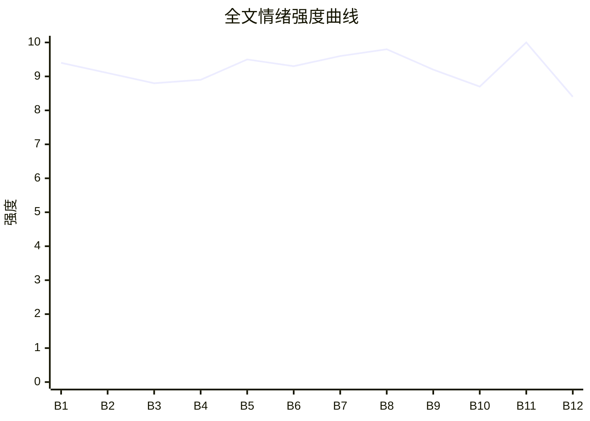

# Beat Sheet 节拍器

## 全文概况

- 总字数: 约 10500 字
- 节拍数: 12 幕
- 核心母题（Logline）: 弟弟林野为被姐夫和白月光害死的姐姐讨回公道，面对索肾与毁尸般羞辱，逐层亮出证据，将二人送进法律、病痛和精神崩溃的清算场。
- 情绪模式: 极致死亡冲击 → 反派否认羞辱 → 证据递进 → 法律锁死 → 器官拒捐反杀 → 余生报应 → 悼亡补偿

## 节拍详表

### Beat 1: 冻库死讯与上门索肾 [第 1 节开头]
- **字数**: 约 720 字（占比 6.9%）
- **核心事件**: 姐姐被冻死第三天，周奕带许薇来修车铺逼她签捐肾同意书。
- **情绪标签**: 震惊、愤怒、寒意
- **情绪强度**: 9.4/10
- **情绪方向**: ⚡突变
- **冲突类型**: 大转折
- **悬念钩子**: 周奕为什么完全不信林夏已死？
- **叙事速度**: 快
- **对话占比**: 38%
- **reversal_mechanism**: [M3]
- **hook_strength**: 9.2/10（极端度 3/3，信息密度 2.8/3，悬念 1.8/2，节奏 1.6/2）
- **关键句**: “肾冻烂了。这是骨灰，你抓一把走？”
- **原文摘录**: “姐姐被锁在海鲜冻库整整一夜……第三天，周奕的奥迪停在修车铺门外……将一份器官捐献单拍在案台上。‘叫林夏别装死了。’……我笑了。把桌角那个黑瓷罐踢到他脚边。‘肾冻烂了。’‘这是骨灰，你抓一把走？’”

### Beat 2: 周奕倒打一耙，冻库真相回放 [第 1 节中段]
- **字数**: 约 850 字（占比 8.1%）
- **核心事件**: 周奕将杀人说成“教训”，林野回忆姐姐被锁冻库、指甲剥落的真相。
- **情绪标签**: 憋屈、恨、心疼
- **情绪强度**: 9.1/10
- **情绪方向**: ↓下降
- **冲突类型**: 微冲突
- **悬念钩子**: 主角会如何证明姐姐真的死了？
- **叙事速度**: 中
- **对话占比**: 42%
- **reversal_mechanism**: [M5]
- **hook_strength**: null
- **关键句**: “铁门上全是带血的抓痕，和结了冰的血印子。”
- **原文摘录**: “周奕看都没看一眼……‘我关她一夜，只是让她长长记性。’……我砸开门找到我姐的时候，她蜷缩在冻库最里面的角落，十个指甲盖全剥落了……那是她活生生用手抠出来的。”

### Beat 3: 冻血手机响起，第一层证据落下 [第 1 节末]
- **字数**: 约 650 字（占比 6.2%）
- **核心事件**: 周奕拨打林夏电话，铃声从抽屉里冻血手机传来。
- **情绪标签**: 惊悚、打脸、期待
- **情绪强度**: 8.8/10
- **情绪方向**: ↑上升
- **冲突类型**: 大转折
- **悬念钩子**: 面对冻血手机，周奕还会如何狡辩？
- **叙事速度**: 快
- **对话占比**: 28%
- **reversal_mechanism**: [M6]
- **hook_strength**: null
- **关键句**: “来电显示上跳动着两个字：‘老公。’”
- **原文摘录**: “他按下拨号键。几秒钟后。一阵刺耳的手机铃声，在修车铺阴暗角落响起来……手机外壳上结着一层还没化透的白霜，背面粘着一大块黑红色的冻血。来电显示上跳动着两个字：‘老公。’”

### Beat 4: 旧伤翻案与血衣死亡证明 [第 2 节]
- **字数**: 约 1100 字（占比 10.5%）
- **核心事件**: 周奕继续污蔑林夏“装惨”，林野拿出血衣和死亡证明。
- **情绪标签**: 愤怒、压抑、快感蓄势
- **情绪强度**: 8.9/10
- **情绪方向**: ↑上升
- **冲突类型**: 大转折
- **悬念钩子**: 死亡证明能否击穿周奕的自欺？
- **叙事速度**: 中
- **对话占比**: 45%
- **reversal_mechanism**: [M5, M6]
- **hook_strength**: null
- **关键句**: “她嫌恶心，把戒指嚼碎了，和着血咽进了肚子里。”
- **原文摘录**: “上个月，是他嫌我姐做的饭不合许薇的胃口，一脚把她从二楼楼梯上踹了下去……啪。袋子被我砸在那份《自愿捐肾同意书》上……衣服最上面，压着一张县医院的死亡证明。”

### Beat 5: 保镖电话实锤，警方封锁冻库 [第 3 节]
- **字数**: 约 1250 字（占比 11.9%）
- **核心事件**: 周奕打给保镖命令绑人，电话那头传来警方抓捕和冻库血迹证据。
- **情绪标签**: 爽、惊惧、崩塌
- **情绪强度**: 9.5/10
- **情绪方向**: ↑上升
- **冲突类型**: 大转折
- **悬念钩子**: 警方介入后，周奕还剩什么狡辩空间？
- **叙事速度**: 快
- **对话占比**: 57%
- **reversal_mechanism**: [M1, M6]
- **hook_strength**: null
- **关键句**: “里面是零下二十二度。”
- **原文摘录**: “阿彪的声音抖得不像人声……‘冻库的门……门里面，全都是血……’……‘没断电……里面是零下二十二度……警察来了！周总，法医刚从里面提取了断掉的指骨和血迹……’”

### Beat 6: 砸骨灰与戒指反证旧爱 [第 4 节前半]
- **字数**: 约 1050 字（占比 10.0%）
- **核心事件**: 周奕砸碎骨灰罐，林野从骨灰里捡出周奕求婚戒指，击穿其否认。
- **情绪标签**: 羞辱、心疼、冷爽
- **情绪强度**: 9.3/10
- **情绪方向**: ⚡突变
- **冲突类型**: 大转折
- **悬念钩子**: 警车到场会如何定罪？
- **叙事速度**: 中
- **对话占比**: 43%
- **reversal_mechanism**: [M5, M6]
- **hook_strength**: null
- **关键句**: “这枚戒指，她到死都没摘下来过。”
- **原文摘录**: “周奕猛地将黑瓷罐砸向水泥地面……灰白色粉末像一阵阴冷的雾……我把它捡起来……那是一个被火烧得变形、发黑的银制小圆环……‘内圈还刻着你名字拼音。’”

### Beat 7: 拘留证落下，周奕跪地扒灰 [第 4 节后半-第 5 节前半]
- **字数**: 约 900 字（占比 8.6%）
- **核心事件**: 警方以故意伤害致人死亡拘留周奕，他终于承认林夏死了并跪地扒骨灰。
- **情绪标签**: 痛快、迟来的悔、厌恶
- **情绪强度**: 9.6/10
- **情绪方向**: ↑上升
- **冲突类型**: 大转折
- **悬念钩子**: 许薇是否会被一起拖下水？
- **叙事速度**: 快
- **对话占比**: 48%
- **reversal_mechanism**: [M1, M5]
- **hook_strength**: null
- **关键句**: “死了……真死了……”
- **原文摘录**: “警官举起一张拘留证拍在他胸口……‘昨天夜里十一点，他受你指使……’……周奕突然像疯了一样……跪在那个肮脏机油坑里……‘夏夏对不起，我错了……’”

### Beat 8: 许薇录音暴露，拒捐条款反杀 [第 5 节后半]
- **字数**: 约 1050 字（占比 10.0%）
- **核心事件**: 恢复录音证明许薇命令开大制冷机；林夏公证拒绝向许薇捐器官。
- **情绪标签**: 爽、恶有恶报、解气
- **情绪强度**: 9.8/10
- **情绪方向**: ↑上升
- **冲突类型**: 大转折
- **悬念钩子**: 许薇没有肾源会怎样受报应？
- **叙事速度**: 快
- **对话占比**: 55%
- **reversal_mechanism**: [M1, M3, M6]
- **hook_strength**: null
- **关键句**: “宁可火化成灰，也绝不给她留一片指甲盖。”
- **原文摘录**: “录音里响起许薇的声音：‘她还有力气砸门，说明还死不了。把制冷机开到最大……’……我翻到文件最后一页……‘如遇配型成功者为许薇，本人拒绝捐献。宁可火化成灰，也绝不给她留一片指甲盖。’”

### Beat 9: 看守所病痛与冻库录音精神折磨 [第 6 节前半]
- **字数**: 约 1000 字（占比 9.5%）
- **核心事件**: 许薇尿毒症靠透析续命，周奕反复听林夏冻库求救录音，精神崩溃。
- **情绪标签**: 报应、寒意、冷静
- **情绪强度**: 9.2/10
- **情绪方向**: →平稳高压
- **冲突类型**: 微冲突
- **悬念钩子**: 主角手里铁盒还能带来什么更大清算？
- **叙事速度**: 中
- **对话占比**: 31%
- **reversal_mechanism**: [M3, M5]
- **hook_strength**: null
- **关键句**: “每天夜里都会出现幻觉，觉得全身结冰。”
- **原文摘录**: “许薇全身浮肿……‘求求你……让我死吧……’……屏幕上正在播放冻库内机收音……‘周奕……冷……我好冷……开门……求求你……’……周奕疯狂地用头撞击金属挡板。”

### Beat 10: 铁盒揭出周家旧罪与经济清算 [第 6 节末-第 7 节前半]
- **字数**: 约 850 字（占比 8.1%）
- **核心事件**: 铁盒内账本、硬盘、保单曝光周奕走私逃税和车祸顶包旧罪，林野买法拍别墅。
- **情绪标签**: 升级、掌控、期待
- **情绪强度**: 8.7/10
- **情绪方向**: ↑上升
- **冲突类型**: 大转折
- **悬念钩子**: 周奕无期后还会受到怎样的精神补刀？
- **叙事速度**: 快
- **对话占比**: 18%
- **reversal_mechanism**: [M6]
- **hook_strength**: null
- **关键句**: “那里面东西，足以把整个周家碾成齑粉。”
- **原文摘录**: “生锈铁盒里……一本泛黄的账本，一块旧硬盘，还有一份意外身故保险单……账本记录走私和阴阳合同……硬盘是肇事车行车记录仪备份……保单受益人写着我的名字。”

### Beat 11: 判决、毁车、许薇惨死，周奕疯掉 [第 7 节后半-第 8 节]
- **字数**: 约 1300 字（占比 12.4%）
- **核心事件**: 周奕被判无期、财产没收；许薇因无肾源惨死；周奕陷入冻库幻觉。
- **情绪标签**: 终极爽、恶心、报应闭环
- **情绪强度**: 10/10
- **情绪方向**: ↑峰值
- **冲突类型**: 大转折
- **悬念钩子**: 主角会如何安置姐姐骨灰？
- **叙事速度**: 中
- **对话占比**: 36%
- **reversal_mechanism**: [M3, M5, M6]
- **hook_strength**: null
- **关键句**: “他机关算尽，踩着林夏的命去抢的东西，最终全成了一场空。”
- **原文摘录**: “判处无期徒刑，没收个人全部财产……许薇昨晚并发症发作，全身器官衰竭……周奕跪倒在地……‘好冷啊……夏夏……开门……把冻库门打开……’他疯了。”

### Beat 12: 海边扬灰，姐姐终于干净 [第 9 节]
- **字数**: 约 900 字（占比 8.6%）
- **核心事件**: 林野卖掉别墅捐款，带姐姐骨灰和戒指去海边扬散，完成告别。
- **情绪标签**: 释然、悲伤、补偿
- **情绪强度**: 8.4/10
- **情绪方向**: ↓回落
- **冲突类型**: 无
- **悬念钩子**: 无，完成情绪闭合。
- **叙事速度**: 慢
- **对话占比**: 5%
- **reversal_mechanism**: [M5]
- **hook_strength**: null
- **关键句**: “姐，干净了。”
- **原文摘录**: “钱全都捐给了县医院的急诊科，署名是林夏……我抓起一把混着机油的碎屑，用力扬了出去……姐姐说，她怕冷，怕黑。更怕周奕碰她……‘姐，干净了。’然后转过身……走回属于我的人间。”

## 情绪曲线可视化

## 节拍密度检测

- 平均每 875 字一个节拍
- 微冲突密度: 每 2500 字一次
- 大转折密度: 每 950 字一次
- 判定: 符合高频节拍器标准；证据升级密度强于普通家庭伦理文。

## 反转机制清单(Reversal Mechanisms)

| 机制 ID | 机制名 | 承载 Beat | 关键段落/金句 | 等价改编提示 |
|--------|--------|-----------|--------------|-------------|
| M1 | 死环反杀 | Beat 5, 7, 8 | “警察说出人命了”“阿彪已经全招了”“如遇配型成功者为许薇，本人拒绝捐献” | 固化载体可换成录音、公证、病历、监控，但必须由反派亲手留下能锁死自己的证据。 |
| M3 | 因果回旋反讽 | Beat 1, 8, 9, 11 | 反派索肾救白月光，结尾白月光无肾源惨死；林夏喊“好冷开门”，周奕疯后喊“好冷开门” | 金句和痛感必须回旋，施害逻辑要原样反打回施害者身上。 |
| M5 | 温度反转曲线 | Beat 2, 4, 6, 7, 11, 12 | 求婚戒指、救命旧事、砸骨灰、跪地扒灰、海边扬灰 | 必须显式存在“曾经爱过/救过”的温度正峰，再写归零与负值悔恨。 |
| M6 | 多层递进反转 | Beat 3, 5, 8, 10, 11 | 冻血手机 → 警方封锁 → 许薇录音+拒捐 → 铁盒旧罪 → 无期+疯癫 | 反转层数不能少，每层从物证、司法、器官、资产、精神逐级升维。 |
