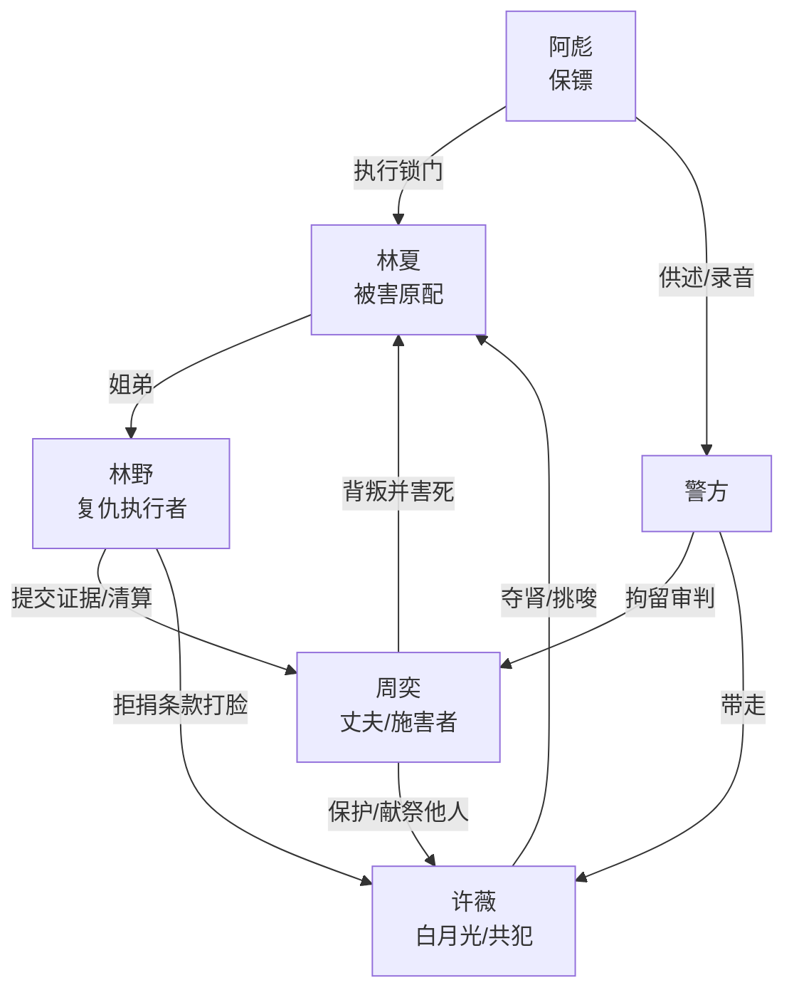

# 角色标签图谱

## 角色清单

### 林野 — 冷静复仇弟弟
- 叙事功能: 第一视角清算者，负责展示证据、控制节奏、完成情绪偿还。
- 核心标签: 冷、狠、护姐
- 弧光: 底层修车铺弟弟 → 掌握证据的复仇执行者 → 完成告别的幸存者
- 台词风格: 短句、冷讽、少解释
- 关键行为: 摆出骨灰、血衣、死亡证明、捐献条款；曝光旧账；买法拍别墅并清算遗产。
- 读者情绪关系: 代偿爽感、心疼、信任。

### 林夏 — 被背叛致死的姐姐
- 叙事功能: 情绪债核心来源，所有复仇的道德合法性来自她的死亡和旧爱旧恩。
- 核心标签: 隐忍、重情、惨烈
- 弧光: 救夫扶夫的妻子 → 被献祭的原配 → 死后仍拒绝施害者触碰
- 台词风格: 临终短促、干净
- 关键行为: 临死嘱托烧透扬灰；签下拒绝许薇的捐献条款；留下铁盒证据。
- 读者情绪关系: 极度心疼、替她要报应。

### 周奕 — 偏执恶夫/伪深情施害者
- 叙事功能: 主压迫者，承担傲慢、否认、崩塌、报应闭环。
- 核心标签: 自负、残忍、迟悔
- 弧光: 高高在上的总裁 → 不信死亡的施害者 → 跪地扒灰的罪犯 → 冻库幻觉疯子
- 台词风格: 命令式、侮辱式、狡辩式
- 关键行为: 指使锁冻库、逼捐肾、砸骨灰、威胁平坟。
- 读者情绪关系: 强恨点，读者期待他失去一切。

### 许薇 — 恶毒白月光/伪弱病人
- 叙事功能: 次压迫者和夺取者，负责制造“病弱外表 vs 恶毒内核”的反差。
- 核心标签: 装弱、贪婪、毒
- 弧光: 被保护的白月光 → 录音暴露的共犯 → 求肾失败的病人 → 痛苦惨死
- 台词风格: 茶味、柔弱、临死尖利
- 关键行为: 命令开大制冷机；索要林夏的肾；事发后甩锅周奕。
- 读者情绪关系: 厌恶、期待病痛报应。

### 阿彪 — 犯罪执行工具人
- 叙事功能: 连接施害命令与司法证据。
- 核心标签: 打手、证人、崩溃
- 弧光: 执行锁门 → 被警方抓捕 → 供出周奕
- 台词风格: 恐慌、结巴
- 关键行为: 锁冻库、电话实锤、录音存证。
- 读者情绪关系: 厌恶但功能性强。

### 李警官/警方 — 公权力清算者
- 叙事功能: 将私人复仇转为合法清算，抬高爽点可信度。
- 核心标签: 冷静、权威、执行
- 弧光: 入场定罪 → 证据确认 → 告知无期风险
- 台词风格: 公文式、短促
- 关键行为: 拘留周奕、带走许薇、播放录音、推进判决。
- 读者情绪关系: 安全感、正义补偿。

## 关系网络

## 角色功能对照表（供改编参考）

| 原角色 | 极致标签 | 叙事功能 | 读者情绪功能 | 改编时必须保留的 |
|--------|---------|---------|-------------|---------------|
| 林野 | 冷静复仇弟弟 | 执行清算 | 代偿爽 | 冷、少话、证据驱动 |
| 林夏 | 惨死原配姐姐 | 情绪债核心 | 心疼 | 临终嘱托+死后禁触碰 |
| 周奕 | 恶夫总裁 | 主反派 | 强恨点 | 傲慢否认到精神崩溃 |
| 许薇 | 恶毒白月光 | 次反派 | 厌恶 | 装弱外壳和恶毒录音 |
| 阿彪 | 执行打手 | 证据桥 | 司法实锤 | 电话/录音供述功能 |
| 警方 | 公权力 | 合法清算 | 正义感 | 拘留证、录音、判决 |
