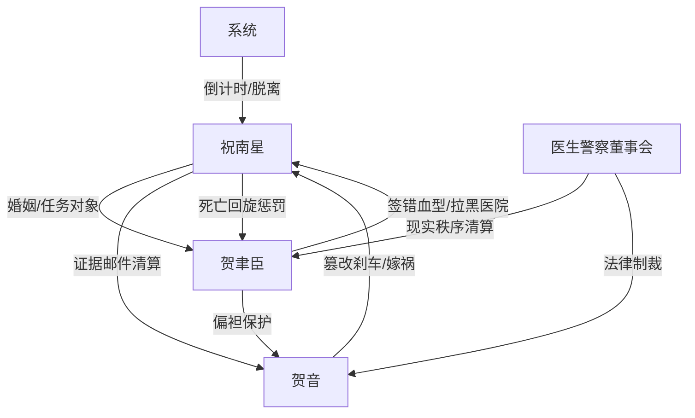

# 角色标签图谱

## 角色清单

### 祝南星 — 清醒赴死型系统大女主
- 叙事功能: 受害者、设局者、灵魂旁观者、最终脱身者
- 核心标签: 清醒、厌弃、冷静复仇
- 弧光: 温婉退让的贺太太 → 主动接受死亡流程 → 灵魂旁观清算 → 现实重生
- 台词风格: 短句、冷句、反问少但准
- 关键行为: 接受错输血型；打包贺音七年犯罪证据；锁定死后邮件；回归后碎掉原稿
- 读者情绪关系: 心疼、代入、爽、认同

### 贺聿臣 — 偏执财阀男主/迟来悔恨型反派
- 叙事功能: 直接施害者、情绪债制造者、悔恨承受器
- 核心标签: 傲慢、偏袒、疯魔
- 弧光: 高高在上的财阀丈夫 → 亲手害死妻子 → 失权崩溃 → 赛博复活疯魔 → 火海殉灭
- 台词风格: 命令式、指责式、后期哀求式
- 关键行为: 签错血型；拉黑医院；包庇贺音；冰棺藏尸；造 AI 女主；火灾不逃
- 读者情绪关系: 恨、厌恶、看他崩溃的爽

### 贺音 — 绿茶疯批黑客养妹
- 叙事功能: 初始恶源、女配压迫者、男主偏袒对象、自毁触发器
- 核心标签: 天才黑客、装柔弱、无底线
- 弧光: 被宠坏的“天才养妹” → 犯罪证据曝光 → 审讯室反咬 → 无期徒刑
- 台词风格: 前期撒娇装委屈，独处时挑衅恶毒，后期尖叫甩锅
- 关键行为: 篡改刹车；篡改监护仪；破坏智能驾驶系统；审讯室诬陷贺聿臣
- 读者情绪关系: 恨、恶心、期待严惩

### 系统 — 规则执行器/冷静见证者
- 叙事功能: 提供脱离任务规则、倒计时、锁定邮件、最终回归通道
- 核心标签: 冰冷、精准、边界清晰
- 弧光: 任务播报器 → 死亡辅助器 → 世界线收束者 → 告别者
- 台词风格: 机械提示，末章略有人性化
- 关键行为: 提醒死亡流程；屏蔽痛觉；锁定定时邮件；带女主回家
- 读者情绪关系: 安全感、确定性、爽点执行保障

### 医生/护士/助理/警察/董事会 — 外部现实秩序
- 叙事功能: 证据确认、道德裁决、社会清算
- 核心标签: 见证、执行、反衬
- 弧光: 被贺聿臣忽视的外部秩序 → 清算力量
- 台词风格: 医疗/法律/商业公事化
- 关键行为: 宣告死亡；指出签错血型；逮捕贺音；罢免贺聿臣
- 读者情绪关系: 替读者审判反派

## 关系网络

## 角色功能对照表（供改编参考）

| 原角色 | 极致标签 | 叙事功能 | 读者情绪功能 | 改编时必须保留的 |
|--------|---------|---------|-------------|---------------|
| 祝南星 | 清醒赴死大女主 | 主动受死并设局 | 心疼、爽、认同 | 主动选择死亡流程；死后不回头 |
| 贺聿臣 | 偏袒型财阀男主 | 最大情绪债债主 | 恨、看崩溃 | 亲手造成死亡；迟来疯魔 |
| 贺音 | 疯批绿茶养妹 | 直接恶源 | 厌恶、等报应 | 装弱和作恶双面性；后期反咬 |
| 系统 | 规则执行器 | 保证死亡与回归闭环 | 安全感 | 不抢复仇主导，只提供规则 |
| 外部秩序 | 医疗/法律/商业裁决 | 清算执行 | 公正补偿 | 用文件、证据、逮捕令落地 |
