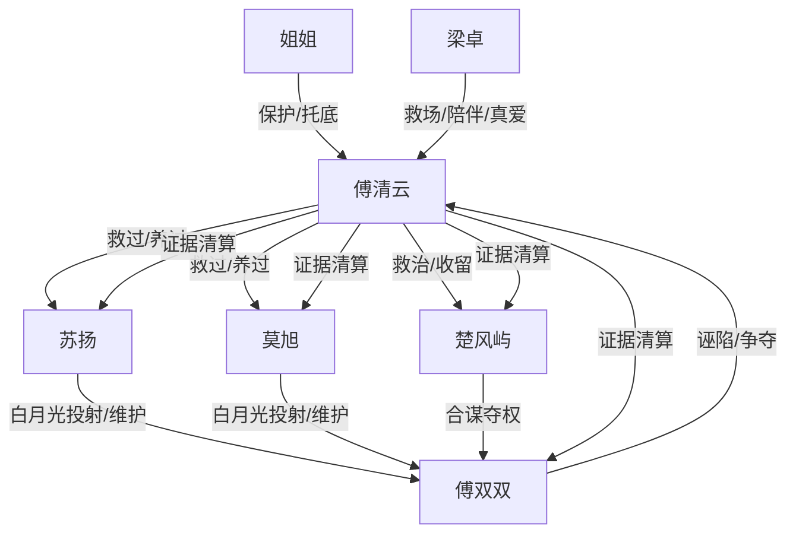

# 角色标签图谱

## 角色清单

### 傅清云 — 弹幕觉醒型清醒富婆女主
- 叙事功能: 主视角、受害者、反杀执行者、主题承载者。
- 核心标签: 清醒、果断、有创伤但不软弱。
- 弧光: 被弹幕定义的恶毒女配 → 设局反杀的主体 → 走向自由与幸福的人。
- 台词风格: 短句、反问、直接拒绝。
- 关键行为: 赶走三男、报警设局、法庭拒绝原谅、旅行疗愈。
- 读者情绪关系: 前期心疼，中段代入爽，后期获得补偿满足。

### 傅双双 — 白月光假千金/伪女主
- 叙事功能: 外部威胁、三男欲望投射、庭审反噬触发器。
- 核心标签: 装柔弱、会设局、自利。
- 弧光: 被三男众星拱月 → 法庭反水自保 → 入狱失势。
- 台词风格: 茶言茶语、装无辜。
- 关键行为: 回国挑衅、操控下药绑架戏码、法庭反水。
- 读者情绪关系: 恨、恶心、期待被拆穿。

### 苏扬 — 温柔儒雅外皮的软弱共犯
- 叙事功能: “被救者反咬”的情绪债载体之一。
- 核心标签: 儒雅、摇摆、自我感动。
- 弧光: 自杀被救 → 主动留在女主身边 → 维护傅双双伤害女主 → 法庭悔悟。
- 台词风格: 看似温和，实则道德绑架。
- 关键行为: 诬陷女主、捏下巴灌药、庭审崩塌。
- 读者情绪关系: 从轻蔑到厌恶。

### 莫旭 — 暴躁小狼狗变白眼狼
- 叙事功能: 情绪爆点制造者、暴力压迫者。
- 核心标签: 冲动、护白月光、恩将仇报。
- 弧光: 落魄男模被救 → 傲娇留宿 → 为傅双双冲女主发疯 → 入狱后纠缠。
- 台词风格: 怒吼、叫嚣、幼稚威胁。
- 关键行为: 砸壶、闯会所、指控女主、出狱纠缠。
- 读者情绪关系: 恨其蠢坏，爽其破防。

### 楚风屿 — 王子皮相下的法制咖恶魔
- 叙事功能: 最大犯罪者、证据反杀核心对象。
- 核心标签: 阴狠、勒索、权力幻想。
- 弧光: 被挑断手筋脚筋的落魄王子 → 被女主救治 → 偷拍勒索惯犯 → 三十年判刑。
- 台词风格: 冷酷命令、威胁感强。
- 关键行为: 逼跪殴打、艳照威胁、密谋夺股权。
- 读者情绪关系: 极致厌恶，期待法律重判。

### 傅清云姐姐 — 霸总护妹/信息差掘金者
- 叙事功能: 亲情补偿、资源托底、价值观对照。
- 核心标签: 护短、有钱、聪明。
- 弧光: 默默监控三男 → 支持女主决断 → 用弹幕做生意。
- 台词风格: 直接、霸气、带喜感。
- 关键行为: 给证据、转五百万、送黑卡、借弹幕赚钱。
- 读者情绪关系: 安全感、爽、喜爱。

### 梁卓 — 正直飞行员/疗愈型真男主
- 叙事功能: 救场者、情感补偿、健康关系样本。
- 核心标签: 正气、稳定、尊重。
- 弧光: 偶然救下女主 → 三年陪伴 → 假男友成真爱 → 丈夫与父亲。
- 台词风格: 温柔坚定，不争抢主导权。
- 关键行为: 会所救人、长期联系、做饭照顾、弹幕挑拨时第一时间表态。
- 读者情绪关系: 安心、甜、补偿。

## 关系网络

## 角色功能对照表（供改编参考）

| 原角色 | 极致标签 | 叙事功能 | 读者情绪功能 | 改编时必须保留的 |
|--------|---------|---------|-------------|---------------|
| 傅清云 | 清醒富婆女主 | 觉醒、设局、清算、疗愈 | 代入与爽感 | 立刻切割、不求回头、不原谅 |
| 傅双双 | 伪女主白月光 | 引诱三男作恶 | 恨点集中 | 装柔弱与法庭反水 |
| 苏扬 | 儒雅共犯 | 道德绑架型背叛 | 憋屈与反感 | 受恩后伤害女主 |
| 莫旭 | 暴躁白眼狼 | 暴力冲突 | 愤怒 | 冲动护白月光 |
| 楚风屿 | 法制咖王子 | 犯罪证据核心 | 极致恨点 | 偷拍勒索/逼签把柄 |
| 姐姐 | 霸总护妹 | 亲情托底 | 安全感 | 给证据、给资源、绝不背叛 |
| 梁卓 | 稳定真男主 | 甜宠补偿 | 治愈 | 低谷救场、长期陪伴 |
