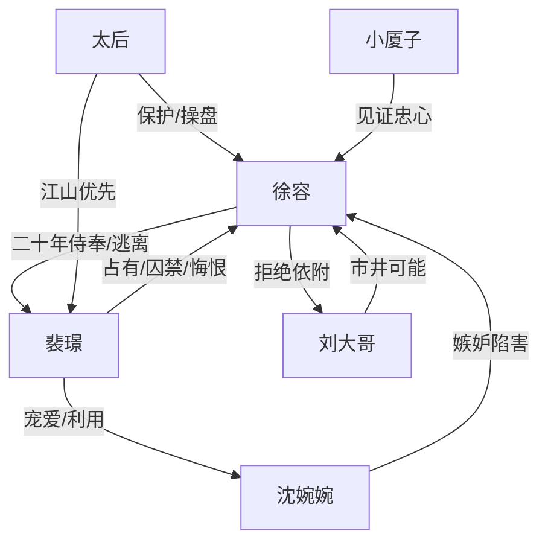

# 角色标签图谱

## 角色清单

### 徐容 — 清醒隐忍的逃笼女主
- 叙事功能: 受害者、见证者、反抗者，承担“拒绝被爱奴役”的主题。
- 核心标签: 女扮男装、首领太监、自由执念
- 弧光: 忠心护主 → 被宠爱囚禁 → 以死亡换自由 → 市井终老
- 台词风格: 克制、冷静、短句见血
- 关键行为: 主动认罪去皇陵；假死逃离；自刺心口留下诅咒；最终选择无墓无碑。
- 读者情绪关系: 心疼、憋屈、敬佩、替她解脱。

### 裴璟 — 疯批帝王/占有型伪情种
- 叙事功能: 核心压迫源，推动女主一次次逃离。
- 核心标签: 帝王、依赖成瘾、权力病
- 弧光: 少年依赖 → 帝王占有 → 悔恨疯狂 → 孤独早亡
- 台词风格: 命令式、亲昵称谓与威胁并存
- 关键行为: 放任贵妃折辱徐容；前世囚宠；皇陵追人；江南识破；容居囚禁。
- 读者情绪关系: 恨、恐惧、复杂怜悯。

### 沈婉婉 — 娇纵贵妃/误入权力局的输家
- 叙事功能: 前期表层反派，制造诬陷与宫斗压力。
- 核心标签: 金尊玉贵、嫉妒、骄傲
- 弧光: 受宠胜利者 → 失宠死局 → 两世皆败
- 台词风格: 娇纵、刻薄、胜利者姿态
- 关键行为: 自导自演肚兜陷害；送行羞辱；干政被赐死。
- 读者情绪关系: 前期恨，后期意识到她也是输家。

### 太后 — 温和外壳下的权力母亲
- 叙事功能: 保护者与操盘者双重身份，代表皇权秩序。
- 核心标签: 清醒、权衡、江山优先
- 弧光: 承诺放徐容出宫 → 为江山召她回笼 → 协助假死
- 台词风格: 平静、理性、带上位者威压
- 关键行为: 识破女身；劝她入后宫；赐死贵妃；提供假死药。
- 读者情绪关系: 信任与警惕并存。

### 小厦子 — 宫中温情见证者
- 叙事功能: 证明徐容多年付出被旁人看见。
- 核心标签: 孝顺、忠心、天真
- 弧光: 相信陛下离不开徐容 → 见证真心无用
- 台词风格: 低声、关切、宫人语气
- 关键行为: 烈日下送水安慰。
- 读者情绪关系: 提供短暂暖意。

### 刘大哥 — 普通生活的可能性
- 叙事功能: 市井自由的具象化，不是爱情救赎，而是正常人间。
- 核心标签: 厚道、踏实、烟火气
- 弧光: 暗恋徐容 → 释然另娶 → 普通生活继续
- 台词风格: 朴素、实在
- 关键行为: 挑水劈柴；最后与徐容和平错过。
- 读者情绪关系: 安心、遗憾、释然。

## 关系网络

## 角色功能对照表（供改编参考）

| 原角色 | 极致标签 | 叙事功能 | 读者情绪功能 | 改编时必须保留的 |
|--------|---------|---------|-------------|---------------|
| 徐容 | 清醒逃笼女主 | 主视角与价值锚点 | 心疼、爽、释然 | 拒绝权力给予的“尊贵” |
| 裴璟 | 疯批伪情种 | 核心压迫源 | 恨、恐惧、复杂 | 爱与占有不可分割 |
| 沈婉婉 | 娇纵表层反派 | 前期冲突引线 | 恨到怜悯 | 她也被宫墙吞噬 |
| 太后 | 权力母亲 | 规则代言人 | 不安、压迫 | 私情服从江山 |
| 刘大哥 | 烟火气普通人 | 自由参照物 | 安心 | 普通生活不是新恋爱爽点 |
