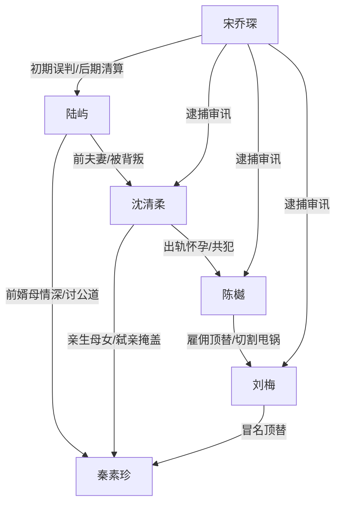

# 角色标签图谱

## 角色清单

### 陆屿 — 冷静破案型前女婿
- 叙事功能: 第一人称视角、真相发现者、情绪债承受者、清算触发者。
- 核心标签: 冷静、重情、细节控
- 弧光: 离婚后的疲惫男人 → 被全网误解的报警人 → 揭开命案的关键证人
- 台词风格: 短、硬、直指事实，如“她不是我岳母”“来不及了，再晚他们就跑了”
- 关键行为: 看到照片报警；公开旧伤细节；递交照片；解释幽闭恐惧症。
- 读者情绪关系: 心疼、代入、期待他洗清污名。

### 秦素珍 — 被害慈母/道德锚点
- 叙事功能: 全文情绪核心与道德坐标，证明主角不是因爱生恨，而是为亲情讨公道。
- 核心标签: 善良、正直、护短
- 弧光: 生前待女婿如子 → 死后被顶替亵渎 → 真相大白获公道
- 台词风格: 温和、体谅、长辈式关怀
- 关键行为: 退彩礼、曾拿养老金帮陆屿、反对女儿出轨未婚先孕。
- 读者情绪关系: 心疼、惋惜、激发复仇正当性。

### 沈清柔 — 虚荣弑母前妻
- 叙事功能: 主反派之一，制造婚姻背叛、亲情背叛和舆论压迫。
- 核心标签: 出轨、虚荣、冷血
- 弧光: 嚣张羞辱前夫 → 阻挠调查 → 崩溃甩锅
- 台词风格: 攻击性强，常用“失败男人”“复婚想都不要想”压低男主。
- 关键行为: 婚内出轨怀孕；参与顶替计划；阻挠检查；掩盖命案。
- 读者情绪关系: 恨、厌恶、期待重判。

### 陈樾 — 伪善富男/主谋型新欢
- 叙事功能: 外部诱因与阶层羞辱来源，推动杀人和顶替方案。
- 核心标签: 炫富、伪善、自私
- 弧光: 搂腰炫耀 → 直播围剿 → 事发后切割甩锅
- 台词风格: 表面客气，实则羞辱，“陆屿哥”式伪善。
- 关键行为: 发短信刺激陆屿；直播；失手推死秦素珍；策划顶替。
- 读者情绪关系: 恨、恶心、期待反噬。

### 刘梅 — 贪财替身
- 叙事功能: 身份反差机制的承载者，后半真相供述工具人。
- 核心标签: 相似脸、贪财、麻木
- 弧光: 假扮慈母 → 被物证击穿 → 供述骗局
- 台词风格: 前期模仿秦素珍温和，后期平淡供述。
- 关键行为: 手部整形；模仿生活习惯；顶替死者；供出藏尸地点。
- 读者情绪关系: 厌恶但非最高恨点，功能是揭开预谋深度。

### 宋乔琛 — 公权力反转执行者
- 叙事功能: 从误判者转为清算者，承接证据并完成权威翻盘。
- 核心标签: 严肃、程序化、可纠错
- 弧光: 质疑报假警 → 看见证据后逮捕 → 道歉并确认功劳
- 台词风格: 命令式、法律化。
- 关键行为: 搜查、要求检查、下令逮捕、封锁现场。
- 读者情绪关系: 前期憋屈来源之一，后期爽点执行者。

## 关系网络

## 角色功能对照表（供改编参考）

| 原角色 | 极致标签 | 叙事功能 | 读者情绪功能 | 改编时必须保留的 |
|--------|---------|---------|-------------|---------------|
| 陆屿 | 冷静破案型前女婿 | 真相发现者 | 心疼、代入、爽 | 被误解但持续拿证据 |
| 秦素珍 | 被害慈母 | 道德锚点 | 心疼、正义感 | 生前对主角有具体恩情 |
| 沈清柔 | 虚荣弑母前妻 | 主反派 | 恨、厌恶 | 亲情背叛+阻挠调查 |
| 陈樾 | 伪善富男 | 阶层羞辱/谋划者 | 恨、期待崩塌 | 炫耀刺激主角且事后甩锅 |
| 刘梅 | 贪财替身 | 身份反转载体 | 惊悚、厌恶 | 高仿身体特征和习惯 |
| 宋乔琛 | 公权力执行者 | 权威清算 | 爽、安心 | 从质疑到执行逮捕 |
