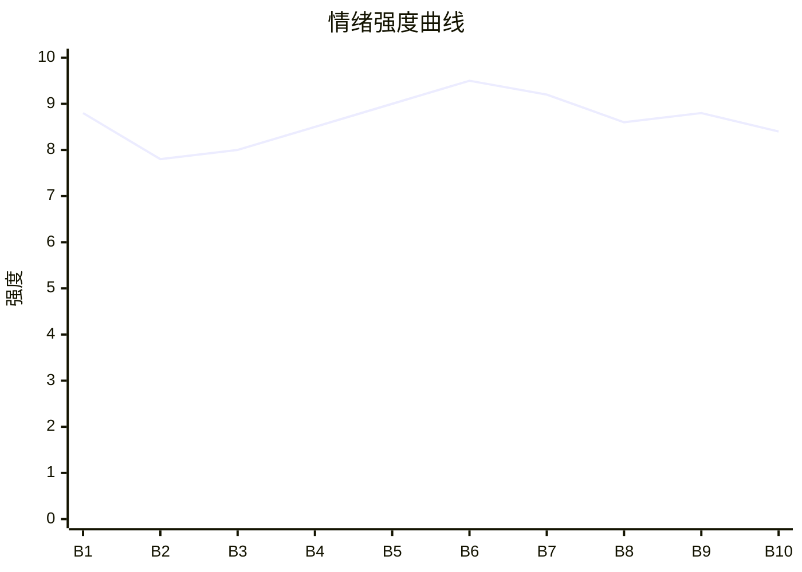

# Beat Sheet 节拍器

## 全文概况

- 总字数: 约 11800 字
- 节拍数: 10 幕
- 核心母题（Logline）: 被全班害死的班长重生回高考前夜，拒绝再救煽动迟到的同学，并用证据链让甩锅者自食其果。
- 情绪模式: 前世极致冤屈 → 今生冷静抽身 → 外部围堵加压 → 证据反杀 → 官方清算 → 人生补偿

## 节拍详表

### Beat 1: 高考前夜重生退群 [开篇-1 前]

- **字数**: 约 850 字（占比 7%）
- **核心事件**: 周砚号召全班高考迟到，苏野回忆前世被烧死，重生后退出班级群。
- **情绪标签**: 震惊、憋屈、冷意、期待
- **情绪强度**: 8.8/10
- **情绪方向**: ⚡突变
- **冲突类型**: 大转折
- **悬念钩子**: 苏野不再救人后，全班会怎样？
- **叙事速度**: 快
- **对话占比**: 35%
- **reversal_mechanism**: [M3]
- **hook_strength**: 9.0/10
- **关键句**: “我反手退出班级群。祝你们反抗成功。”
- **原文摘录**: “高考前夜，校霸周砚在群里发了一段语音。‘明天第一场语文，全班统一迟到十分钟进考场。’……他们把我锁进废弃教室，任由大火烧了一整夜。再睁眼，我又回到了周砚在群里号召全班迟到的那一刻。我反手退出班级群。祝你们反抗成功。”

### Beat 2: 青梅与班主任双重施压 [1]

- **字数**: 约 1500 字（占比 13%）
- **核心事件**: 林知夏和老赵逼苏野回群道歉，苏野提醒规则后拉黑二人。
- **情绪标签**: 愤怒、荒唐、清醒
- **情绪强度**: 7.8/10
- **情绪方向**: ↑上升
- **冲突类型**: 微冲突
- **悬念钩子**: 林骁动摇，但全班仍被周砚裹挟。
- **叙事速度**: 中快
- **对话占比**: 60%
- **reversal_mechanism**: [M3]
- **hook_strength**: null
- **关键句**: “你们觉得迟到十分钟很酷，那就去酷，少带上我。”
- **原文摘录**: “林知夏……‘周砚号召明天高考迟到十分钟，是为了向应试教育宣战！’……我低头看了一眼桌上的透明文件袋。准考证、身份证、签字笔、2B铅笔。一样不少。‘林知夏，高考开考十五分钟后不得入场。’……班主任老赵……‘周砚是在帮大家做心理脱敏。’……我挂断电话，把老赵也拉进黑名单。”

### Beat 3: 直播网暴与父母支持 [2]

- **字数**: 约 1300 字（占比 11%）
- **核心事件**: 周砚直播泄露苏野信息，引导网暴；苏野录屏，并得到父母支持。
- **情绪标签**: 压迫、孤立、安心
- **情绪强度**: 8.0/10
- **情绪方向**: ↑上升
- **冲突类型**: 大转折
- **悬念钩子**: 周砚宣布奶茶店集合，陌生人威胁“考点见”。
- **叙事速度**: 快
- **对话占比**: 45%
- **reversal_mechanism**: [M1]
- **hook_strength**: null
- **关键句**: “我盯着屏幕，反手点开录屏。”
- **原文摘录**: “周砚开直播了。【高考前夜，重点班全员迟到十分钟，向应试教育宣战】……我的头像，名字，学校，只打了薄薄一层码。……爸爸说：‘明天谁找你，你都不要理。谁拦你，你就往警察和老师身边走。’……陌生号码发来短信。‘明天考点见。叛徒。’”

### Beat 4: 考点围堵与准时入场 [3]

- **字数**: 约 1350 字（占比 11%）
- **核心事件**: 网暴者和林知夏在考点外围堵苏野，苏野报警并准时入场。
- **情绪标签**: 紧张、痛快、切割
- **情绪强度**: 8.5/10
- **情绪方向**: ↑上升
- **冲突类型**: 大转折
- **悬念钩子**: 周砚临时改成开考后出发。
- **叙事速度**: 快
- **对话占比**: 55%
- **reversal_mechanism**: [M1, M3]
- **hook_strength**: null
- **关键句**: “警察同志，有人阻止我参加高考！”
- **原文摘录**: “两个男生举着手机冲过来……‘全班都在奶茶店等你，你真要一个人进去？’……林知夏从奶茶店冲出来，一把抓住我的手腕。‘你成绩好，少考十分钟根本不会怎么样。’……我提高声音。‘警察同志，有人阻止我参加高考！’……九点整，铃声响起。语文考试正式开始。”

### Beat 5: 全班缺考后集体甩锅 [4]

- **字数**: 约 1400 字（占比 12%）
- **核心事件**: 全班语文缺考，周砚、林知夏、老赵集体把责任推给苏野。
- **情绪标签**: 愤怒、荒谬、期待清算
- **情绪强度**: 9.0/10
- **情绪方向**: ↑上升
- **冲突类型**: 大转折
- **悬念钩子**: 苏野拿出备用手机，准备播放证据。
- **叙事速度**: 快
- **对话占比**: 70%
- **reversal_mechanism**: [M1, M3]
- **hook_strength**: null
- **关键句**: “既然你们都说是我害的。那我们就趁着午休时间算清楚。”
- **原文摘录**: “重点班，三十多个人，全被拦在外面。……周砚抬手指向我。‘是他！’……林知夏冲过来……‘这次这么大的事，你为什么不管？’……老赵挤进人群。‘苏野，这件事你确实有责任。’……我从书包夹层里拿出备用手机。”

### Beat 6: 证据链第一轮反杀 [5]

- **字数**: 约 1450 字（占比 12%）
- **核心事件**: 苏野播放群语音、林知夏发言、老赵录音、直播和围堵视频，舆论倒转。
- **情绪标签**: 痛快、反杀、清算
- **情绪强度**: 9.5/10
- **情绪方向**: ⚡突变
- **冲突类型**: 大转折
- **悬念钩子**: 官方要求周砚、林知夏、老赵配合调查。
- **叙事速度**: 快
- **对话占比**: 60%
- **reversal_mechanism**: [M1, M3, M6]
- **hook_strength**: null
- **关键句**: “赵老师，您刚才不是说，如果我第一时间告诉您，您一定会管吗？”
- **原文摘录**: “手机里，周砚的声音清清楚楚传出来。……‘谁准时去，谁就是怂包。’……老赵的声音从手机里传出来……‘这是在帮大家做考前心理脱敏。’……我点开今天早上保存的视频。……考务负责人带着执勤民警从校门里走出来。”

### Beat 7: 内部互咬与热搜爆炸 [6-7]

- **字数**: 约 1700 字（占比 14%）
- **核心事件**: 周砚甩锅“自愿”，林骁反噬，热搜冲上榜，家长和教育局介入。
- **情绪标签**: 崩塌、报应、失控
- **情绪强度**: 9.2/10
- **情绪方向**: →高位
- **冲突类型**: 大转折
- **悬念钩子**: 林知夏再次求苏野改口。
- **叙事速度**: 快
- **对话占比**: 65%
- **reversal_mechanism**: [M3, M6]
- **hook_strength**: null
- **关键句**: “我讨厌考试，不代表我想缺考！”
- **原文摘录**: “周砚……‘我没有组织迟到。我只是提议。是他们自己愿意来的。’……林骁第一个崩溃。……热搜榜尾，一个词条正在飞速上升。#重点班直播迟到全员缺考#……教育局的人很快赶到。”

### Beat 8: 亲情求情与拒绝做救世主 [8]

- **字数**: 约 1300 字（占比 11%）
- **核心事件**: 林母求苏野放过林知夏，林骁崩溃错过数学，周砚父母试图洗白。
- **情绪标签**: 冷静、失望、拒绝
- **情绪强度**: 8.6/10
- **情绪方向**: →平稳高位
- **冲突类型**: 微冲突
- **悬念钩子**: 周砚父母洗白被推上新热搜。
- **叙事速度**: 中
- **对话占比**: 50%
- **reversal_mechanism**: [M3]
- **hook_strength**: null
- **关键句**: “这一次，我不做救世主。”
- **原文摘录**: “林母……‘知夏她不是故意的。’……我平静地说：‘阿姨，现场有监控。我说了不算。’……林骁蹲在地上哭起来。‘我完了。’……#周砚父母称儿子只是热血# 周砚的脸色，彻底变了。”

### Beat 9: 最后求情与情感切断 [9]

- **字数**: 约 1350 字（占比 11%）
- **核心事件**: 林知夏最后一次求苏野帮忙，周砚晕倒制造道德压力，苏野继续进考场，父母赶到。
- **情绪标签**: 决绝、补偿、释然
- **情绪强度**: 8.8/10
- **情绪方向**: ↓缓降
- **冲突类型**: 微冲突
- **悬念钩子**: 高考结束后的处理结果。
- **叙事速度**: 中
- **对话占比**: 55%
- **reversal_mechanism**: [M3]
- **hook_strength**: null
- **关键句**: “可惜。没有下一次了。”
- **原文摘录**: “林知夏……‘最后一次。你就帮我最后一次。’……‘可这条路，不是我铺的。’……周砚倒在了地上。……我把准考证递过去。老师看了看我，轻声说：‘别受影响。’……‘可惜。没有下一次了。’”

### Beat 10: 官方清算与人生重启 [10]

- **字数**: 约 1700 字（占比 14%）
- **核心事件**: 周砚成绩无效，林知夏记入诚信档案，老赵停职；苏野考上大学，完成价值观收束。
- **情绪标签**: 爽、释然、重生
- **情绪强度**: 8.4/10
- **情绪方向**: ↓缓降
- **冲突类型**: 大转折收束
- **悬念钩子**: 无，完成闭环。
- **叙事速度**: 中
- **对话占比**: 35%
- **reversal_mechanism**: [M3]
- **hook_strength**: null
- **关键句**: “准时入场，正常发挥。”
- **原文摘录**: “高考结束后第三天，处理结果下来了。周砚……全部考试成绩无效。林知夏……记入诚信档案。老赵停职调查。……我拍了张照片发朋友圈。配文只有一句：‘准时入场，正常发挥。’……不是所有人都值得拉一把。有些人奔向深渊时，手里还攥着刀。”

## 情绪曲线可视化

## 节拍密度检测

- 平均每 1180 字一个节拍
- 微冲突密度: 每约 2500 字一次
- 大转折密度: 每约 1400 字一次
- 判定: 符合高频节拍器标准

## 反转机制清单(Reversal Mechanisms)

| 机制 ID | 机制名 | 承载 Beat | 关键段落/金句 | 等价改编提示 |
|--------|--------|-----------|--------------|-------------|
| M1 | 死环反杀 | Beat 3-6 | “我盯着屏幕，反手点开录屏。” / “赵老师，您刚才不是说……” | 固化载体必须换，但“证据反向锁死甩锅者”的结构不换。 |
| M3 | 因果回旋反讽 | Beat 1-10 | “祝你们反抗成功。” / “准时入场，正常发挥。” | 施害者的规则必须在结尾被主角原样回敬或价值反转。 |
| M6 | 多层递进反转 | Beat 4-7 | 入场反转、缺考反转、证据反转、热搜官方反转 | 层数不能少，每层量级从个人冲突升到公共事件。 |
