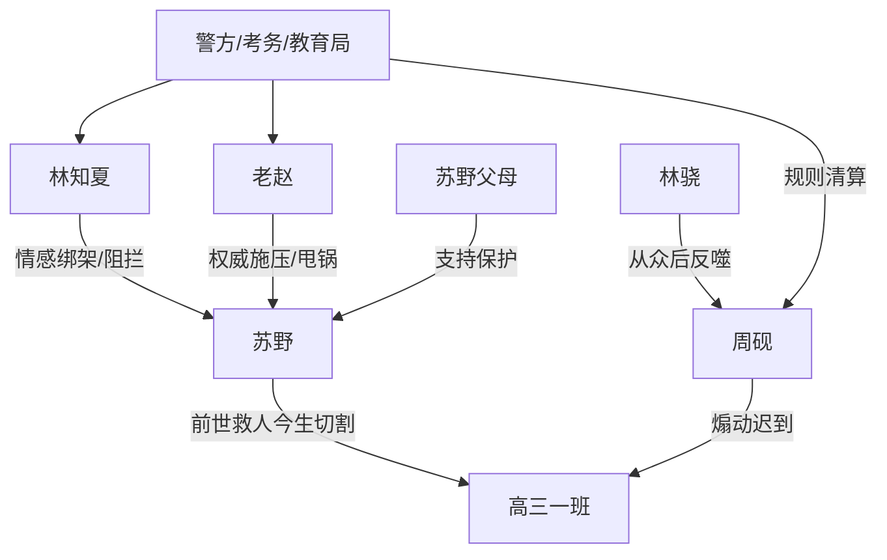

# 角色标签图谱

## 角色清单

### 苏野 — 清醒重生复仇者

- 叙事功能: 主视角、证据链收集者、道德坐标锚点。
- 核心标签: 清醒、克制、规则反击
- 弧光: 前世滥好人救世主 → 今生先保护自己
- 台词风格: 短句、冷讽、直接切割
- 关键行为: 退群、拉黑、录屏、报警、播放证据、拒绝作伪证
- 读者情绪关系: 心疼、代入、爽

### 周砚 — 热血包装的自私校霸

- 叙事功能: 核心施害者、迟到事件发起者、甩锅源头。
- 核心标签: 煽动型领袖、伪热血、甩锅
- 弧光: 群体偶像 → 缺考罪魁 → 成绩无效
- 台词风格: 口号化、道德绑架、事后推责
- 关键行为: 号召迟到、直播网暴、泄露信息、缺考后指认苏野
- 读者情绪关系: 恨、厌恶、期待报应

### 林知夏 — 背刺青梅/恋爱脑帮凶

- 叙事功能: 情感债来源，负责把公共冲突变成私人背叛。
- 核心标签: 青梅背刺、双标、情感绑架
- 弧光: 崇拜周砚 → 阻止苏野 → 求苏野作伪证 → 被切割
- 台词风格: 指责式、撒娇式求情、道德绑架
- 关键行为: 打电话逼道歉、考点拉扯、要求苏野陪复读、求改口
- 读者情绪关系: 恨、失望、爽点对象

### 老赵 — 失职甩锅班主任

- 叙事功能: 成人权威反派，放大事件的制度荒诞。
- 核心标签: 失职、偏袒、甩锅
- 弧光: 威严训斥 → 录音曝光 → 停职调查
- 台词风格: 命令式、官腔、推责
- 关键行为: 鼓励“心理脱敏”、逼苏野发红包、缺考后甩锅班长
- 读者情绪关系: 愤怒、期待被查

### 林骁 — 从众者/反噬见证人

- 叙事功能: 展示群体裹挟的代价，触发内部互咬。
- 核心标签: 怯懦、从众、后悔
- 弧光: 犹豫 → 跟随 → 崩溃 → 复读
- 台词风格: 发抖、哭诉、事后清醒
- 关键行为: 向苏野求确认、缺考后推周砚、热评反击
- 读者情绪关系: 可怜但不免责

### 苏野父母 — 亲情支持者

- 叙事功能: 给主角正向情感支撑，确认道德坐标。
- 核心标签: 理性、保护、托底
- 弧光: 远程担忧 → 现场支持 → 送入大学
- 台词风格: 简短、明确、保护性强
- 关键行为: 告诉苏野靠近警察老师、拒绝林知夏、教育“先保护自己”
- 读者情绪关系: 安心、补偿

## 关系网络

## 角色功能对照表（供改编参考）

| 原角色 | 极致标签 | 叙事功能 | 读者情绪功能 | 改编时必须保留的 |
|--------|---------|---------|-------------|---------------|
| 苏野 | 清醒重生复仇者 | 主视角与反杀执行者 | 代入、爽 | 冷静、不主动害人、证据反击 |
| 周砚 | 伪热血校霸 | 核心施害者 | 恨、报应期待 | 口号煽动+事后甩锅 |
| 林知夏 | 背刺青梅 | 情感债 | 痛、恨 | 前世参与伤害+今生求原谅 |
| 老赵 | 失职权威 | 制度荒诞 | 愤怒 | 先不管、后甩锅、被录音 |
| 林骁 | 从众受害者 | 群体代价 | 复杂、警醒 | 犹豫但选择错误 |
