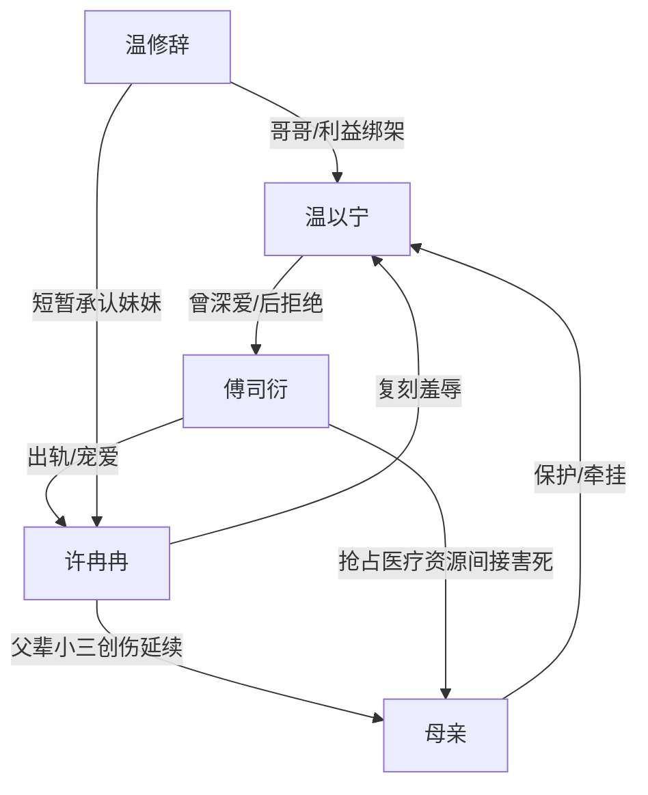

# 角色标签图谱

## 角色清单

### 温以宁 — 创伤型清醒退场女主
- 叙事功能: 承载全部情绪债，死亡后触发火葬场清算。
- 核心标签: 被背叛、失去生育能力、冷静退场。
- 弧光: 依恋傅司衍 → 忍痛分手 → 母亲死亡后彻底绝望 → 临终拒绝。
- 台词风格: 短、冷、少控诉。
- 关键行为: 提分手、磕头求医、跳楼、临终拒绝傅司衍。
- 读者情绪关系: 心疼、代入、替她恨所有施害者。

### 傅司衍 — 救赎者堕落成加害者的追悔渣男
- 叙事功能: 最大温度反转载体；前史救赎，现实施害，后期悔恨。
- 核心标签: 出轨、傲慢、自我合理化。
- 弧光: 承诺守护 → 反复背叛 → 逼死女主 → 墓前殉情。
- 台词风格: 前期轻佻羞辱，后期崩溃乞求。
- 关键行为: 拿女主和小三比较、抢医生、要求道歉、清算许冉冉、自尽。
- 读者情绪关系: 前期恨，后期不完全怜悯，主要提供迟来报应。

### 许冉冉 — 父辈小三创伤复刻者
- 叙事功能: 外部挑衅源，把父母辈伤害复制到女主身上。
- 核心标签: 私生女、小三、白莲挑衅。
- 弧光: 登堂入室 → 怀孕上位 → 女主死后失势 → 被极端清算。
- 台词风格: 甜腻、挑衅、装委屈。
- 关键行为: 免提羞辱、戴戒指挑衅、逼女主磕头、辱骂死者。
- 读者情绪关系: 强恨点，承担终局清算爽点。

### 温修辞 — 利益化变质哥哥
- 叙事功能: 摧毁女主最后亲情依靠，后期执行部分清算。
- 核心标签: 护妹旧影、利益妥协、迟来悔恨。
- 弧光: 曾经护妹 → 逼妹忍耐 → 目睹妹妹坠楼 → 悔恨清算。
- 台词风格: 前期说教，后期暴烈。
- 关键行为: 阻止分手、承认许冉冉也是妹妹、殴打傅司衍、驱逐许冉冉。
- 读者情绪关系: 恨其背叛，也接受其后期悔恨。

### 母亲 — 原生创伤与情绪债锚点
- 叙事功能: 将父辈出轨创伤具象化；她的死亡把矛盾推到不可逆。
- 核心标签: 家暴受害者、病弱、唯一温情。
- 弧光: 被保护者 → 受刺激病发 → 延误救治死亡。
- 台词风格: 温柔、担忧。
- 关键行为: 跟去别墅、看见许冉冉、病发。
- 读者情绪关系: 心疼、激发复仇期待。

## 关系网络

## 角色功能对照表（供改编参考）

| 原角色 | 极致标签 | 叙事功能 | 读者情绪功能 | 改编时必须保留的 |
|--------|---------|---------|-------------|---------------|
| 温以宁 | 创伤型清醒退场女主 | 承债与退场 | 心疼、代入 | 冷静放弃、临终拒绝 |
| 傅司衍 | 追悔渣男 | 温度反转核心 | 恨、看他崩溃 | 曾经真承诺+现实背叛 |
| 许冉冉 | 白莲私生女小三 | 挑衅与清算对象 | 恨、等报应 | 复刻上一代小三创伤 |
| 温修辞 | 变质护妹哥哥 | 亲情背刺 | 二次伤害、迟来悔恨 | 利益绑架妹妹 |
| 母亲 | 原生创伤锚点 | 不可逆死亡 | 心疼、愤怒 | 被延误救治死亡 |
