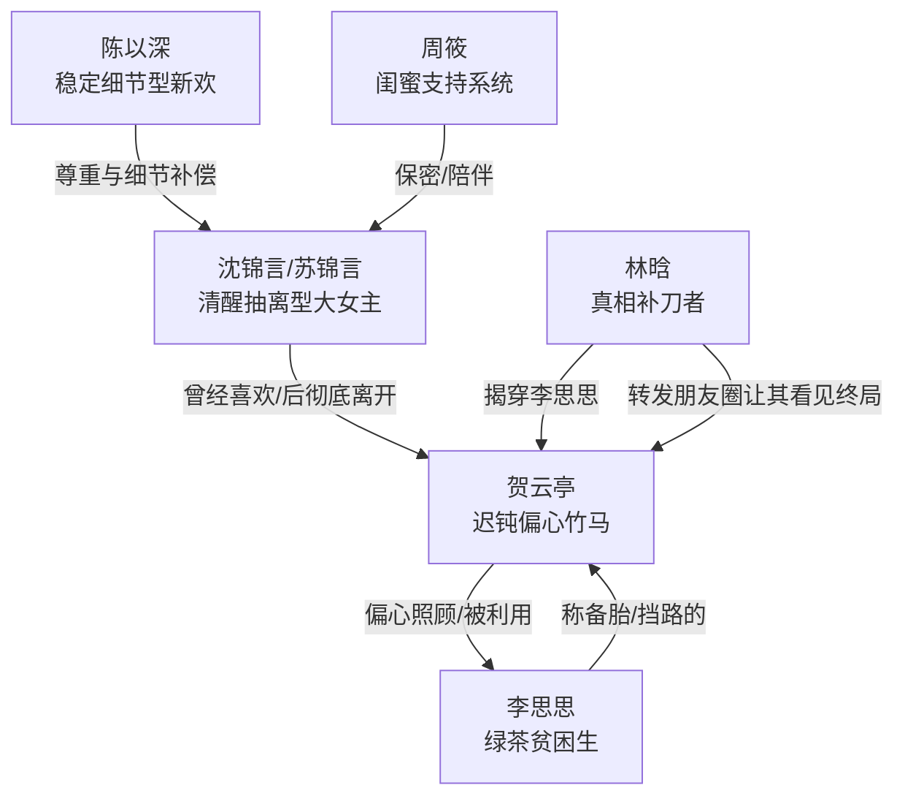

# 角色标签图谱

## 角色清单

### 沈锦言 / 苏锦言 — 清醒抽离型大女主
- 叙事功能: 受害者、裁判者、离开者，负责让读者体验“我不争了但我赢了”。
- 核心标签: 清醒、克制、高价值
- 弧光: 忍耐旧爱偏心 → 发现志愿被改 → 远赴哈佛 → 接受更好的对待 → 彻底告别
- 台词风格: 短、平、准，常用反问和定论句。
- 关键行为: 不回消息、提交哈佛、停止合作、波士顿对账、书店拒绝。
- 读者情绪关系: 心疼她被辜负，爽于她不纠缠、不回头。

### 贺云亭 — 迟钝偏心型竹马
- 叙事功能: 施害者与追悔者，制造情绪债并承担迟到惩罚。
- 核心标签: 自以为深情、偏心、迟到醒悟
- 弧光: 笃定女主会原谅 → 擅改志愿 → 失去女主 → 看清李思思 → 明白但无效
- 台词风格: 前期哄劝式、轻描淡写；后期低声解释、无力追问。
- 关键行为: 缺席庆祝、陪李思思咨询、擅改志愿、接电话离开、飞波士顿、书店道歉。
- 读者情绪关系: 前期恨其傲慢，后期爽于其追悔无门。

### 李思思 — 绿茶贫困生 / 利用型第三者
- 叙事功能: 催化旧关系崩塌，让贺云亭偏心具象化。
- 核心标签: 示弱、索取、算计
- 弧光: 被资助者 → 被偏爱者 → 聊天记录暴露 → 被赶走
- 台词风格: 软声、依赖、以弱者身份发问。
- 关键行为: 占用贺云亭时间、冲清华、电话打断、背后称其“备胎”。
- 读者情绪关系: 引发厌恶，承担“被偏心保护的既得利益者”恨点。

### 陈以深 — 稳定细节型新欢
- 叙事功能: 情绪补偿者，证明女主不是要求太多，而是从前被对待得太少。
- 核心标签: 稳定、细致、尊重边界
- 弧光: 推荐书店的朋友 → 图书馆陪伴者 → 暖贴与共读的伴侣
- 台词风格: 具体、自然、不追问。
- 关键行为: 推荐书、讨论论文、准备暖贴、记得书页、理解“山长路远”。
- 读者情绪关系: 提供安心感和补偿爽点。

### 周筱 — 女主支持系统
- 叙事功能: 见证者、保护者、替女主断联。
- 核心标签: 忠诚、懂分寸、嘴硬心软
- 弧光: 旁观女主受伤 → 帮她收拾行李 → 替她保密
- 台词风格: 直接、替女主不平。
- 关键行为: 质问“你怎么不生气”、帮忙折衣服、对贺云亭撒谎。
- 读者情绪关系: 让女主不是孤立无援。

### 林晗 — 迟到旁观者
- 叙事功能: 向贺云亭展示真相，辅助完成反噬。
- 核心标签: 清醒、旁观、补刀
- 弧光: 发现李思思真面目 → 等贺云亭看清 → 告知“那就好”
- 台词风格: 简短补刀。
- 关键行为: 推出聊天截图、评价“知道了有什么用”。
- 读者情绪关系: 替读者补刀贺云亭。

## 关系网络

## 角色功能对照表（供改编参考）

| 原角色 | 极致标签 | 叙事功能 | 读者情绪功能 | 改编时必须保留的 |
|--------|---------|---------|-------------|---------------|
| 沈锦言 | 清醒抽离型大女主 | 被牺牲后夺回人生 | 心疼+爽 | 不吵闹、不回头、高价值去处 |
| 贺云亭 | 迟钝偏心竹马 | 施害与追悔 | 恨+追悔爽 | “以为她会原谅”的傲慢 |
| 李思思 | 利用型弱者 | 偏心载体 | 厌恶 | 示弱索取+背后算计 |
| 陈以深 | 稳定细节型新欢 | 情绪补偿 | 安心+甜 | 具体细节照顾，不强势拯救 |
| 周筱 | 闺蜜见证者 | 支持与保密 | 暖意 | 懂女主、不劝和 |
| 林晗 | 真相补刀者 | 反噬推进 | 痛快 | 揭穿第三者并点破无用追悔 |
