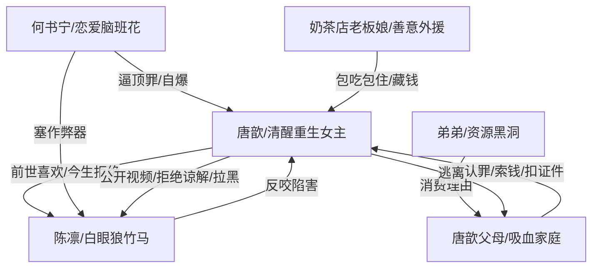

# 角色标签图谱

## 角色清单

### 唐歆 — 清醒重生女主
- 叙事功能: 第一视角主角，承担受害、取证、反杀、逃离四重功能。
- 核心标签: 学霸、清醒、边界感
- 弧光: 前世讨好救人 → 今生冷眼旁观 → 证据反杀 → 彻底逃离
- 台词风格: 短句、平静、边界明确
- 关键行为: 不提醒陈凛、提前录像、公开视频、拒绝谅解书、拉黑家人
- 读者情绪关系: 心疼、代入、爽

### 陈凛 — 白眼狼竹马
- 叙事功能: 主压迫者之一，前世毁女主志愿，今生反咬女主。
- 核心标签: 自恋、甩锅、懦弱
- 弧光: 被追捧的学霸 → 高考作弊嫌疑人 → 公开塌房 → 求原谅失败
- 台词风格: 理所当然、威胁、哀求递进
- 关键行为: 羞辱女主、指认女主、找记者围堵、求女主谅解
- 读者情绪关系: 恨、鄙夷、看他崩塌很爽

### 何书宁 — 恋爱脑班花
- 叙事功能: 作弊器直接投放者，引爆高考作弊事件。
- 核心标签: 嫉妒、冲动、甩锅
- 弧光: 吃醋闹事 → 塞作弊器 → 被视频锁定 → 反咬陈凛
- 台词风格: 情绪化、哭诉、自我合理化
- 关键行为: 塞通讯器、逼女主顶罪、当众承认、爆出通话记录
- 读者情绪关系: 恨、厌烦、看她自爆很爽

### 唐歆父亲 — 吸血重男轻女家长
- 叙事功能: 家庭线压迫源，逼女主为钱牺牲。
- 核心标签: 重男轻女、贪钱、控制欲
- 弧光: 贬低女儿 → 逼签谅解书 → 被女主用未来收益稳住 → 被拉黑
- 台词风格: 命令式、贬低式、利益计算
- 关键行为: 逼顶罪、摔筷子、扣身份证、索要每月打钱
- 读者情绪关系: 恨、窒息、期待断亲

### 唐歆母亲 — 软性吸血同谋
- 叙事功能: 家庭压迫的缓冲型执行者，看似温和但同样剥削。
- 核心标签: 偏心、算计、顺从父权
- 弧光: 默许关押前世女儿 → 今生索钱索鞋 → 被拉黑
- 台词风格: 犹豫开口、实则索取
- 关键行为: 要女主工资、转述陈家谅解书要求、扣身份证
- 读者情绪关系: 寒心、厌恶

### 唐歆弟弟 — 被偏爱的资源黑洞
- 叙事功能: 家庭吸血的理由载体。
- 核心标签: 被溺爱、消费需求、沉默受益者
- 弧光: 无明显成长
- 台词风格: 基本缺席
- 关键行为: 要八千块球鞋、占据家庭资源
- 读者情绪关系: 厌烦、间接恨点

### 奶茶店老板娘 — 善意外援
- 叙事功能: 给女主提供临时庇护和现实逃离条件。
- 核心标签: 热心、清醒、保护者
- 弧光: 雇主 → 临时庇护者 → 见证女主考上清华
- 台词风格: 直白、接地气
- 关键行为: 包吃包住、帮藏钱、替女主赶走陈家人
- 读者情绪关系: 暖、安心、补偿

## 关系网络

## 角色功能对照表（供改编参考）

| 原角色 | 极致标签 | 叙事功能 | 读者情绪功能 | 改编时必须保留的 |
|--------|---------|---------|-------------|---------------|
| 唐歆 | 清醒重生女主 | 受害者、取证者、逃离者 | 心疼与爽 | 前世惨死、今生不救、证据反杀、最终逃离 |
| 陈凛 | 白眼狼竹马 | 主反派、回旋金句承载者 | 恨与打脸 | 前世毁人生，今生反咬，最后低头求原谅 |
| 何书宁 | 恋爱脑班花 | 事件引爆者、自爆者 | 厌恶与反讽 | 亲手放置违规物，并在压力下供出陈凛 |
| 父母 | 吸血家庭 | 第二压迫层 | 窒息与断亲爽 | 为钱逼女主牺牲，重男轻女，最终被拉黑 |
| 老板娘 | 善意外援 | 现实庇护 | 暖与补偿 | 给女主一个能逃出去的落脚点 |
