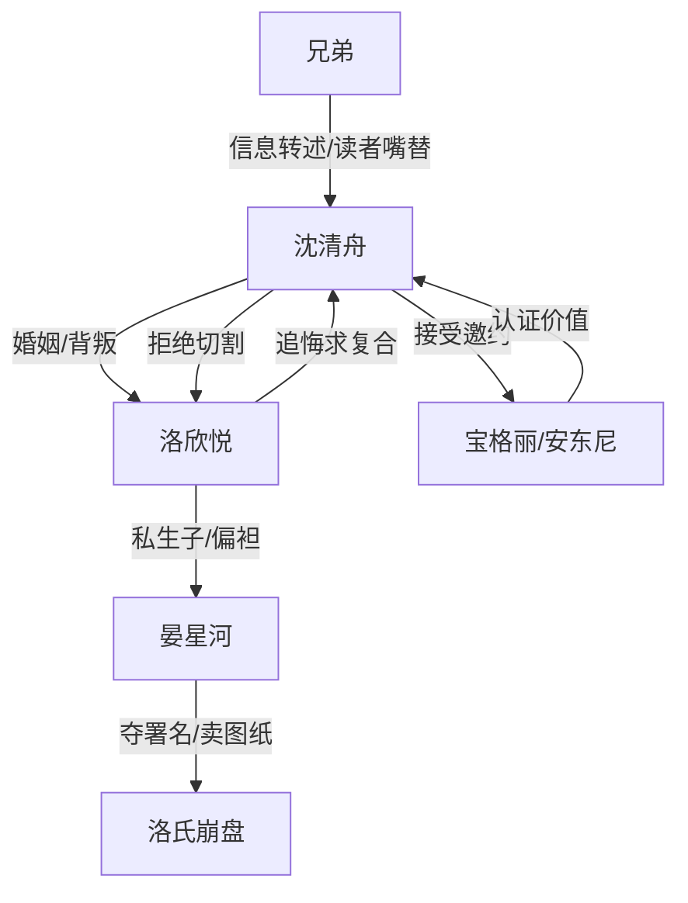

# 角色标签图谱

## 角色清单

### 沈清舟 — 清醒断舍离男主
- 叙事功能: 承受背叛、完成撤离、用事业登顶兑现反杀。
- 核心标签: 珠宝天才、克制、清醒
- 弧光: 备孕牺牲的丈夫 → 米兰独立设计师 → 全球执行总裁
- 台词风格: 短句、冷淡、直接切割
- 关键行为: 接受宝格丽邀约、拿走手稿、拉黑离开、寄律师函、拒绝复合
- 读者情绪关系: 心疼前半，后半爽和敬佩

### 洛欣悦 — 自负冷血女总裁/追妻火葬场对象
- 叙事功能: 背叛者、误判者、后悔者。
- 核心标签: 自负、偏袒、迟来悔恨
- 弧光: 掌控婚姻与洛氏 → 识人失败 → 失去爱人与公司
- 台词风格: 前期温柔包装命令，后期哀求补偿
- 关键行为: 与晏星河生子、夺男主署名、机场抛下男主、报警抓晏星河、米兰求复合
- 读者情绪关系: 前半恨，后半看她悔恨获得爽感

### 晏星河 — 恃宠而骄男小三
- 叙事功能: 引爆羞辱、放大洛欣悦识人失败、推动洛氏崩盘。
- 核心标签: 小三、贪婪、无能
- 弧光: 戴千万表炫耀 → 抢项目署名 → 卖图纸入狱
- 台词风格: 装可怜和挑衅切换
- 关键行为: 戴婚礼表、抢新生系列、羞辱男主不能生、卖图纸
- 读者情绪关系: 强恨点，入狱是主要爽点之一

### 安东尼 — 海外价值认证者
- 叙事功能: 给男主提供外部舞台和身份背书。
- 核心标签: 专业、赏识、国际资源
- 弧光: 接机欢迎 → 提供项目 → 推动男主全球升位
- 台词风格: 直接赞赏、职业化
- 关键行为: 接男主入职，交付项目，宣布董事会任命
- 读者情绪关系: 补偿感、认可感

### 兄弟 — 读者嘴替
- 叙事功能: 转述国内报应，替读者骂出情绪。
- 核心标签: 仗义、直爽、信息渠道
- 弧光: 曝光满月宴 → 转述晏星河入狱 → 转述洛氏破产
- 台词风格: 口语化、情绪外放
- 关键行为: 发视频、打电话通报
- 读者情绪关系: 代骂、代爽

## 关系网络

## 角色功能对照表（供改编参考）

| 原角色 | 极致标签 | 叙事功能 | 读者情绪功能 | 改编时必须保留的 |
|--------|---------|---------|-------------|---------------|
| 沈清舟 | 清醒断舍离男主 | 承受、撤离、登顶 | 心疼转爽 | 克制、不求复合、职业底气 |
| 洛欣悦 | 自负追悔女总裁 | 施害、误判、火葬场 | 恨与看悔 | 曾经温柔+现实偏袒+后期崩溃 |
| 晏星河 | 恃宠男小三 | 羞辱、夺功、作死 | 恨点和报应点 | 无能却贪、靠宠上位、犯罪清算 |
| 安东尼 | 国际认证者 | 给男主外部价值 | 补偿 | 专业平台必须强于原婚姻平台 |
| 兄弟 | 读者嘴替 | 传递国内报应 | 代骂代爽 | 口语化转述报应 |
