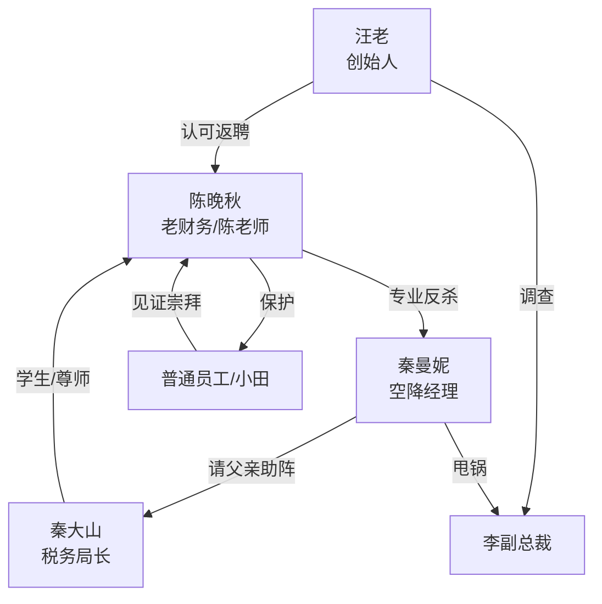

# 角色标签图谱

## 角色清单

### 陈晚秋 — 佛系清醒老财务 / 降噪型大女主
- 叙事功能: 主角、规则反杀者、价值坐标。
- 核心标签: 资深、松弛、专业。
- 弧光: 被空降经理人视为老废物 → 公司定海神针 → 制度改革者 → 真正退休。
- 台词风格: 短句、冷幽默、数字精确。
- 关键行为: 拒签两月劝退协议；被锁后打 120；请秦局长解释旧账；拿出税务方案；推动反职场 PUA 条例。
- 读者情绪关系: 爽、安心、敬佩。

### 秦曼妮 — 天才海归空降经理 / 职场 PUA 反派
- 叙事功能: 施压者、误判制造者、被教育对象。
- 核心标签: 傲慢、年轻、工具理性。
- 弧光: 996 改革者 → 违法逼退者 → 税务风险制造者 → 基层重塑者。
- 台词风格: 职场黑话、命令式、压迫性强。
- 关键行为: 推 996；逼签劝退；锁杂物室；请审计查旧账；甩锅李副总裁；三年后带基层账本求教。
- 读者情绪关系: 前期恨，中期看她崩塌爽，后期轻度修复。

### 秦大山 / 秦局长 — 官方专业权威 / 父亲清算者
- 叙事功能: 身份揭示者、公权力见证者、反派父权制动器。
- 核心标签: 税务权威、尊师、刚正。
- 弧光: 被女儿当作强援请来 → 认出恩师 → 反向清算女儿。
- 台词风格: 权威、直接、带训诫。
- 关键行为: 鞠躬称陈老师；解释五万元旧案；确认虚假申报风险；安排女儿基层挂职。
- 读者情绪关系: 提供官方背书与强爽点。

### 汪易天 / 汪老 — 创始人 / 价值裁判
- 叙事功能: 终极权力介入者、补偿发放者、制度升华载体。
- 核心标签: 老派、识人、护公司根基。
- 弧光: 传说中的退休创始人 → 出场确认主角功劳 → 推动集团健康工时。
- 台词风格: 稳重、掷地有声。
- 关键行为: 确认实名报备和补税；调查李副总裁；返聘主角；设立员工关怀基金。
- 读者情绪关系: 提供终极认可和补偿。

### 小田 — 普通员工 / 群众视角
- 叙事功能: 信息传递、同事情绪反馈、群众爽点承接。
- 核心标签: 年轻、胆小、成长。
- 弧光: 缩着脖子提醒秋姐认错 → 三年后成为财务部副经理。
- 台词风格: 口语化、员工视角。
- 关键行为: 发微信提醒；欢送会上送锦旗。
- 读者情绪关系: 让读者看到主角行为保护了普通人。

### 李副总裁 — 幕后降本增效推手
- 叙事功能: 更高层风险来源，证明秦曼妮不是孤立坏人。
- 核心标签: 甩锅、逐利、隐身。
- 弧光: 被秦曼妮供出 → 被总部调查。
- 台词风格: 间接出现，无直接台词。
- 关键行为: 授意三千万税务方案。
- 读者情绪关系: 扩大清算范围。

## 关系网络

## 角色功能对照表（供改编参考）

| 原角色 | 极致标签 | 叙事功能 | 读者情绪功能 | 改编时必须保留的 |
|--------|---------|---------|-------------|---------------|
| 陈晚秋 | 佛系清醒老专业人 | 主角/规则反杀 | 爽、敬佩 | 松弛姿态 + 专业硬实力 + 合规反击 |
| 秦曼妮 | 天才空降压迫者 | 施害者/误判者 | 恨、看崩塌 | 年轻傲慢 + 职场黑话 + 逐层加码 |
| 秦局长 | 官方权威学生 | 身份揭示/清算 | 震惊、背书爽 | 强援反向认主角 |
| 汪老 | 终极价值裁判 | 补偿/制度升级 | 圆满、价值满足 | 创始人级别认可与制度落地 |
| 小田/同事 | 群众视角 | 留存反馈 | 代入、集体爽 | 普通员工受益的可见变化 |
