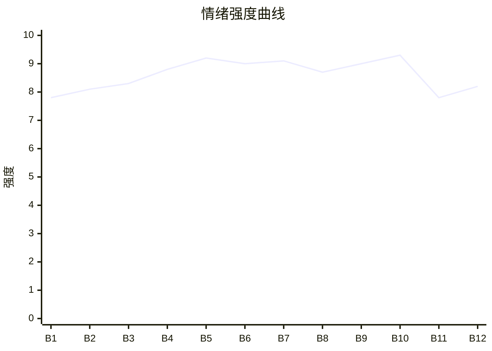

# Beat Sheet 节拍器

## 全文概况

- 总字数: 约 11800 字
- 节拍数: 12 幕
- 核心母题（Logline）: 嗜睡神女温月被穿越女以科学和平等之名公开羞辱，皇帝护短清算，天象反噬证明神女不可欺，最终反派输给自己的傲慢。
- 情绪模式: 违和开局 → 极致打压 → 公开审判 → 付费卡怒点 → 护短清算 → 理念反杀 → 轻爽收束

## 节拍详表

### Beat 1: 摘星阁被闯入 [开篇-第一次落泪]
- **字数**: 约 620 字（占比 5.3%）
- **核心事件**: 嗜睡神女被穿越女沈知意闯入摘星阁，一巴掌打醒。
- **情绪标签**: 违和、惊扰、委屈
- **情绪强度**: 7.8/10
- **情绪方向**: ⚡突变
- **冲突类型**: 大转折
- **悬念钩子**: 神女一哭，地面开始剧烈摇晃。
- **叙事速度**: 快
- **对话占比**: 45%
- **reversal_mechanism**: [M7]
- **hook_strength**: 8.6/10（极端度 2.4/3；信息密度 2.7/3；悬念 1.8/2；节奏 1.7/2）
- **关键句**: “下一秒，脚下的土地开始剧烈摇晃。”
- **原文摘录**: 我天生嗜睡。皇帝在宫内为我建造摘星阁，不许任何人靠近。直到我听到耳边传来嘈杂的声音，缓缓睁开眼。“郡主，真的不能进啊，陛下吩咐过，谁都不能惊醒神女！会有大祸事的！”另一道跋扈声音传来：“装神弄鬼，这世界上根本就没有神！你们就是不懂科学！”话音刚落，我的门被大力踹开。女子气势汹汹的走到我面前，一巴掌扇向我。周围人瞬间噤声。我摸着红肿的脸，嘴一瘪，两串泪珠落下来。下一秒，脚下的土地开始剧烈摇晃。

### Beat 2: 科学话术初次失效 [地动-强拽出阁]
- **字数**: 约 1100 字（占比 9.3%）
- **核心事件**: 沈知意用“地壳运动”“空气放电”解释异象，继续辱骂并强行拖走温月。
- **情绪标签**: 憋屈、愤怒、恐惧
- **情绪强度**: 8.1/10
- **情绪方向**: ↑上升
- **冲突类型**: 微冲突连续升级
- **悬念钩子**: 她要把神女带出去，当众验证。
- **叙事速度**: 快
- **对话占比**: 55%
- **reversal_mechanism**: [M7, M6]
- **关键句**: “今天我就让你们看看，这世上根本没有神！”
- **原文摘录**: 地面剧烈晃动。满殿宫人瞬间跪成一片。“神女息怒！”沈知意扶住门框，嘴却还硬着：“不过是地震而已，有什么大惊小怪的？这是正常的地壳运动，和她有什么关系！”我越想越委屈，眼泪掉得更凶。殿外一声巨响，有宫女尖叫：“山石裂了！”沈知意脸终于变了，却仍说：“不可能……这不科学……”随后她又骂我“装神弄鬼，骗吃骗喝”，说我是不劳而获的人，最后攥住我的手腕，强行把我从榻上拽起：“让我看看，你到底是真有本事，还是只会哭。”

### Beat 3: 御道公开展示羞辱 [出阁-金殿前]
- **字数**: 约 900 字（占比 7.6%）
- **核心事件**: 温月被拖过御道，赤脚跌撞，沈知意当众宣告要揭穿神女。
- **情绪标签**: 羞辱、无助、围观压迫
- **情绪强度**: 8.3/10
- **情绪方向**: ↑上升
- **冲突类型**: 微冲突
- **悬念钩子**: 沈知意拿出火器，百官无人敢拦。
- **叙事速度**: 中快
- **对话占比**: 48%
- **reversal_mechanism**: [M6]
- **关键句**: “所谓神女，不过也是个会哭会疼的普通女人！”
- **原文摘录**: 沈知意死死攥着我的手腕，指甲都掐进了我肉里。她一路高声教训众人：“这世上没有神，只有装神弄鬼的人！”我被她拽得跌跌撞撞，绣鞋都掉了一只。殿外已有不少官员候朝，见状全都变了脸色。沈知意扬声开口：“都来看看！所谓神女，不过也是个会哭会疼的普通女人！”她捏住我的下巴，逼我抬头，又掏出火器威胁：“谁敢拦我？这是我做的火器，威力比你们刀剑强百倍。”

### Beat 4: 金殿审判假神 [入殿-寄生虫羞辱]
- **字数**: 约 1050 字（占比 8.9%）
- **核心事件**: 沈知意把温月推倒在金殿，公开演讲式审判她是“寄生虫”。
- **情绪标签**: 极致憋屈、羞耻、恨意
- **情绪强度**: 8.8/10
- **情绪方向**: ↑上升
- **冲突类型**: 大转折
- **悬念钩子**: 温月被逼到崩溃边缘，百官开始动摇。
- **叙事速度**: 中
- **对话占比**: 60%
- **reversal_mechanism**: [M3, M6]
- **关键句**: “她只是既得利益者，是靠着你们的恐惧活着的寄生虫！”
- **原文摘录**: 金殿之上，百官齐聚。沈知意拽着我，把我拖到殿中最显眼的地方，将我往地上一推。我膝盖重重磕在金砖上。她站在高处说：“所谓神女，不过也是个普通女人。”她让百官睁眼看看，说百姓交税养着我、跪拜供着我，遇灾还要求我保佑。她每说一句便逼近一步：“她不是神。她只是既得利益者。是靠着你们的恐惧活着的寄生虫！”最后她坐在椅子上，像审犯人一样问：“你到底是怎么骗人的？”

### Beat 5: 付费卡点，皇帝回宫 [继续折辱-皇帝入殿]
- **字数**: 约 950 字（占比 8.1%）
- **核心事件**: 沈知意继续撕扯衣领、宣布“再无神女”，皇帝回宫看见现场。
- **情绪标签**: 怒点、期待、压抑爆发前
- **情绪强度**: 9.2/10
- **情绪方向**: ⚡突变
- **冲突类型**: 大转折
- **悬念钩子**: 皇帝脸色阴沉到极点，将如何处置沈知意。
- **叙事速度**: 快
- **对话占比**: 42%
- **reversal_mechanism**: [M2, M6]
- **关键句**: “皇帝的脸色，骤然阴沉到了极点。”
- **原文摘录**: 沈知意仍居高临下看我，说我“被养废了”。她伸手扯住我的衣领，强迫我站起来：“让所有人看看，神女不过如此！”我摇摇晃晃站着，泪水在眼眶里打转。她转向百官：“今日之后，这世上再无神女……”就在这时，殿外传来高喝：“陛下回宫……”皇帝踏入金殿，看见我赤着一只脚，发髻散乱，眼眶通红，浑身发抖，也看见沈知意扯着我的衣领，当众羞辱我。只一瞬，皇帝的脸色骤然阴沉到了极点。

### Beat 6: 皇帝护短初清算 [回宫-沈知意被掌嘴]
- **字数**: 约 1250 字（占比 10.6%）
- **核心事件**: 皇帝连打沈知意，下令掌嘴五十押天牢，抱住温月安抚。
- **情绪标签**: 爽、护短、余怒
- **情绪强度**: 9.0/10
- **情绪方向**: ↑上升
- **冲突类型**: 大转折
- **悬念钩子**: 温月问“他们是不是都不信我”，天象再起。
- **叙事速度**: 中快
- **对话占比**: 58%
- **reversal_mechanism**: [M2, M6]
- **关键句**: “朕捧在手心里连一句重话都舍不得说的人，你也敢碰。”
- **原文摘录**: 沈知意先发制人：“臣女今日正替大周肃清迷信。”皇帝没看她，只看我的赤脚、红眼、凌乱衣襟和青紫手腕。青禾哭诉后，皇帝甩了沈知意一耳光。沈知意不可置信：“你打我？”皇帝反手又是一耳光：“朕捧在手心里连一句重话都舍不得说的人，你也敢碰。”他下令掌嘴五十，押入天牢。随后他抱住我：“阿月，不怕，哥哥回来了。”我问：“哥哥，他们是不是都不信我？”殿外风猛地变大，云层低压，沈知意仍喊只是下雨，下一刻金殿震动。

### Beat 7: 诛心挑拨与神女昏厥 [地动加剧-皇城震颤]
- **字数**: 约 1100 字（占比 9.3%）
- **核心事件**: 沈知意挑拨皇帝和温月关系，质疑温月被爱的原因，触发更大天灾。
- **情绪标签**: 心痛、不安、失控
- **情绪强度**: 9.1/10
- **情绪方向**: ↑上升
- **冲突类型**: 大转折
- **悬念钩子**: 温月昏倒，皇城剧烈震颤，灾祸将失控。
- **叙事速度**: 中
- **对话占比**: 52%
- **reversal_mechanism**: [M5, M6]
- **关键句**: “如果我不是神女，你还会要我吗？”
- **原文摘录**: 沈知意说皇帝只是需要一个工具稳住皇权：“若有一日她没用了，第一个抛弃她的就是皇帝。”我愣住，想起很多年前哥哥翻窗陪我，说“别人不要你，哥哥要你”。可沈知意把我不敢想的东西摆出来。我问：“哥哥，如果我不是神女，你还会要我吗？”皇帝脱口而出：“会。你不是因为是神女，才被朕护着。是因为你是温月。”沈知意却大笑，污蔑皇帝人伦不清。下一刻我眼前一黑，软软倒下，整座皇城剧烈震颤。

### Beat 8: 昏睡中的天灾扩散 [摘星阁内-带沈知意]
- **字数**: 约 850 字（占比 7.2%）
- **核心事件**: 温月昏迷，太医说明必须让她安稳；沈知意追随者在宫外闹事。
- **情绪标签**: 危机、焦灼、等待清算
- **情绪强度**: 8.7/10
- **情绪方向**: →平稳高压
- **冲突类型**: 微冲突
- **悬念钩子**: 皇帝决定把沈知意带来，让温月出气。
- **叙事速度**: 中
- **对话占比**: 38%
- **reversal_mechanism**: [M6]
- **关键句**: “可阿月这口气，不得不出。”
- **原文摘录**: 我做了一个梦，梦里很吵。摘星阁内太医跪满地：“神女惊惧过度，万不可再受刺激。”外头急报不断：宫墙塌了，湖水漫出，城外山道断了。天牢传来消息，沈知意仍说这些都是自然现象，还说宫外有追随者在闹，称陛下打压真理。床上的我低低呓语：“吵……”摘星阁后的山石全崩。皇帝沉默良久，突然站起身：“把沈知意带过来。”

### Beat 9: 两个选择，逼她跪下 [沈知意入阁-古松遭雷劈]
- **字数**: 约 980 字（占比 8.3%）
- **核心事件**: 皇帝给沈知意两个选择：赔罪或杀尽党羽；天雷劈断古松击碎她的科学自信。
- **情绪标签**: 压迫反转、恐惧、爽
- **情绪强度**: 9.0/10
- **情绪方向**: ↑上升
- **冲突类型**: 大转折
- **悬念钩子**: 沈知意被迫面对解释不了的神迹。
- **叙事速度**: 快
- **对话占比**: 55%
- **reversal_mechanism**: [M2, M7, M6]
- **关键句**: “你不跪，朕就先杀一个。”
- **原文摘录**: 沈知意被押到摘星阁外，脸颊肿起，手脚锁链，却仍说“装神弄鬼”。皇帝给她两个选择：“第一，跪下给她赔罪，直到她肯原谅你。第二，朕杀了你，再诛你所有党羽。”沈知意骂他疯了。皇帝却说：“在朕眼里，你们所有人加起来，都比不过她一根头发。”窗外惊雷劈断百年古松，树身裂成两半，离沈知意只有几步。她终于白了脸。

### Beat 10: 平等话术被反杀 [跪下-理念崩塌]
- **字数**: 约 1050 字（占比 8.9%）
- **核心事件**: 沈知意被迫下跪，温月用最朴素的问题拆穿她“平等”背后的傲慢。
- **情绪标签**: 反讽、痛快、清算
- **情绪强度**: 9.3/10
- **情绪方向**: ↑上升
- **冲突类型**: 大转折
- **悬念钩子**: 沈知意的失败不只是输给神，而是输给傲慢。
- **叙事速度**: 中
- **对话占比**: 62%
- **reversal_mechanism**: [M3, M6]
- **关键句**: “你嘴里的科学和平等，也不过是你压人的刀。”
- **原文摘录**: 沈知意膝盖一点点弯下去，扑通一声跪在我床前。她仍说：“因为你不该存在。”我问：“你们那里的人，若是不喜欢谁，也可以随便打她，骂她，拖着她走吗？”沈知意张了张嘴，一时没能说出话来。皇帝冷眼看着她：“你口口声声说众生平等，原来也不过如此。你觉得自己来自未来，便天然高人一等。朕看，你嘴里的科学和平等，也不过是你压人的刀。”外头的风渐渐小了。

### Beat 11: 神女秩序恢复 [沈知意消失-祈雨]
- **字数**: 约 850 字（占比 7.2%）
- **核心事件**: 温月回到被供奉的日常，大旱时轻易祈雨，神女身份彻底坐实。
- **情绪标签**: 补偿、安定、尊崇
- **情绪强度**: 7.8/10
- **情绪方向**: ↓下降
- **冲突类型**: 无/余波
- **悬念钩子**: 温月想起沈知意的“凭什么”，给出天意答案。
- **叙事速度**: 慢
- **对话占比**: 32%
- **reversal_mechanism**: [M2]
- **关键句**: “刚走到窗边，天上就下起了雨。”
- **原文摘录**: 皇帝没告诉我如何处置沈知意，只是我的眼前再也没有这个人了。京城日子照常过，神庙香火不断，百官更安静恭敬。后来有一年大旱，百官跪在摘星阁外求我祈雨。我睡眼惺忪被叫醒，心情不大好。皇帝低声哄我：“阿月乖，帮他们这一回。”我勉强点头，刚走到窗边，天上就下起了雨。满城百姓伏地叩首，齐呼神女。

### Beat 12: 金句收束，别惹我 [看雨-结尾]
- **字数**: 约 420 字（占比 3.6%）
- **核心事件**: 温月用“看天意”“别惹我”完成轻松反讽收尾。
- **情绪标签**: 轻爽、余味、满足
- **情绪强度**: 8.2/10
- **情绪方向**: ↓下降后回勾
- **冲突类型**: 收束
- **悬念钩子**: 无，爽点闭合。
- **叙事速度**: 慢
- **对话占比**: 45%
- **reversal_mechanism**: [M3]
- **关键句**: “天意说，别惹我。”
- **原文摘录**: 我看着檐下连成珠的雨，想起很久以前，沈知意红着眼问我，凭什么。其实我也说不清凭什么。这世上有些事，本就不是谁都能想明白的。就像她带着未来而来，却输在自己的傲慢里。我伸手接了一点雨，凉凉的。皇帝问：“看什么呢？”我认真想了想，说：“看天意。”他问：“那天意说了什么？”我回头看他，也笑了：“天意说，别惹我。”殿外风雨如注，万民俯首。我打了个哈欠，重新缩回软榻里，懒洋洋闭上眼。这一回，再没人敢来吵我了。

## 情绪曲线可视化

## 节拍密度检测

- 平均每 980 字一个节拍
- 微冲突密度: 每 550-700 字一次
- 大转折密度: 每 1800-2200 字一次
- 判定: 符合 高频节拍器标准

## 反转机制清单(Reversal Mechanisms)

| 机制 ID | 机制名 | 承载 Beat | 关键段落/金句 | 等价改编提示 |
|--------|--------|-----------|--------------|-------------|
| M2 | 身份反差爆发 | Beat 5-6, Beat 9-11 | “她不是什么神女”反复被地动、雷劈、祈雨打脸 | 表层“假神/废物”可换，但真实身份/权能必须在后半段层层坐实 |
| M3 | 因果回旋反讽 | Beat 4, Beat 10, Beat 12 | “众生平等”被回敬为“你嘴里的科学和平等，也不过是你压人的刀” | 必须找到反派高频价值口号，结尾原结构回旋打脸 |
| M6 | 多层递进反转 | Beat 2, Beat 5, Beat 7, Beat 10 | 异象初现 → 皇帝回宫 → 皇城震颤 → 理念崩塌 | 层数不能少，反转量级需从个人羞辱升到权力和价值观 |
| M7 | 降维打击 | Beat 1-2, Beat 9 | “这不科学”面对山崩、雷劈彻底失效 | 必须保留两套规则：理性话术 vs 超自然天意，旧规则在高潮失效 |
