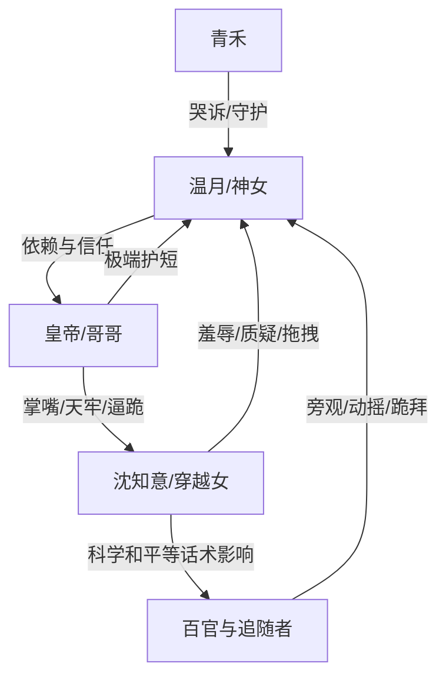

# 角色标签图谱

## 角色清单

### 温月 — 嗜睡软萌神女
- 叙事功能: 被压迫核心、天象触发器、最终天意合法性来源
- 核心标签: 嗜睡、委屈即天灾、被天下供奉
- 弧光: 被质疑羞辱 → 被护短清算 → 神性重新坐实
- 台词风格: 短、软、直觉化
- 关键行为: 落泪引发地动；问出“若不喜欢谁也能随便打她吗”；结尾说“别惹我”
- 读者情绪关系: 心疼、保护欲、爽感投射

### 沈知意 — 傲慢穿越女/伪文明审判者
- 叙事功能: 压迫者、价值观反派、现代优越感靶子
- 核心标签: 科学话术、居高临下、暴力拆神
- 弧光: 气焰嚣张 → 口硬动摇 → 被迫下跪 → 理念破产
- 台词风格: 演讲式、质问式、现代词密集
- 关键行为: 闯阁打人、拖拽温月、金殿审判、挑拨皇帝与温月
- 读者情绪关系: 恨、烦、期待她被打脸

### 皇帝/哥哥 — 疯批护短帝王
- 叙事功能: 外部清算执行者、温月情感锚点、付费点兑现者
- 核心标签: 极端护短、帝王权力、情感偏执
- 弧光: 缺席 → 回宫震怒 → 清算沈知意 → 继续守护温月
- 台词风格: 冷、短、压迫感强
- 关键行为: 掌掴沈知意、下令押天牢、威胁斩杀追随者、哄温月祈雨
- 读者情绪关系: 爽、安心、轻微疯感刺激

### 青禾 — 忠仆见证者
- 叙事功能: 传递温月受害事实，放大读者心疼
- 核心标签: 忠心、惊惧、哭诉
- 弧光: 拦不住 → 哭诉 → 陪伴神女
- 台词风格: 哀求、急切
- 关键行为: 向皇帝哭诉沈知意罪行
- 读者情绪关系: 代替读者喊冤

### 百官/宫人 — 舆论与秩序背景板
- 叙事功能: 见证羞辱与神迹，体现“信仰摇摆”
- 核心标签: 敬畏、动摇、趋利避害
- 弧光: 旁观迟疑 → 恐惧跪拜 → 更恭敬
- 台词风格: 惊呼、求饶、规劝
- 关键行为: 金殿旁观、地动后跪求宽恕、旱灾时求雨
- 读者情绪关系: 轻微不满，后期补偿性敬畏

## 关系网络

## 角色功能对照表（供改编参考）

| 原角色 | 极致标签 | 叙事功能 | 读者情绪功能 | 改编时必须保留的 |
|--------|---------|---------|-------------|---------------|
| 温月 | 软萌神女 | 被压迫与天意反噬核心 | 心疼+爽感投射 | 弱姿态、强权能、被惊扰即灾 |
| 沈知意 | 傲慢穿越女 | 价值观反派 | 恨点与打脸期待 | 伪文明话术+真实暴力行为 |
| 皇帝 | 疯批护短帝王 | 清算执行 | 爽点兑现 | 回宫付费点、极端护短台词 |
| 青禾 | 忠仆 | 见证受害 | 替读者喊冤 | 哭诉细节 |
| 百官宫人 | 舆论场 | 放大公开羞辱 | 憋屈与补偿 | 先旁观后跪拜 |
