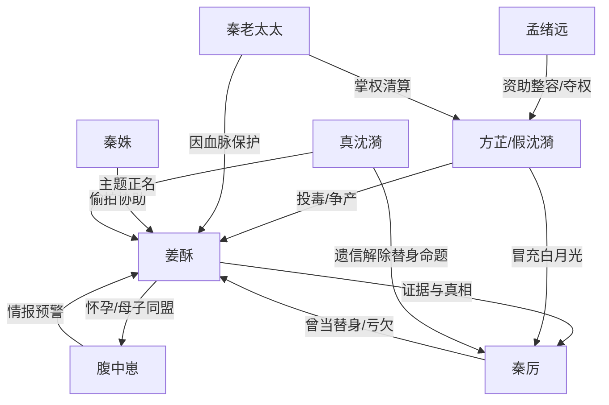

# 角色标签图谱

## 角色清单

### 姜酥 — 清醒替身孕妈/反击型女主
- 叙事功能: 第一视角主角，承接替身羞辱、血脉翻盘、证据反杀和甜宠修复。
- 核心标签: 清醒、自尊、会忍会打牌
- 弧光: 被扫地出门的替身 → 秦家唯一血脉保护者 → 真相揭露同盟 → 被正名的姜酥
- 台词风格: 短句、冷静、直指规则。
- 关键行为: 撕登机牌、宣布怀孕、主动亲权鉴定、留投毒视频、向秦厉摊牌。
- 读者情绪关系: 心疼她的替身屈辱，爽她的清醒反击。

### 腹中崽 — 东北嘴替活财神/信息雷达
- 叙事功能: 外挂、喜剧引擎、预警系统、读者嘴替。
- 核心标签: 大碴子味、护妈、天生知情
- 弧光: 阻止打胎 → 帮妈站稳秦家 → 识破投毒和假身份 → 促成父母修复
- 台词风格: 东北口语、夸张、吐槽密集。
- 关键行为: 爆料秦厉绝户、感知沈漪恶意、提醒录证据、点破画中人与现实沈漪不一致。
- 读者情绪关系: 爽、萌、解压，替读者骂反派。

### 秦厉 — 冰山霸总/迟钝欠债男主
- 叙事功能: 豪门资源中心、情感债务人、后期清算执行者。
- 核心标签: 冷硬、执念、执行力强
- 弧光: 驱逐替身 → 怀疑孩子 → 被事实动摇 → 白月光幻灭 → 道歉挽留
- 台词风格: 字少、命令式、低温。
- 关键行为: 验血、亲权鉴定、调查假沈漪、家族例会公开处刑、花园道歉。
- 读者情绪关系: 前期让人恨，后期因“知错补偿”和笨拙靠近获得有限原谅。

### 沈漪/方芷 — 假白月光毒妇/财产猎杀者
- 叙事功能: 情敌压迫者、夺产阴谋承载者、身份反转靶子。
- 核心标签: 温柔伪装、阴毒、贪婪
- 弧光: 白月光回归者 → 暗中投毒者 → 孟绪远棋子/同谋 → 冒牌货崩塌
- 台词风格: 温柔、关切、话里藏刀。
- 关键行为: 搬进主卧、暗示胎儿问题、送问题红枣茶、计划公开病情夺权。
- 读者情绪关系: 恨、厌、期待她被撕掉面具。

### 秦老太太 — 子嗣至上豪门掌权者
- 叙事功能: 秦家权力认证器，决定姜酥是否站稳。
- 核心标签: 精明、强势、重血脉
- 弧光: 视姜酥为金丝雀 → 保护孕妇 → 承认她受委屈 → 支持清算
- 台词风格: 少而重，一句话定调。
- 关键行为: 早餐站队、医院陪检、安排主楼居住、例会命安保。
- 读者情绪关系: 爽点辅助，现实功利但有效保护女主。

### 孟绪远 — 幕后金主/商业夺权反派
- 叙事功能: 把宅斗升级为商业阴谋，提供假白月光系统性动机。
- 核心标签: 资本、操盘、阴谋
- 弧光: 晚宴陌生男人 → 沈漪金主 → 整容骗局操盘者 → 经侦带走
- 台词风格: 急躁、利益导向。
- 关键行为: 资助假沈漪、收购整形诊所、试图借医疗档案逼宫秦氏。
- 读者情绪关系: 提升反派量级，增强清算爽感。

### 秦姝 — 豪门堂妹/录像工具人
- 叙事功能: 证据见证者、轻喜剧辅助、女主临时盟友。
- 核心标签: 大咧、年轻、爱刺激
- 弧光: 旁观吃瓜 → 配合偷拍 → 认可姜酥
- 台词风格: 网感、直接。
- 关键行为: 录下沈漪下药视频。
- 读者情绪关系: 轻松、可信见证。

## 关系网络

## 角色功能对照表（供改编参考）

| 原角色 | 极致标签 | 叙事功能 | 读者情绪功能 | 改编时必须保留的 |
|--------|---------|---------|-------------|---------------|
| 姜酥 | 清醒替身孕妈 | 主角/反击者 | 心疼+爽 | 不哭求、不恋爱脑、主动翻牌 |
| 腹中崽 | 东北嘴替活财神 | 外挂/喜剧/预警 | 萌爽+解压 | 方言人设和有效情报 |
| 秦厉 | 冰山欠债霸总 | 资源与情感债务人 | 先恨后有限原谅 | 冷转暖要慢，必须道歉 |
| 方芷 | 假白月光毒妇 | 核心反派 | 恨点 | 温柔伪装+实质伤害 |
| 秦老太太 | 血脉掌权者 | 站队认证 | 爽点放大 | 因孩子转向保护女主 |
| 孟绪远 | 资本操盘者 | 阴谋升级 | 危机感 | 把情敌线升维为夺权线 |
