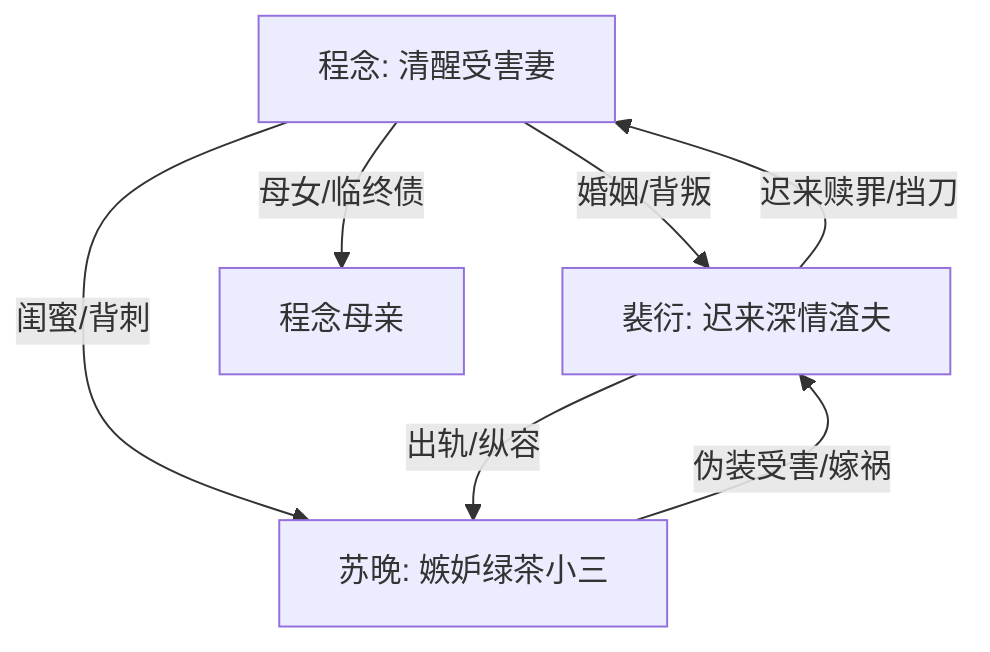

# 角色标签图谱

## 角色清单

### 程念 — 清醒断舍离受害妻
- 叙事功能: 承受亲密关系双重背叛，积累情绪债，最终完成拒绝原谅与重生。
- 核心标签: 隐忍、心软、死心后决绝
- 弧光: 相信丈夫与闺蜜 → 被反复摧毁 → 不再等待 → 拒绝原谅、重新开始
- 台词风格: 前期平静压抑，后期短句冷判
- 关键行为: 提离婚、收集视频、网上控诉、留下离婚协议、拒绝复合
- 读者情绪关系: 心疼、代入、替她憋屈，后期爽

### 裴衍 — 迟来深情渣夫
- 叙事功能: 主要施害者之一，也是后半悔恨和赎罪线承载者。
- 核心标签: 纵容、傲慢、迟悔
- 弧光: 宠溺小三并压制妻子 → 亲手害死孩子 → 发现真相 → 求原谅失败 → 挡刀死亡
- 台词风格: 前期轻描淡写、命令式；后期哀求、破碎
- 关键行为: 拒陪岳母临终、送妻子进精神病院、逼跪导致流产、将苏晚送精神病院、挡刀
- 读者情绪关系: 恨、恶心、后期有限释然但不可洗白

### 苏晚 — 嫉妒型绿茶闺蜜小三
- 叙事功能: 明面反派与挑衅者，推动每次羞辱升级，最终引爆真相。
- 核心标签: 伪装、嫉妒、癫狂
- 弧光: 装作孩子气闺蜜 → 公开宣战 → 假孕嫁祸 → 败露 → 疯癫刺杀 → 终身监禁
- 台词风格: 撒娇、挑衅、羞辱、破罐子破摔
- 关键行为: 下药勾引、发视频、假怀孕假流产、嫁祸程念、持刀刺杀
- 读者情绪关系: 强恨点，承担被清算快感

### 程念母亲 — 亲情债锚点
- 叙事功能: 把婚姻背叛升级为生死亲情亏欠，让裴衍不可原谅。
- 核心标签: 临终、牵挂、无辜
- 弧光: 病危等女婿 → 未见到裴衍 → 死不瞑目式离场
- 台词风格: 重复、虚弱、牵挂
- 关键行为: 临终询问“阿衍来了吗”
- 读者情绪关系: 心疼、加重对裴衍与苏晚的恨

### 小姨/护士/医生 — 现实见证者
- 叙事功能: 传递病危、抢救、出院、流产等事实，增强现实可信度。
- 核心标签: 信息节点、旁观者、事实背书
- 弧光: 无
- 台词风格: 功能性直接
- 关键行为: 通知母亲病危、告知孩子保不住、告知裴衍程念出院
- 读者情绪关系: 提供事实确认，避免全靠女主自述

## 关系网络

## 角色功能对照表（供改编参考）

| 原角色 | 极致标签 | 叙事功能 | 读者情绪功能 | 改编时必须保留的 |
|--------|---------|---------|-------------|---------------|
| 程念 | 清醒断舍离受害妻 | 受害、见证、最终审判 | 心疼与爽感代入 | 不原谅、不回头、最终重生 |
| 裴衍 | 迟来深情渣夫 | 施害与赎罪 | 恨点转悔恨爽点 | 前期实际伤害必须重，后期悔不洗白 |
| 苏晚 | 嫉妒型绿茶闺蜜小三 | 挑衅、嫁祸、终局危机 | 强恨点与清算对象 | 闺蜜背刺、假孕/嫁祸、嫉妒动机 |
| 母亲 | 亲情债锚点 | 把伤害升级到不可原谅 | 催泪与道德定罪 | 临终等待被辜负 |
